# App Core & Navigation

**18 separate screenshot previews.** Click any preview image to see the full-size PNG directly on GitHub.

[← All UI Studios](../README.md) · [Interaction specification](UI_INTERACTION_SPEC.md) · [Complete screen inventory](ALL_SCREENS.md) · [Open offline HTML package on Google Drive](https://drive.google.com/file/d/1el4TFos8ai705Ch40GtNtfPCd4qAsgCx/view?usp=drivesdk)

**Status:** Visual design baseline for implementation planning; this is not working product UI. HTML prototypes are for offline/local preview; GitHub displays screenshots and source, not a live app.

---

### 01. Dashboard

[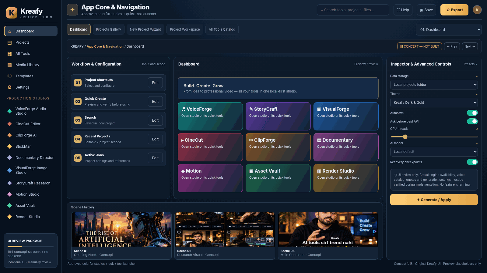](screenshots/01_dashboard.png)

[Full-size PNG](screenshots/01_dashboard.png) · [HTML prototype source](01_dashboard.html) · [Back to all studios](../README.md)

---

### 02. Projects Gallery

[Full-size PNG](screenshots/02_projects-gallery.png) · [HTML prototype source](02_projects-gallery.html) · [Back to all studios](../README.md)

---

### 03. New Project Wizard

[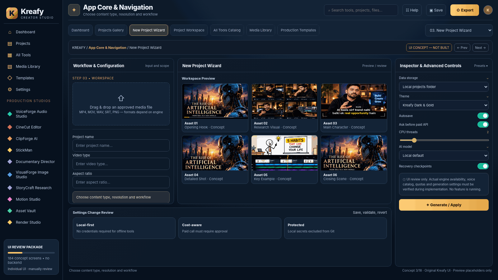](screenshots/03_new-project-wizard.png)

[Full-size PNG](screenshots/03_new-project-wizard.png) · [HTML prototype source](03_new-project-wizard.html) · [Back to all studios](../README.md)

---

### 04. Project Workspace

[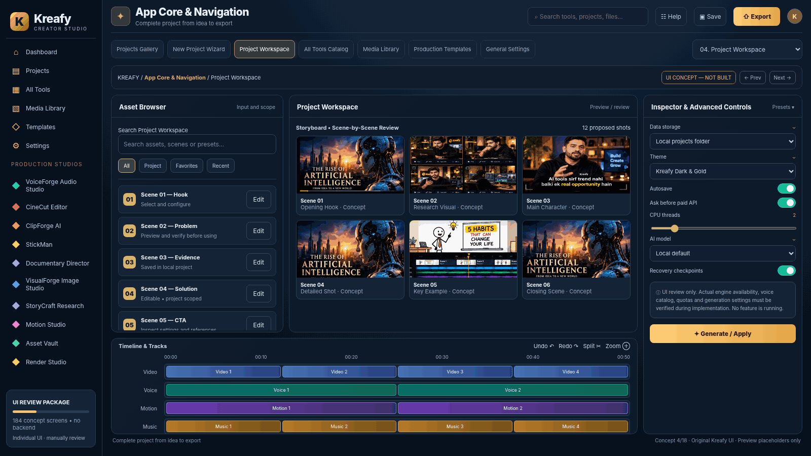](screenshots/04_project-workspace.png)

[Full-size PNG](screenshots/04_project-workspace.png) · [HTML prototype source](04_project-workspace.html) · [Back to all studios](../README.md)

---

### 05. All Tools Catalog

[Full-size PNG](screenshots/05_all-tools-catalog.png) · [HTML prototype source](05_all-tools-catalog.html) · [Back to all studios](../README.md)

---

### 06. Media Library

[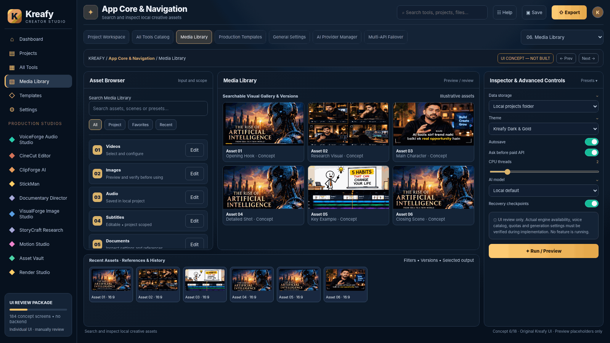](screenshots/06_media-library.png)

[Full-size PNG](screenshots/06_media-library.png) · [HTML prototype source](06_media-library.html) · [Back to all studios](../README.md)

---

### 07. Production Templates

[Full-size PNG](screenshots/07_production-templates.png) · [HTML prototype source](07_production-templates.html) · [Back to all studios](../README.md)

---

### 08. General Settings

[Full-size PNG](screenshots/08_general-settings.png) · [HTML prototype source](08_general-settings.html) · [Back to all studios](../README.md)

---

### 09. Ai Provider Manager

[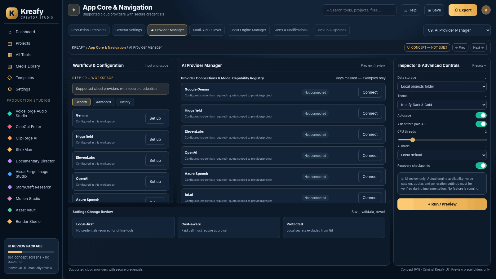](screenshots/09_ai-provider-manager.png)

[Full-size PNG](screenshots/09_ai-provider-manager.png) · [HTML prototype source](09_ai-provider-manager.html) · [Back to all studios](../README.md)

---

### 10. Multi Api Failover

[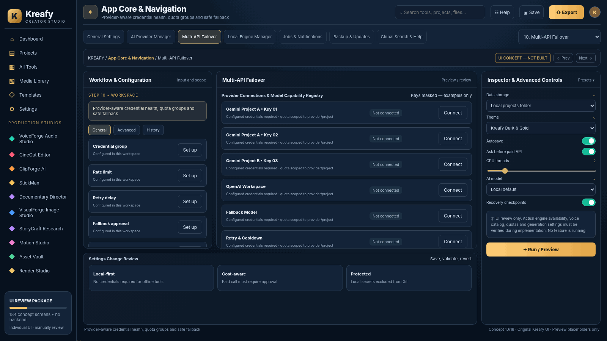](screenshots/10_multi-api-failover.png)

[Full-size PNG](screenshots/10_multi-api-failover.png) · [HTML prototype source](10_multi-api-failover.html) · [Back to all studios](../README.md)

---

### 11. Local Engine Manager

[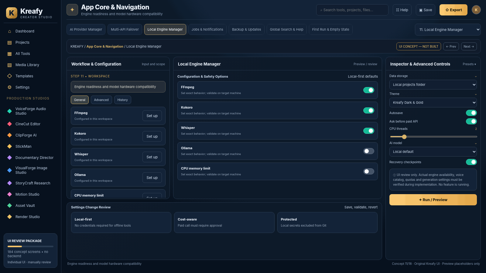](screenshots/11_local-engine-manager.png)

[Full-size PNG](screenshots/11_local-engine-manager.png) · [HTML prototype source](11_local-engine-manager.html) · [Back to all studios](../README.md)

---

### 12. Jobs Notifications

[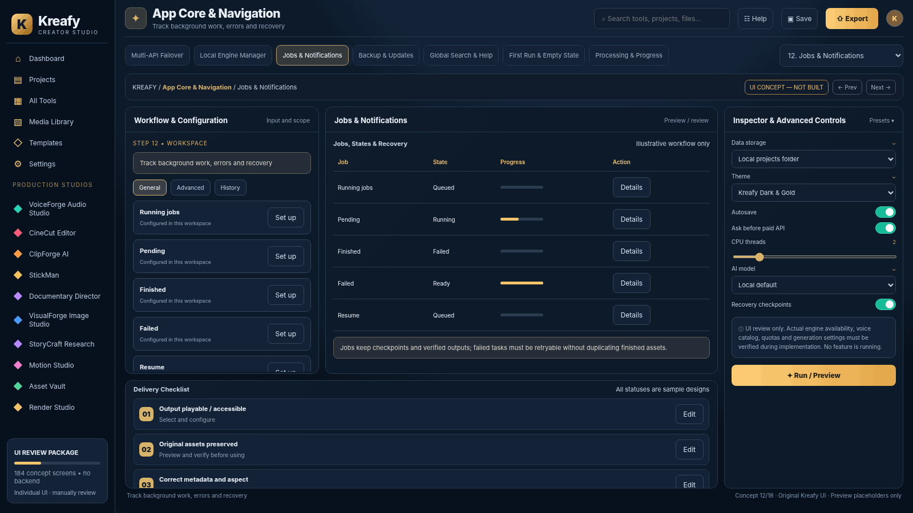](screenshots/12_jobs-notifications.png)

[Full-size PNG](screenshots/12_jobs-notifications.png) · [HTML prototype source](12_jobs-notifications.html) · [Back to all studios](../README.md)

---

### 13. Backup Updates

[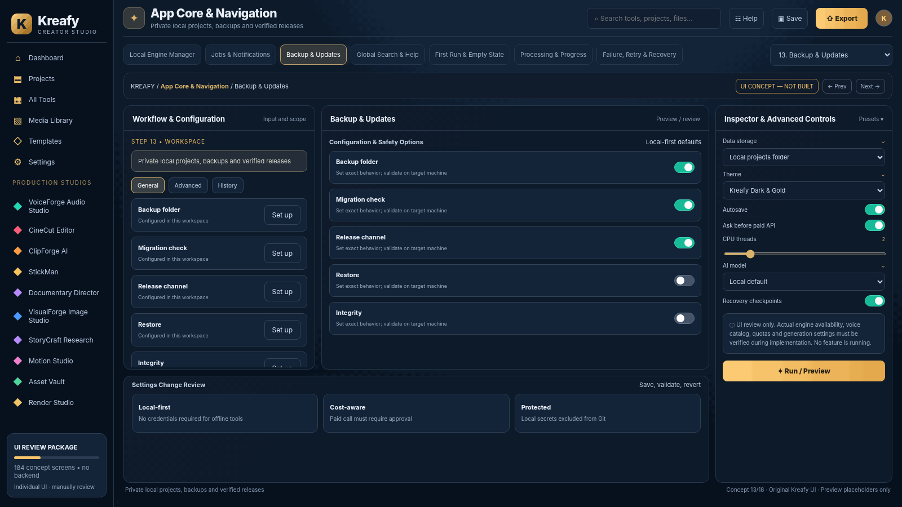](screenshots/13_backup-updates.png)

[Full-size PNG](screenshots/13_backup-updates.png) · [HTML prototype source](13_backup-updates.html) · [Back to all studios](../README.md)

---

### 14. Global Search Help

[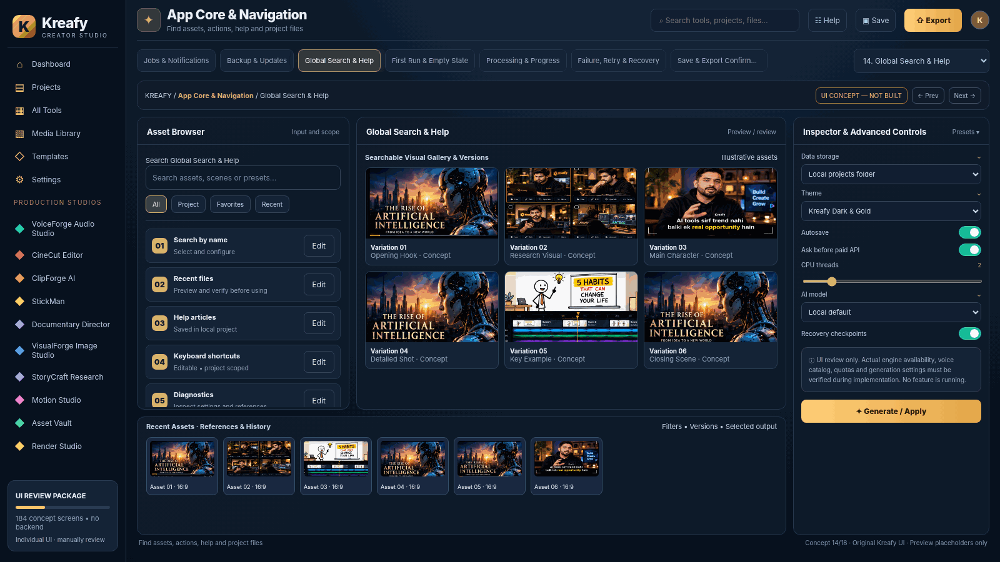](screenshots/14_global-search-help.png)

[Full-size PNG](screenshots/14_global-search-help.png) · [HTML prototype source](14_global-search-help.html) · [Back to all studios](../README.md)

---

### 15. First Run Empty State

[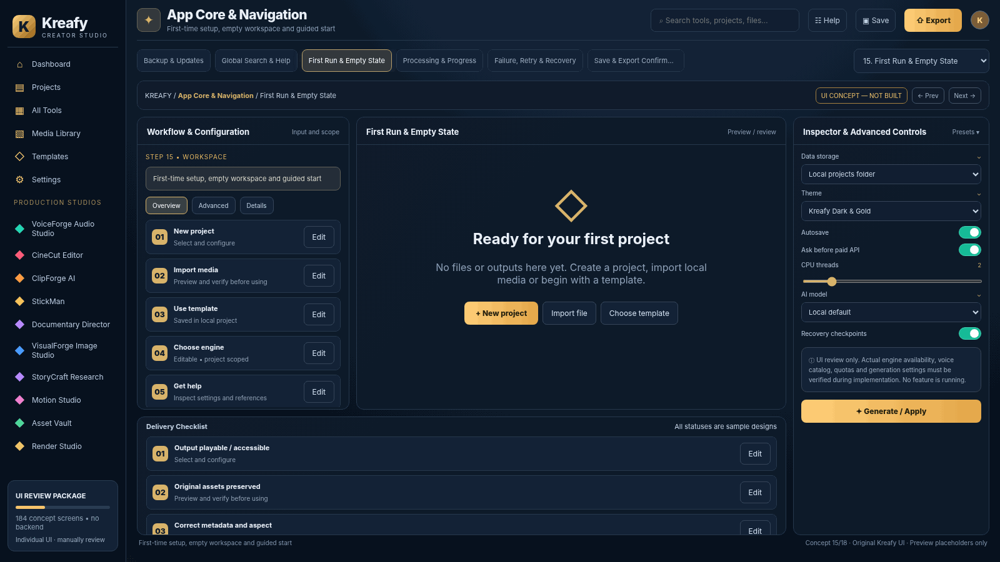](screenshots/15_first-run-empty-state.png)

[Full-size PNG](screenshots/15_first-run-empty-state.png) · [HTML prototype source](15_first-run-empty-state.html) · [Back to all studios](../README.md)

---

### 16. Processing Progress

[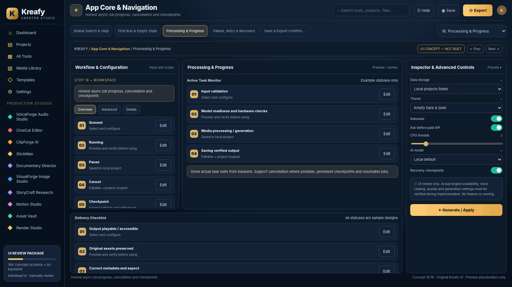](screenshots/16_processing-progress.png)

[Full-size PNG](screenshots/16_processing-progress.png) · [HTML prototype source](16_processing-progress.html) · [Back to all studios](../README.md)

---

### 17. Failure Retry Recovery

[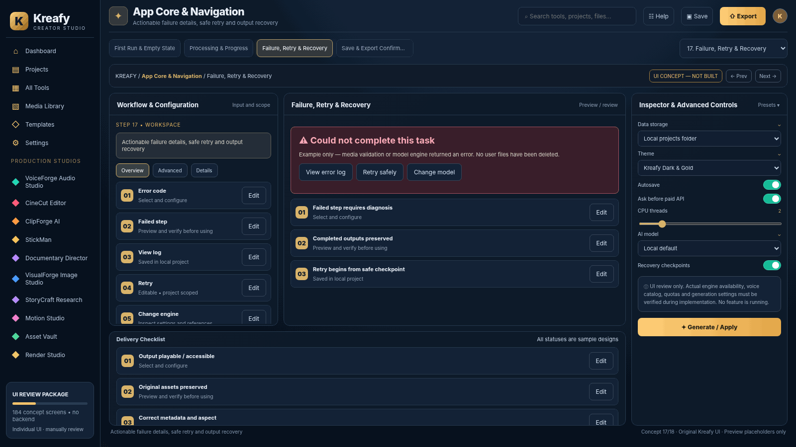](screenshots/17_failure-retry-recovery.png)

[Full-size PNG](screenshots/17_failure-retry-recovery.png) · [HTML prototype source](17_failure-retry-recovery.html) · [Back to all studios](../README.md)

---

### 18. Save Export Confirmation

[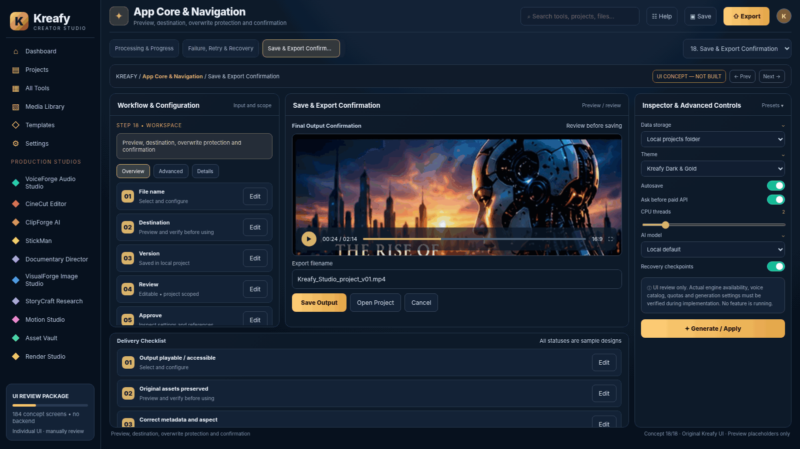](screenshots/18_save-export-confirmation.png)

[Full-size PNG](screenshots/18_save-export-confirmation.png) · [HTML prototype source](18_save-export-confirmation.html) · [Back to all studios](../README.md)

---
