# VoiceForge Audio Studio

**19 separate screenshot previews.** Click any preview image to see the full-size PNG directly on GitHub.

[← All UI Studios](../README.md) · [Interaction specification](UI_INTERACTION_SPEC.md) · [Complete screen inventory](ALL_SCREENS.md) · [Open offline HTML package on Google Drive](https://drive.google.com/file/d/1el4TFos8ai705Ch40GtNtfPCd4qAsgCx/view?usp=drivesdk)

**Status:** Visual design baseline for implementation planning; this is not working product UI. HTML prototypes are for offline/local preview; GitHub displays screenshots and source, not a live app.

---

### 01. Text To Speech

[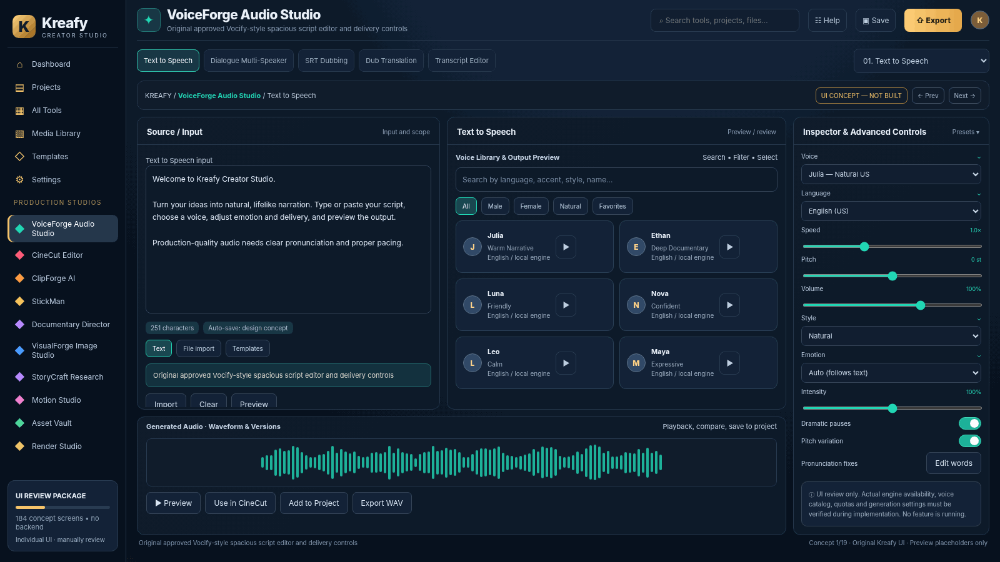](screenshots/01_text-to-speech.png)

[Full-size PNG](screenshots/01_text-to-speech.png) · [HTML prototype source](01_text-to-speech.html) · [Back to all studios](../README.md)

---

### 02. Dialogue Multi Speaker

[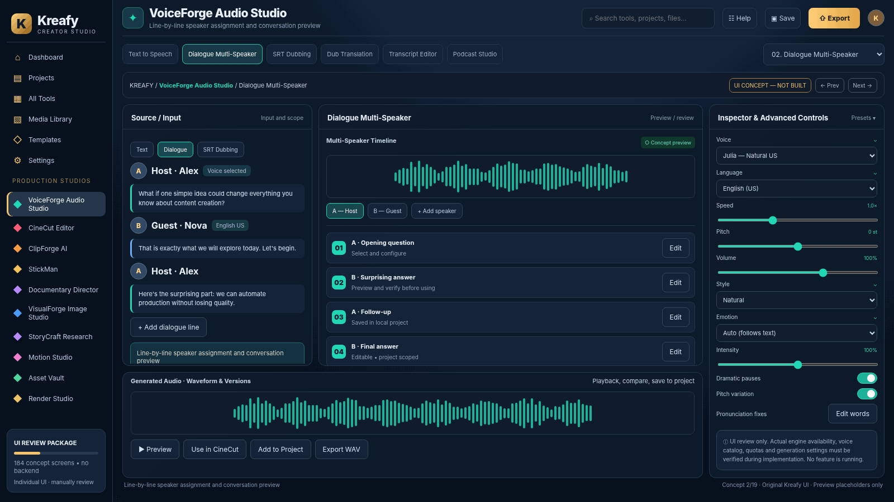](screenshots/02_dialogue-multi-speaker.png)

[Full-size PNG](screenshots/02_dialogue-multi-speaker.png) · [HTML prototype source](02_dialogue-multi-speaker.html) · [Back to all studios](../README.md)

---

### 03. Srt Dubbing

[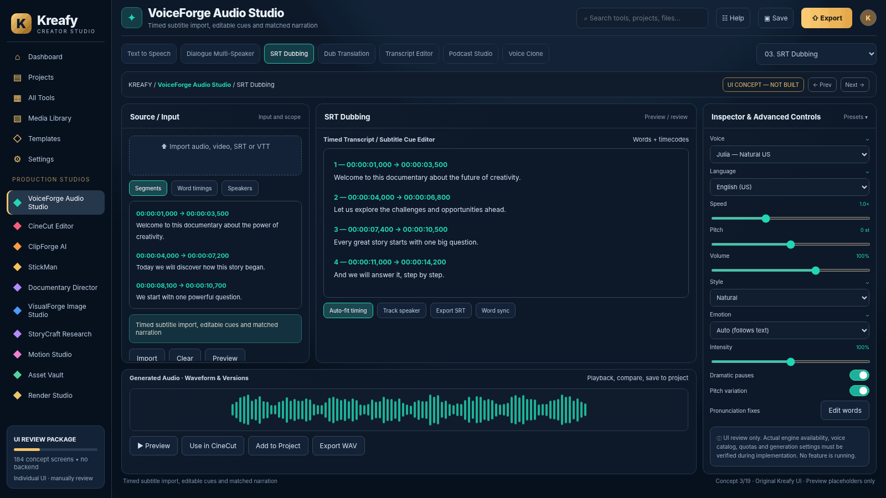](screenshots/03_srt-dubbing.png)

[Full-size PNG](screenshots/03_srt-dubbing.png) · [HTML prototype source](03_srt-dubbing.html) · [Back to all studios](../README.md)

---

### 04. Dub Translation

[Full-size PNG](screenshots/04_dub-translation.png) · [HTML prototype source](04_dub-translation.html) · [Back to all studios](../README.md)

---

### 05. Transcript Editor

[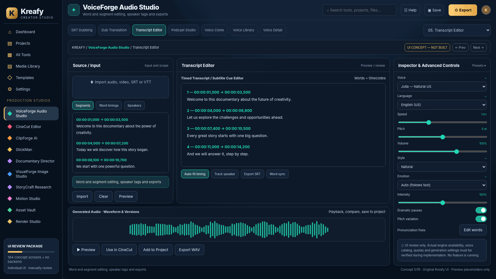](screenshots/05_transcript-editor.png)

[Full-size PNG](screenshots/05_transcript-editor.png) · [HTML prototype source](05_transcript-editor.html) · [Back to all studios](../README.md)

---

### 06. Podcast Studio

[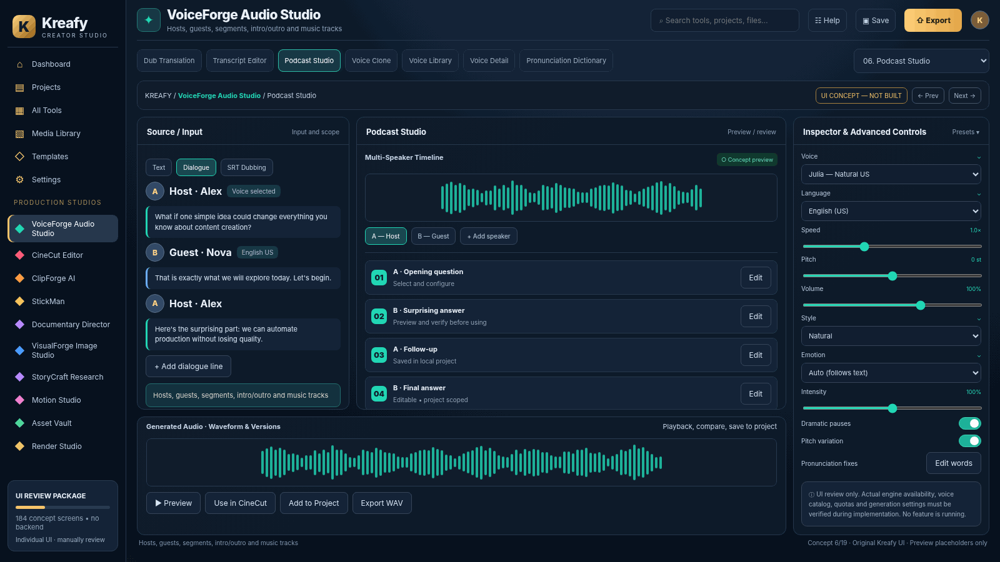](screenshots/06_podcast-studio.png)

[Full-size PNG](screenshots/06_podcast-studio.png) · [HTML prototype source](06_podcast-studio.html) · [Back to all studios](../README.md)

---

### 07. Voice Clone

[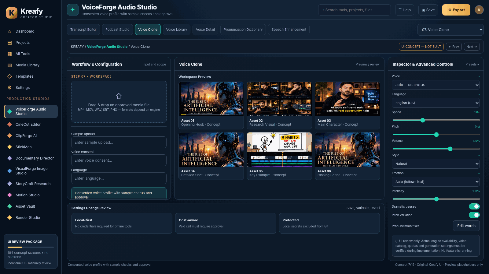](screenshots/07_voice-clone.png)

[Full-size PNG](screenshots/07_voice-clone.png) · [HTML prototype source](07_voice-clone.html) · [Back to all studios](../README.md)

---

### 08. Voice Library

[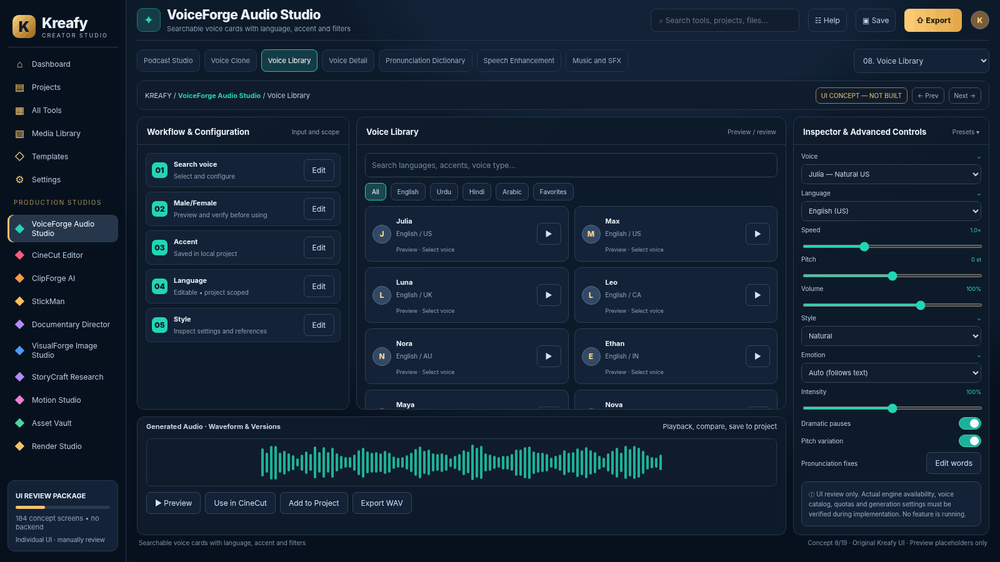](screenshots/08_voice-library.png)

[Full-size PNG](screenshots/08_voice-library.png) · [HTML prototype source](08_voice-library.html) · [Back to all studios](../README.md)

---

### 09. Voice Detail

[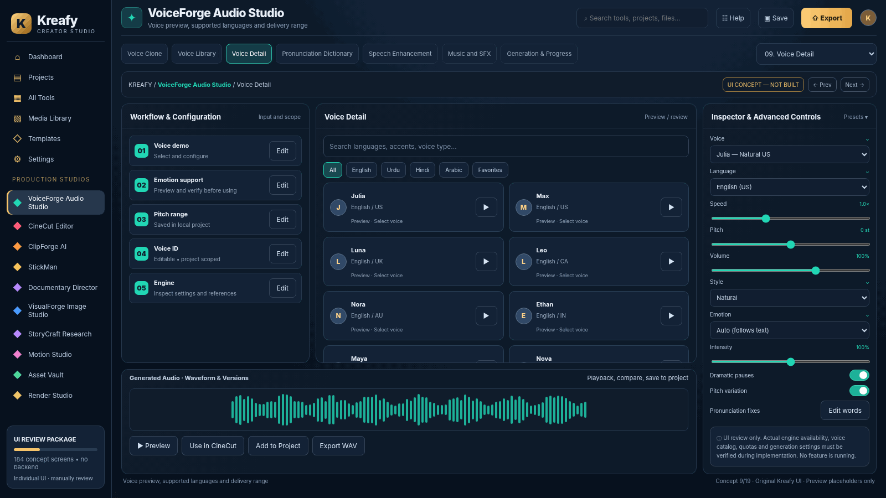](screenshots/09_voice-detail.png)

[Full-size PNG](screenshots/09_voice-detail.png) · [HTML prototype source](09_voice-detail.html) · [Back to all studios](../README.md)

---

### 10. Pronunciation Dictionary

[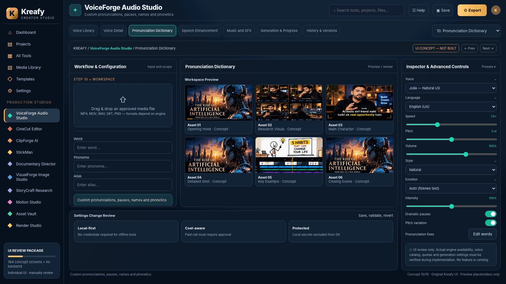](screenshots/10_pronunciation-dictionary.png)

[Full-size PNG](screenshots/10_pronunciation-dictionary.png) · [HTML prototype source](10_pronunciation-dictionary.html) · [Back to all studios](../README.md)

---

### 11. Speech Enhancement

[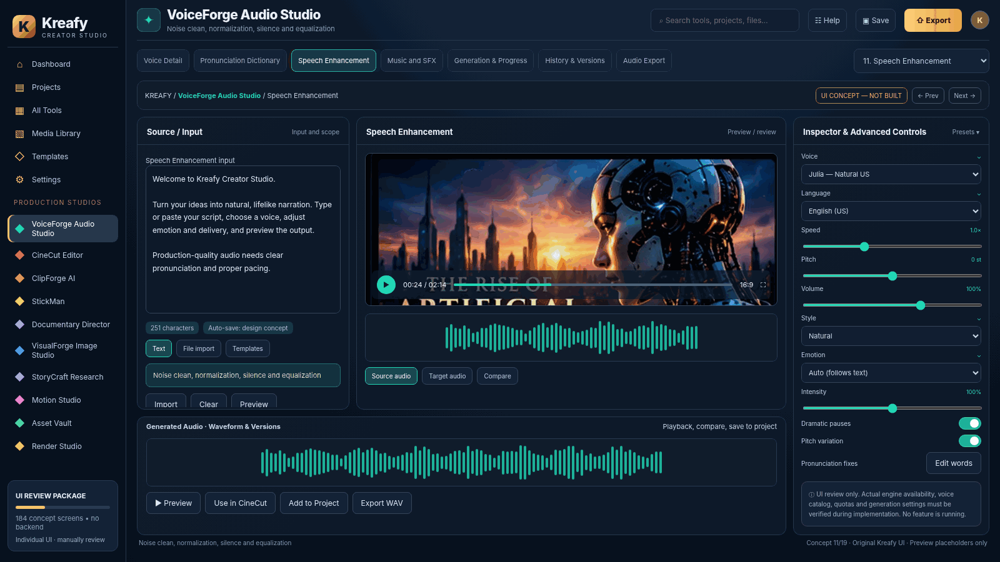](screenshots/11_speech-enhancement.png)

[Full-size PNG](screenshots/11_speech-enhancement.png) · [HTML prototype source](11_speech-enhancement.html) · [Back to all studios](../README.md)

---

### 12. Music And Sfx

[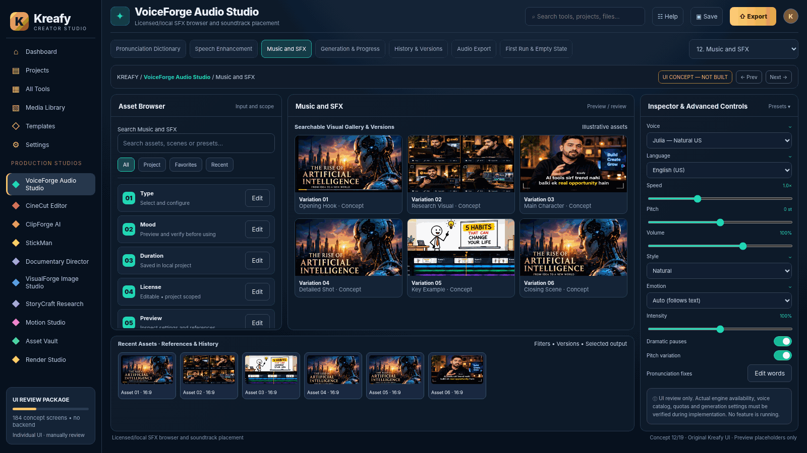](screenshots/12_music-and-sfx.png)

[Full-size PNG](screenshots/12_music-and-sfx.png) · [HTML prototype source](12_music-and-sfx.html) · [Back to all studios](../README.md)

---

### 13. Generation Progress

[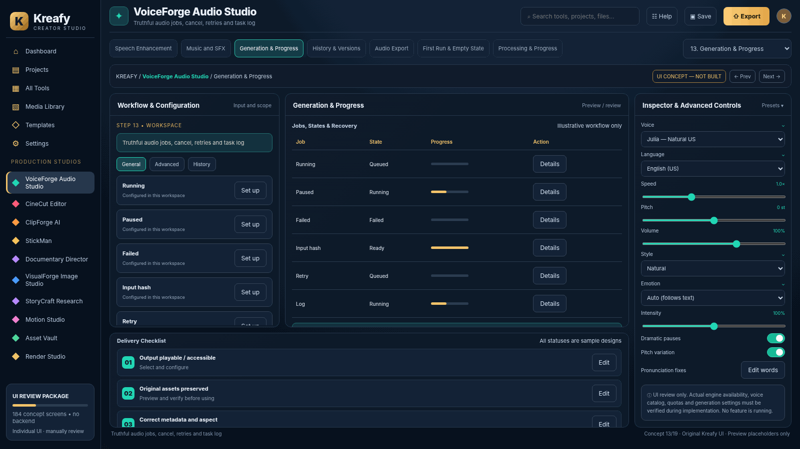](screenshots/13_generation-progress.png)

[Full-size PNG](screenshots/13_generation-progress.png) · [HTML prototype source](13_generation-progress.html) · [Back to all studios](../README.md)

---

### 14. History Versions

[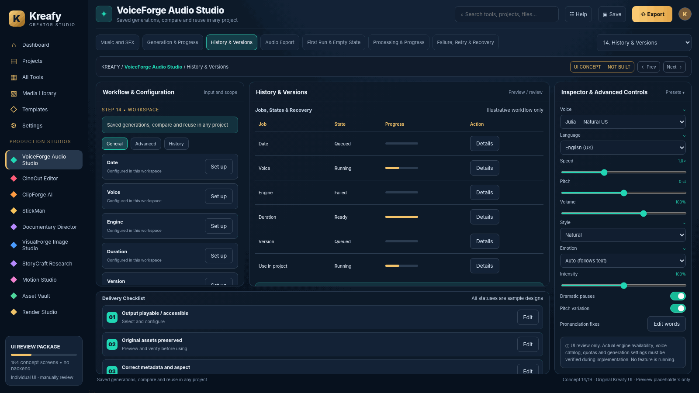](screenshots/14_history-versions.png)

[Full-size PNG](screenshots/14_history-versions.png) · [HTML prototype source](14_history-versions.html) · [Back to all studios](../README.md)

---

### 15. Audio Export

[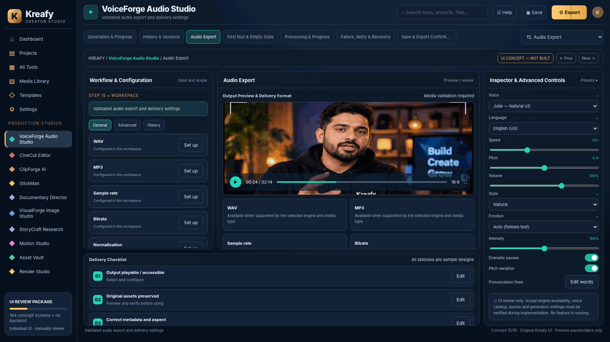](screenshots/15_audio-export.png)

[Full-size PNG](screenshots/15_audio-export.png) · [HTML prototype source](15_audio-export.html) · [Back to all studios](../README.md)

---

### 16. First Run Empty State

[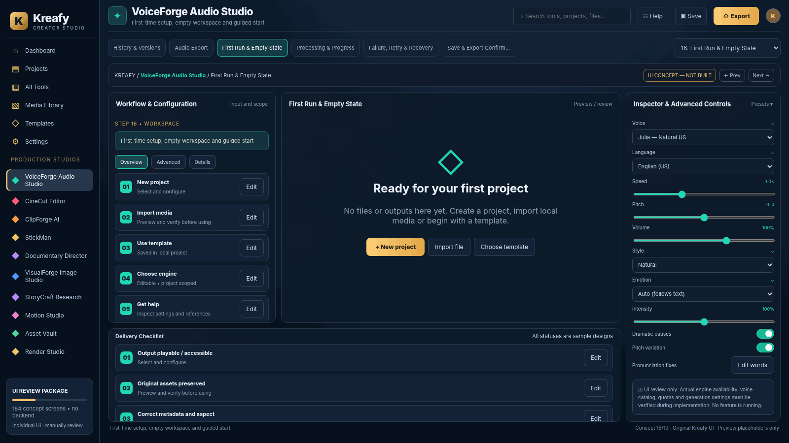](screenshots/16_first-run-empty-state.png)

[Full-size PNG](screenshots/16_first-run-empty-state.png) · [HTML prototype source](16_first-run-empty-state.html) · [Back to all studios](../README.md)

---

### 17. Processing Progress

[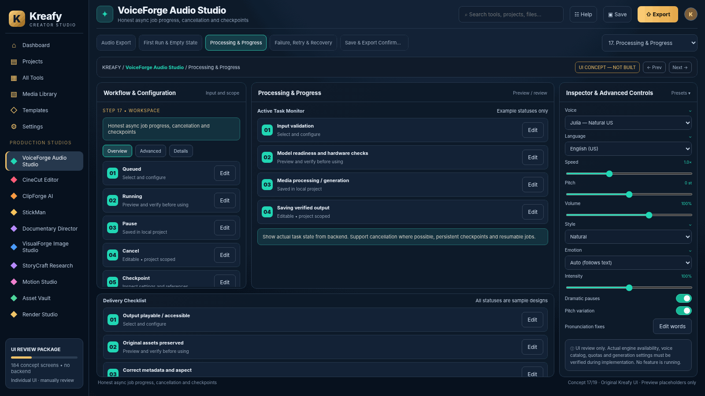](screenshots/17_processing-progress.png)

[Full-size PNG](screenshots/17_processing-progress.png) · [HTML prototype source](17_processing-progress.html) · [Back to all studios](../README.md)

---

### 18. Failure Retry Recovery

[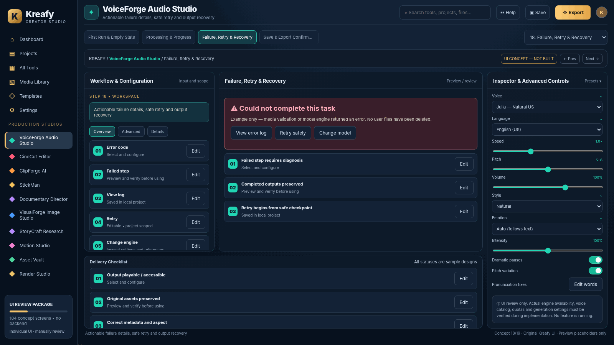](screenshots/18_failure-retry-recovery.png)

[Full-size PNG](screenshots/18_failure-retry-recovery.png) · [HTML prototype source](18_failure-retry-recovery.html) · [Back to all studios](../README.md)

---

### 19. Save Export Confirmation

[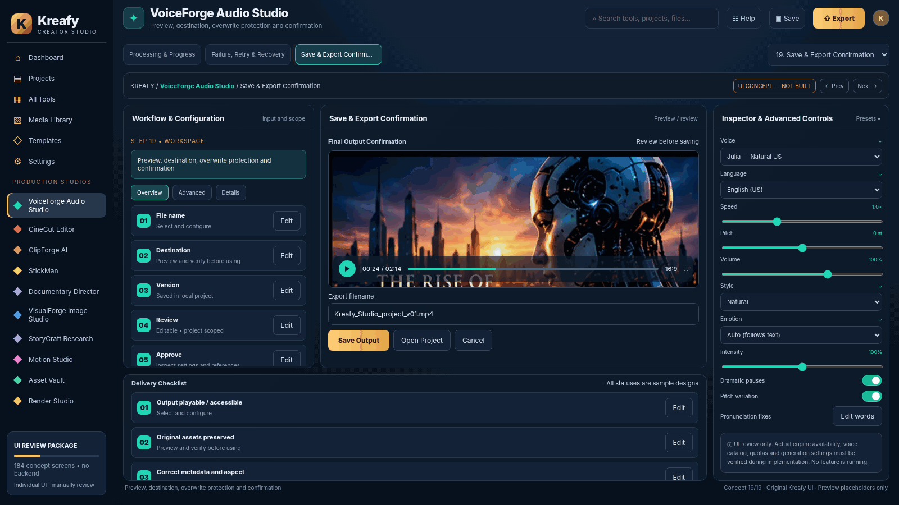](screenshots/19_save-export-confirmation.png)

[Full-size PNG](screenshots/19_save-export-confirmation.png) · [HTML prototype source](19_save-export-confirmation.html) · [Back to all studios](../README.md)

---
