# CineCut Video Editor

**21 separate screenshot previews.** Click any preview image to see the full-size PNG directly on GitHub.

[← All UI Studios](../README.md) · [Interaction specification](UI_INTERACTION_SPEC.md) · [Complete screen inventory](ALL_SCREENS.md) · [Open offline HTML package on Google Drive](https://drive.google.com/file/d/1el4TFos8ai705Ch40GtNtfPCd4qAsgCx/view?usp=drivesdk)

**Status:** Visual design baseline for implementation planning; this is not working product UI. HTML prototypes are for offline/local preview; GitHub displays screenshots and source, not a live app.

---

### 01. Main Editing Workspace

[Full-size PNG](screenshots/01_main-editing-workspace.png) · [HTML prototype source](01_main-editing-workspace.html) · [Back to all studios](../README.md)

---

### 02. Media Stock Browser

[Full-size PNG](screenshots/02_media-stock-browser.png) · [HTML prototype source](02_media-stock-browser.html) · [Back to all studios](../README.md)

---

### 03. Text Titles

[Full-size PNG](screenshots/03_text-titles.png) · [HTML prototype source](03_text-titles.html) · [Back to all studios](../README.md)

---

### 04. Animated Captions

[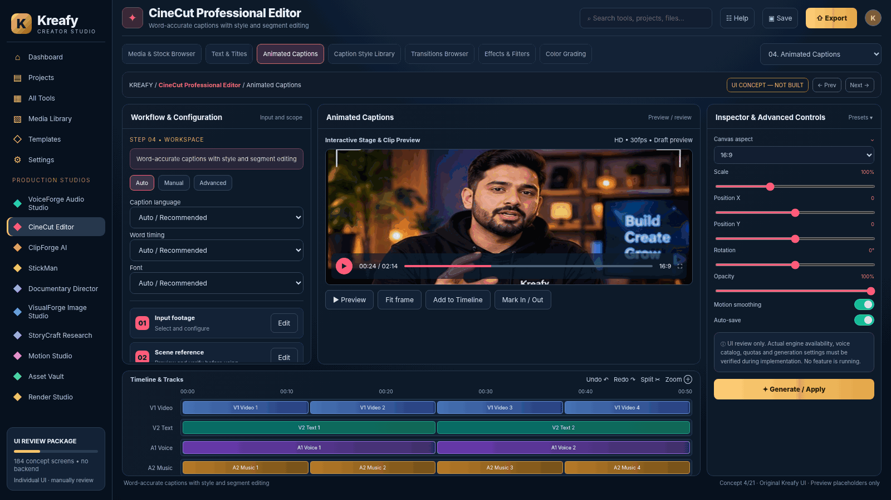](screenshots/04_animated-captions.png)

[Full-size PNG](screenshots/04_animated-captions.png) · [HTML prototype source](04_animated-captions.html) · [Back to all studios](../README.md)

---

### 05. Caption Style Library

[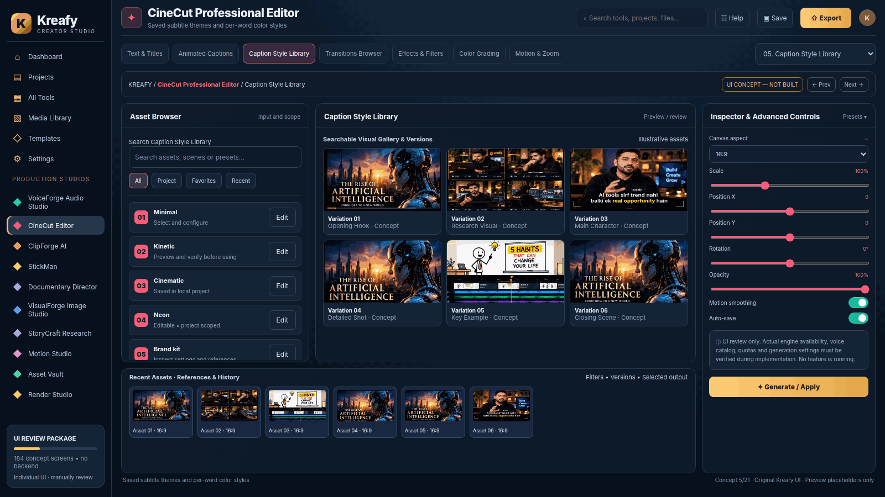](screenshots/05_caption-style-library.png)

[Full-size PNG](screenshots/05_caption-style-library.png) · [HTML prototype source](05_caption-style-library.html) · [Back to all studios](../README.md)

---

### 06. Transitions Browser

[Full-size PNG](screenshots/06_transitions-browser.png) · [HTML prototype source](06_transitions-browser.html) · [Back to all studios](../README.md)

---

### 07. Effects Filters

[Full-size PNG](screenshots/07_effects-filters.png) · [HTML prototype source](07_effects-filters.html) · [Back to all studios](../README.md)

---

### 08. Color Grading

[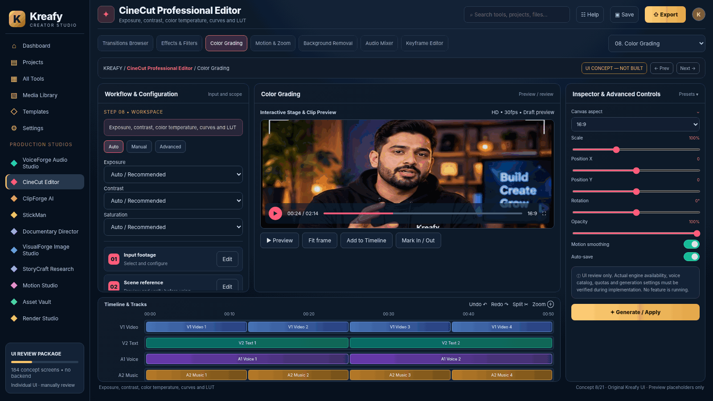](screenshots/08_color-grading.png)

[Full-size PNG](screenshots/08_color-grading.png) · [HTML prototype source](08_color-grading.html) · [Back to all studios](../README.md)

---

### 09. Motion Zoom

[Full-size PNG](screenshots/09_motion-zoom.png) · [HTML prototype source](09_motion-zoom.html) · [Back to all studios](../README.md)

---

### 10. Background Removal

[Full-size PNG](screenshots/10_background-removal.png) · [HTML prototype source](10_background-removal.html) · [Back to all studios](../README.md)

---

### 11. Audio Mixer

[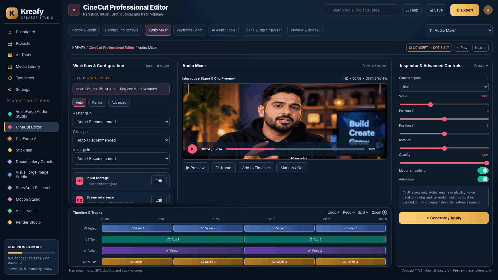](screenshots/11_audio-mixer.png)

[Full-size PNG](screenshots/11_audio-mixer.png) · [HTML prototype source](11_audio-mixer.html) · [Back to all studios](../README.md)

---

### 12. Keyframe Editor

[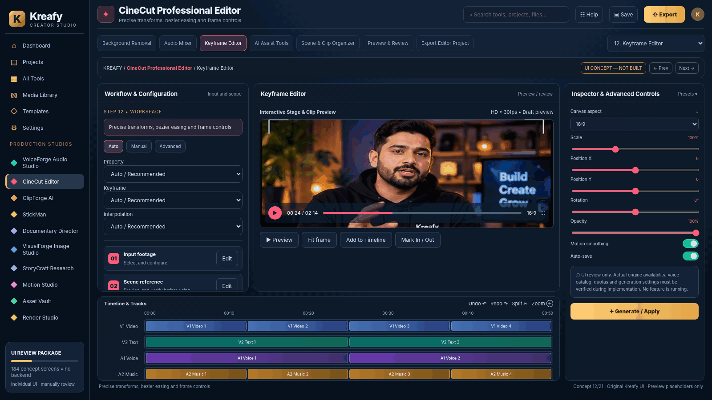](screenshots/12_keyframe-editor.png)

[Full-size PNG](screenshots/12_keyframe-editor.png) · [HTML prototype source](12_keyframe-editor.html) · [Back to all studios](../README.md)

---

### 13. Ai Assist Tools

[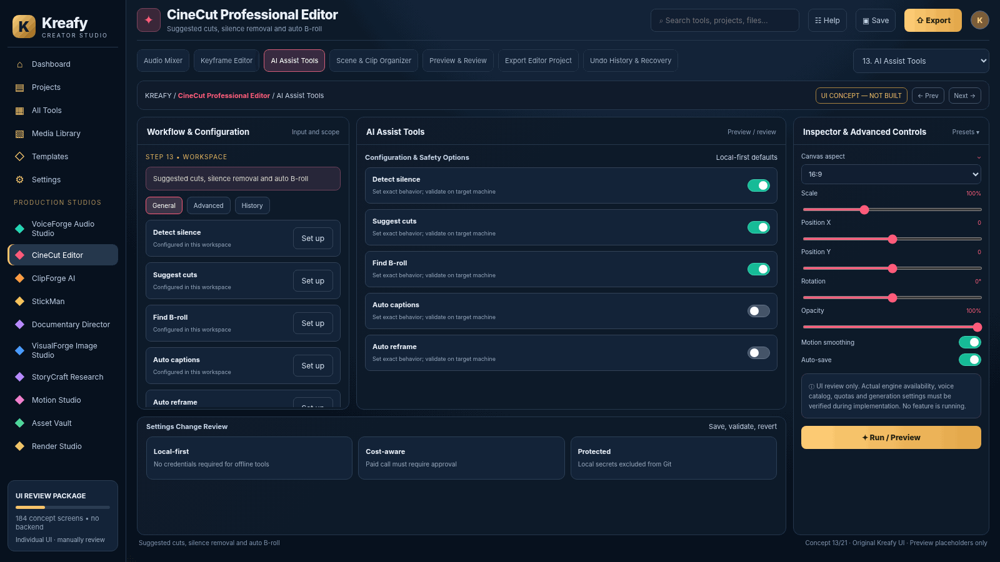](screenshots/13_ai-assist-tools.png)

[Full-size PNG](screenshots/13_ai-assist-tools.png) · [HTML prototype source](13_ai-assist-tools.html) · [Back to all studios](../README.md)

---

### 14. Scene Clip Organizer

[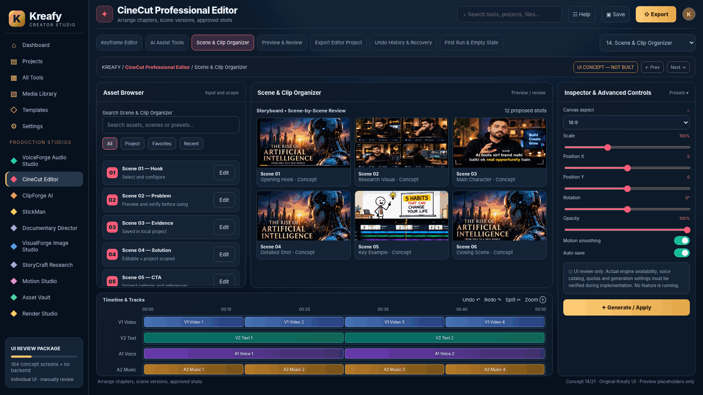](screenshots/14_scene-clip-organizer.png)

[Full-size PNG](screenshots/14_scene-clip-organizer.png) · [HTML prototype source](14_scene-clip-organizer.html) · [Back to all studios](../README.md)

---

### 15. Preview Review

[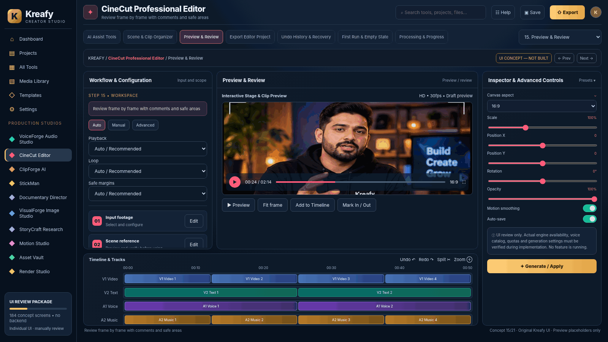](screenshots/15_preview-review.png)

[Full-size PNG](screenshots/15_preview-review.png) · [HTML prototype source](15_preview-review.html) · [Back to all studios](../README.md)

---

### 16. Export Editor Project

[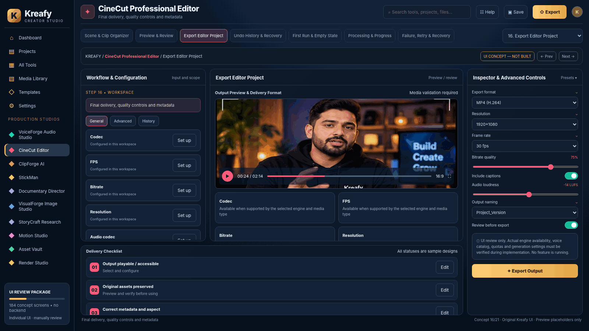](screenshots/16_export-editor-project.png)

[Full-size PNG](screenshots/16_export-editor-project.png) · [HTML prototype source](16_export-editor-project.html) · [Back to all studios](../README.md)

---

### 17. Undo History Recovery

[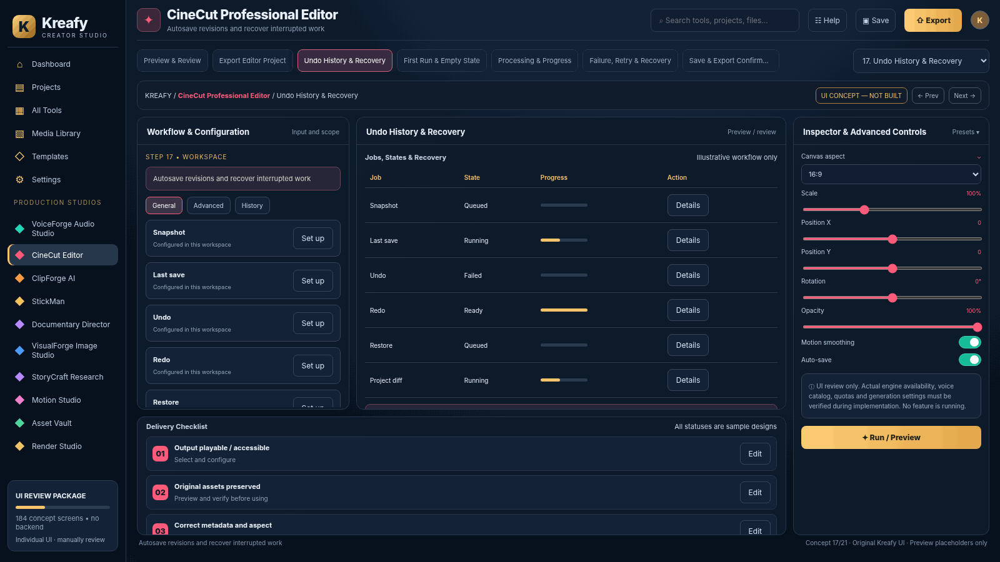](screenshots/17_undo-history-recovery.png)

[Full-size PNG](screenshots/17_undo-history-recovery.png) · [HTML prototype source](17_undo-history-recovery.html) · [Back to all studios](../README.md)

---

### 18. First Run Empty State

[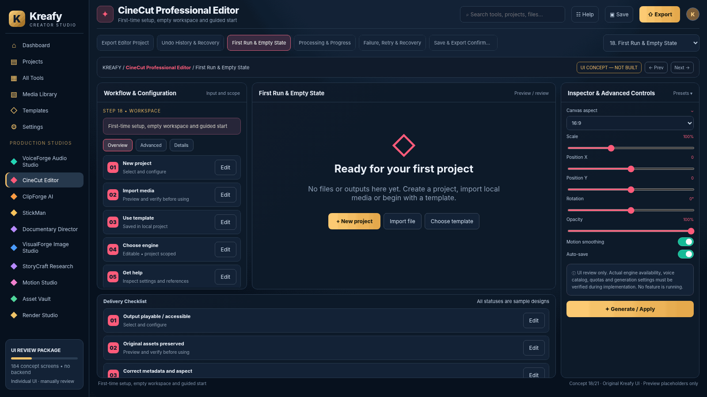](screenshots/18_first-run-empty-state.png)

[Full-size PNG](screenshots/18_first-run-empty-state.png) · [HTML prototype source](18_first-run-empty-state.html) · [Back to all studios](../README.md)

---

### 19. Processing Progress

[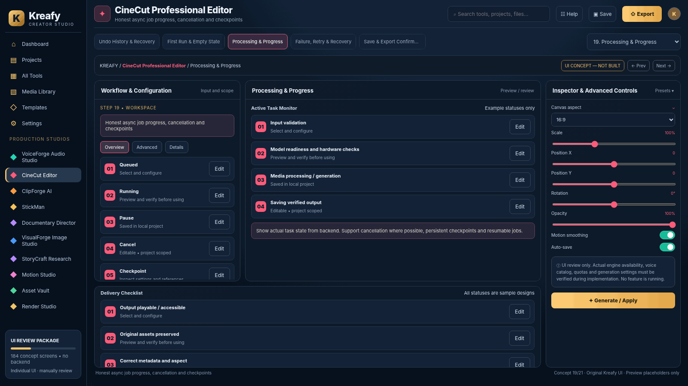](screenshots/19_processing-progress.png)

[Full-size PNG](screenshots/19_processing-progress.png) · [HTML prototype source](19_processing-progress.html) · [Back to all studios](../README.md)

---

### 20. Failure Retry Recovery

[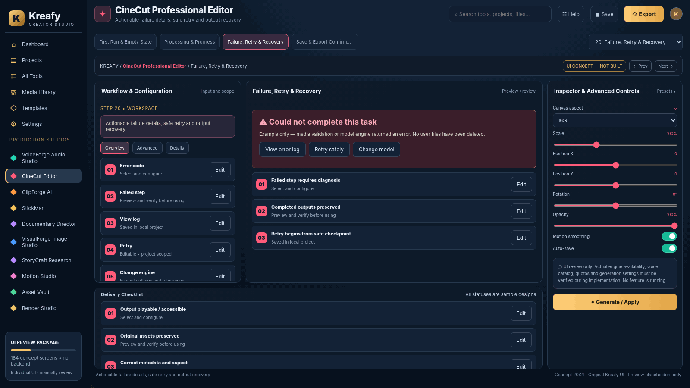](screenshots/20_failure-retry-recovery.png)

[Full-size PNG](screenshots/20_failure-retry-recovery.png) · [HTML prototype source](20_failure-retry-recovery.html) · [Back to all studios](../README.md)

---

### 21. Save Export Confirmation

[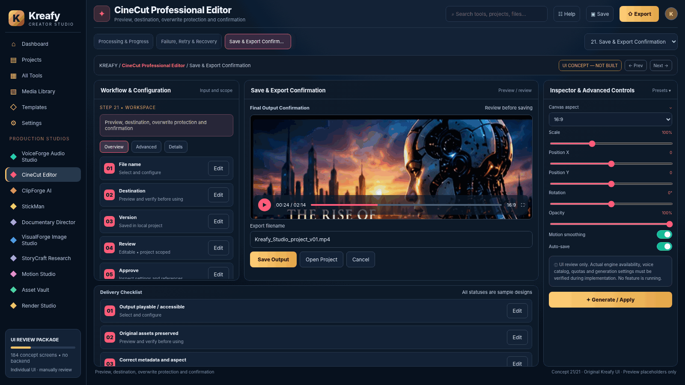](screenshots/21_save-export-confirmation.png)

[Full-size PNG](screenshots/21_save-export-confirmation.png) · [HTML prototype source](21_save-export-confirmation.html) · [Back to all studios](../README.md)

---
