# ClipForge AI — Long Video to Shorts

**17 separate screenshot previews.** Click any preview image to see the full-size PNG directly on GitHub.

[← All UI Studios](../README.md) · [Interaction specification](UI_INTERACTION_SPEC.md) · [Complete screen inventory](ALL_SCREENS.md) · [Open offline HTML package on Google Drive](https://drive.google.com/file/d/1el4TFos8ai705Ch40GtNtfPCd4qAsgCx/view?usp=drivesdk)

**Status:** Visual design baseline for implementation planning; this is not working product UI. HTML prototypes are for offline/local preview; GitHub displays screenshots and source, not a live app.

---

### 01. Import Long Video

[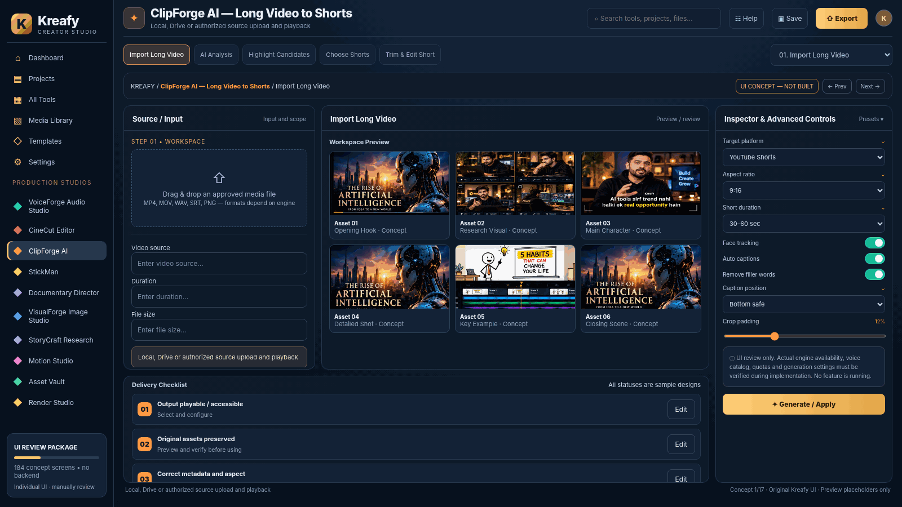](screenshots/01_import-long-video.png)

[Full-size PNG](screenshots/01_import-long-video.png) · [HTML prototype source](01_import-long-video.html) · [Back to all studios](../README.md)

---

### 02. Ai Analysis

[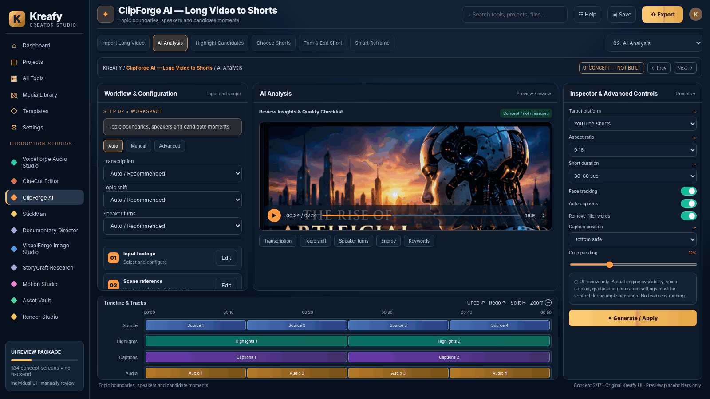](screenshots/02_ai-analysis.png)

[Full-size PNG](screenshots/02_ai-analysis.png) · [HTML prototype source](02_ai-analysis.html) · [Back to all studios](../README.md)

---

### 03. Highlight Candidates

[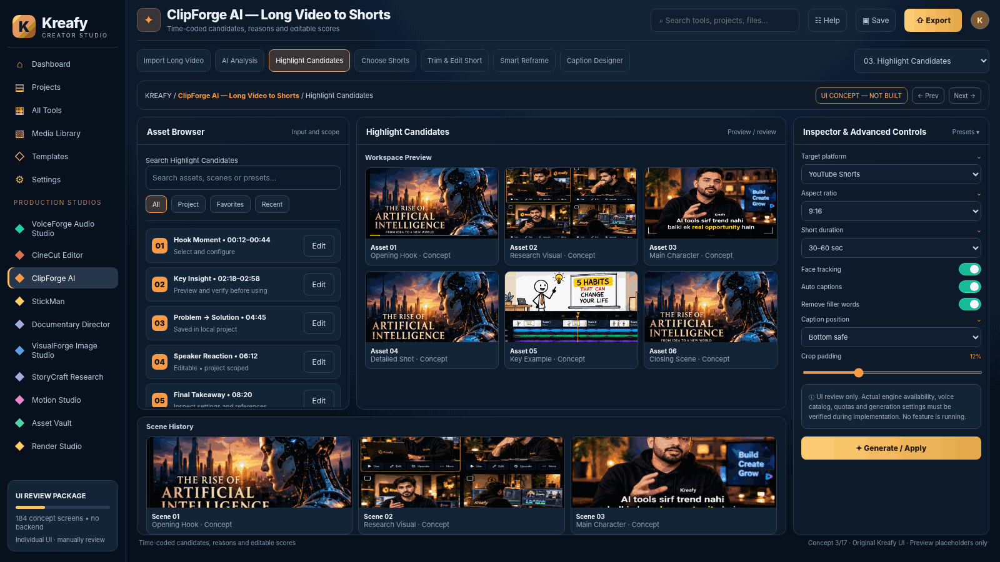](screenshots/03_highlight-candidates.png)

[Full-size PNG](screenshots/03_highlight-candidates.png) · [HTML prototype source](03_highlight-candidates.html) · [Back to all studios](../README.md)

---

### 04. Choose Shorts

[Full-size PNG](screenshots/04_choose-shorts.png) · [HTML prototype source](04_choose-shorts.html) · [Back to all studios](../README.md)

---

### 05. Trim Edit Short

[Full-size PNG](screenshots/05_trim-edit-short.png) · [HTML prototype source](05_trim-edit-short.html) · [Back to all studios](../README.md)

---

### 06. Smart Reframe

[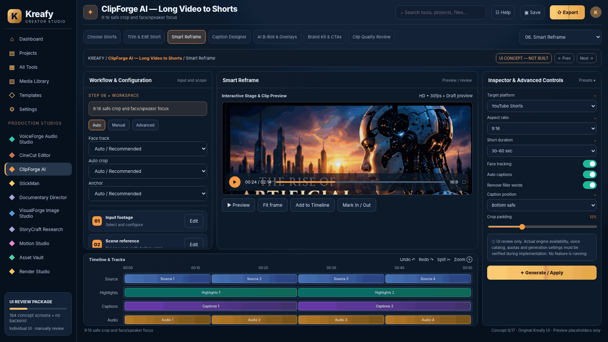](screenshots/06_smart-reframe.png)

[Full-size PNG](screenshots/06_smart-reframe.png) · [HTML prototype source](06_smart-reframe.html) · [Back to all studios](../README.md)

---

### 07. Caption Designer

[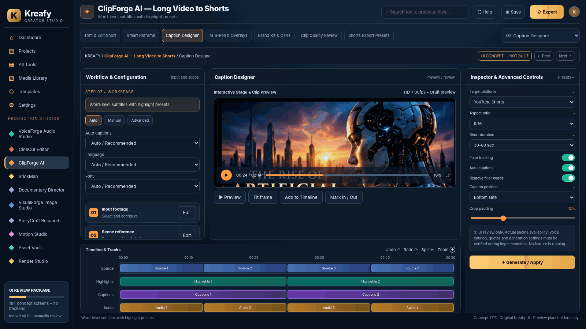](screenshots/07_caption-designer.png)

[Full-size PNG](screenshots/07_caption-designer.png) · [HTML prototype source](07_caption-designer.html) · [Back to all studios](../README.md)

---

### 08. Ai B Roll Overlays

[Full-size PNG](screenshots/08_ai-b-roll-overlays.png) · [HTML prototype source](08_ai-b-roll-overlays.html) · [Back to all studios](../README.md)

---

### 09. Brand Kit Ctas

[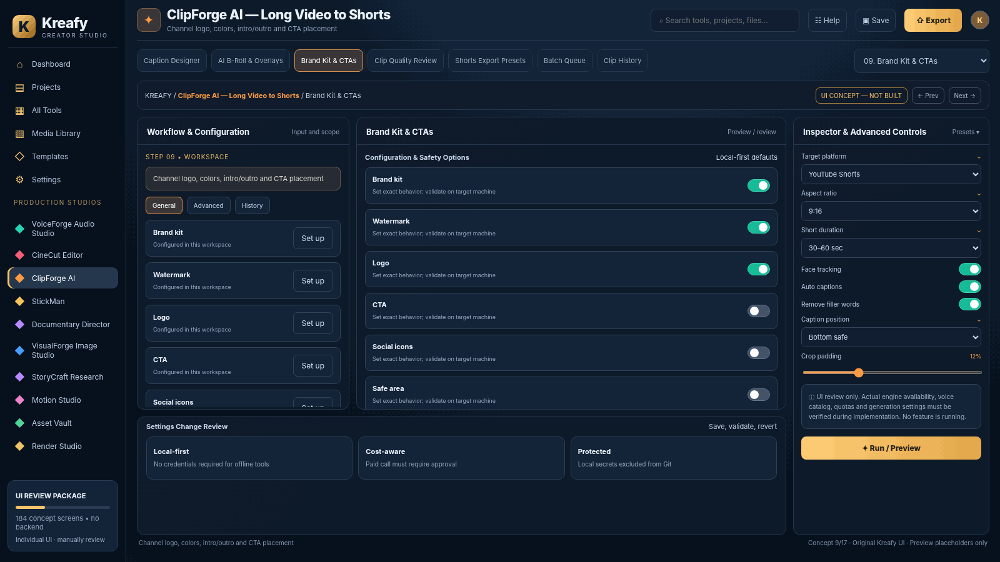](screenshots/09_brand-kit-ctas.png)

[Full-size PNG](screenshots/09_brand-kit-ctas.png) · [HTML prototype source](09_brand-kit-ctas.html) · [Back to all studios](../README.md)

---

### 10. Clip Quality Review

[Full-size PNG](screenshots/10_clip-quality-review.png) · [HTML prototype source](10_clip-quality-review.html) · [Back to all studios](../README.md)

---

### 11. Shorts Export Presets

[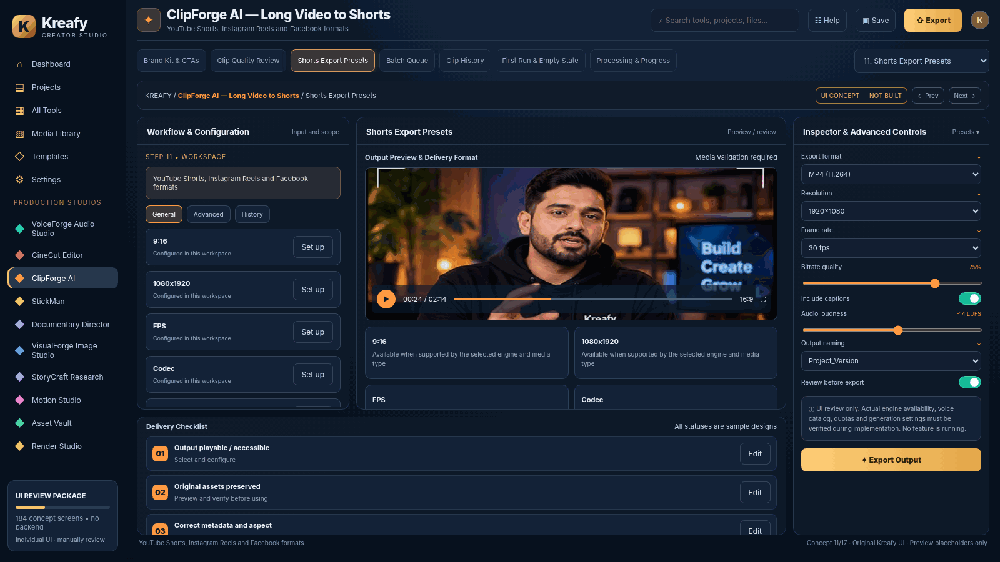](screenshots/11_shorts-export-presets.png)

[Full-size PNG](screenshots/11_shorts-export-presets.png) · [HTML prototype source](11_shorts-export-presets.html) · [Back to all studios](../README.md)

---

### 12. Batch Queue

[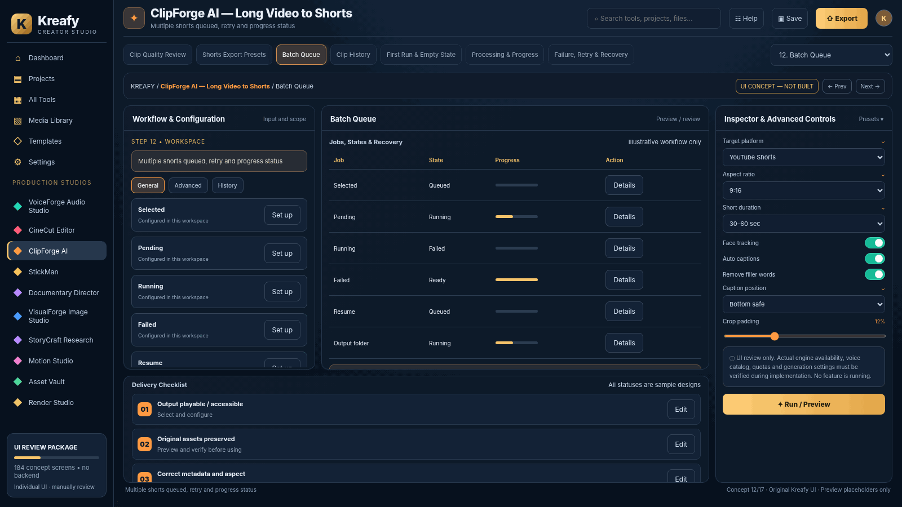](screenshots/12_batch-queue.png)

[Full-size PNG](screenshots/12_batch-queue.png) · [HTML prototype source](12_batch-queue.html) · [Back to all studios](../README.md)

---

### 13. Clip History

[Full-size PNG](screenshots/13_clip-history.png) · [HTML prototype source](13_clip-history.html) · [Back to all studios](../README.md)

---

### 14. First Run Empty State

[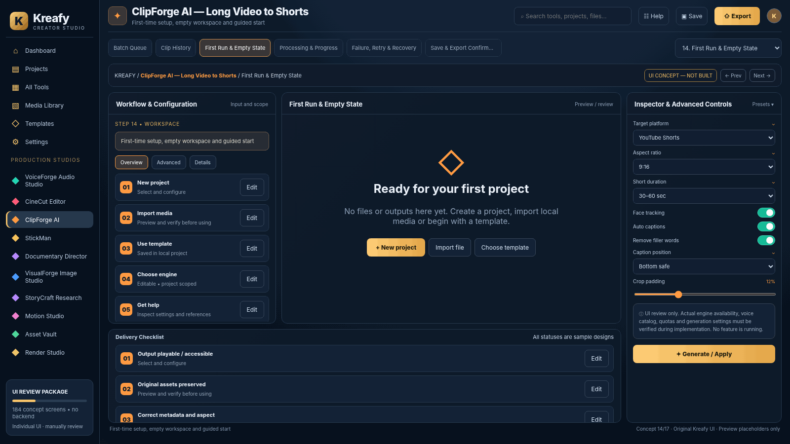](screenshots/14_first-run-empty-state.png)

[Full-size PNG](screenshots/14_first-run-empty-state.png) · [HTML prototype source](14_first-run-empty-state.html) · [Back to all studios](../README.md)

---

### 15. Processing Progress

[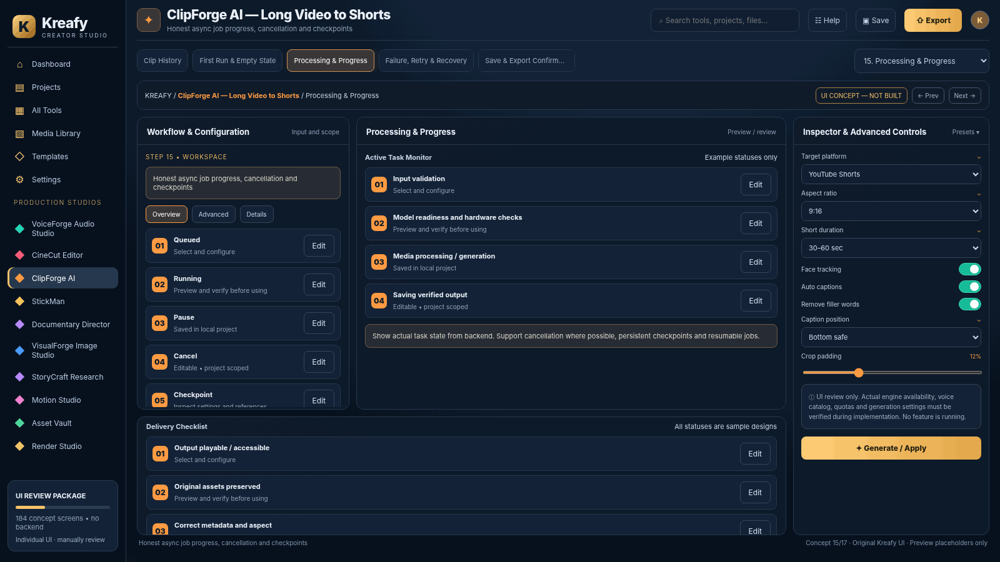](screenshots/15_processing-progress.png)

[Full-size PNG](screenshots/15_processing-progress.png) · [HTML prototype source](15_processing-progress.html) · [Back to all studios](../README.md)

---

### 16. Failure Retry Recovery

[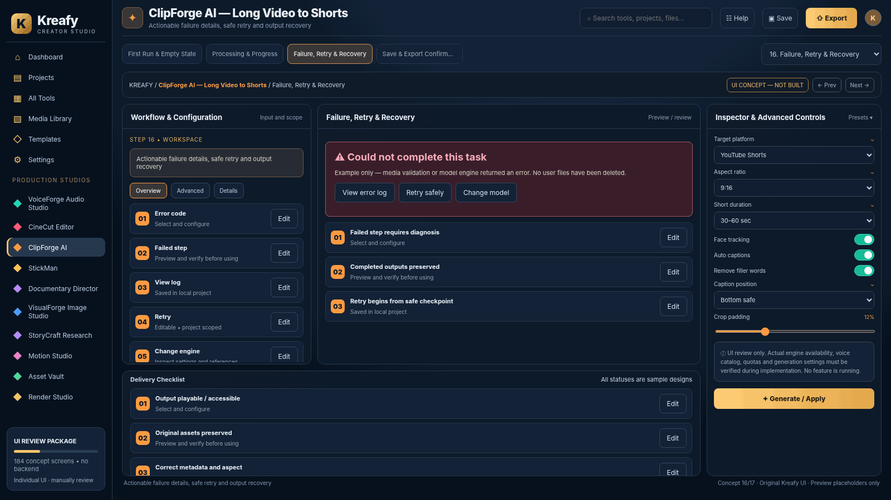](screenshots/16_failure-retry-recovery.png)

[Full-size PNG](screenshots/16_failure-retry-recovery.png) · [HTML prototype source](16_failure-retry-recovery.html) · [Back to all studios](../README.md)

---

### 17. Save Export Confirmation

[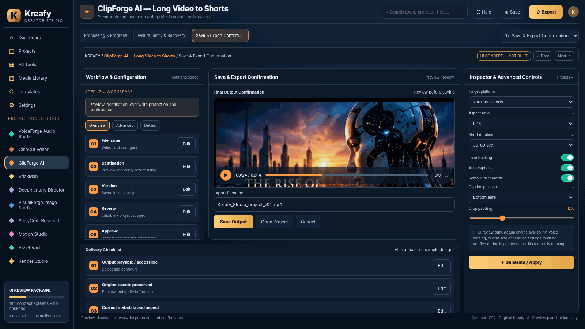](screenshots/17_save-export-confirmation.png)

[Full-size PNG](screenshots/17_save-export-confirmation.png) · [HTML prototype source](17_save-export-confirmation.html) · [Back to all studios](../README.md)

---
