# StickMan & Whiteboard Animation

**17 separate screenshot previews.** Click any preview image to see the full-size PNG directly on GitHub.

[← All UI Studios](../README.md) · [Interaction specification](UI_INTERACTION_SPEC.md) · [Complete screen inventory](ALL_SCREENS.md) · [Open offline HTML package on Google Drive](https://drive.google.com/file/d/1el4TFos8ai705Ch40GtNtfPCd4qAsgCx/view?usp=drivesdk)

**Status:** Visual design baseline for implementation planning; this is not working product UI. HTML prototypes are for offline/local preview; GitHub displays screenshots and source, not a live app.

---

### 01. Script To Animation

[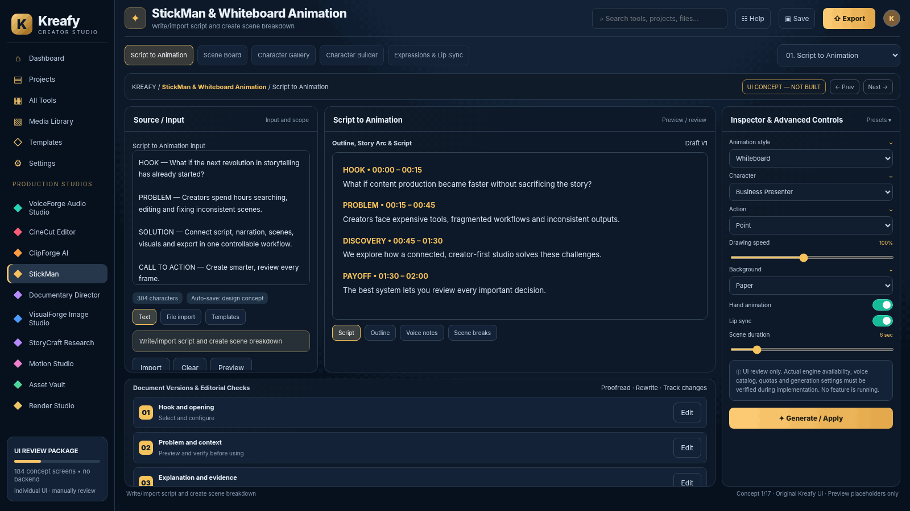](screenshots/01_script-to-animation.png)

[Full-size PNG](screenshots/01_script-to-animation.png) · [HTML prototype source](01_script-to-animation.html) · [Back to all studios](../README.md)

---

### 02. Scene Board

[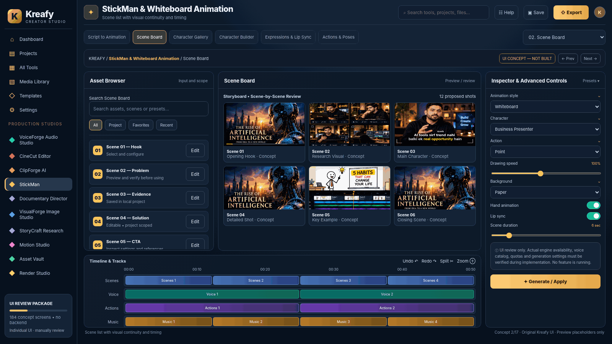](screenshots/02_scene-board.png)

[Full-size PNG](screenshots/02_scene-board.png) · [HTML prototype source](02_scene-board.html) · [Back to all studios](../README.md)

---

### 03. Character Gallery

[Full-size PNG](screenshots/03_character-gallery.png) · [HTML prototype source](03_character-gallery.html) · [Back to all studios](../README.md)

---

### 04. Character Builder

[Full-size PNG](screenshots/04_character-builder.png) · [HTML prototype source](04_character-builder.html) · [Back to all studios](../README.md)

---

### 05. Expressions Lip Sync

[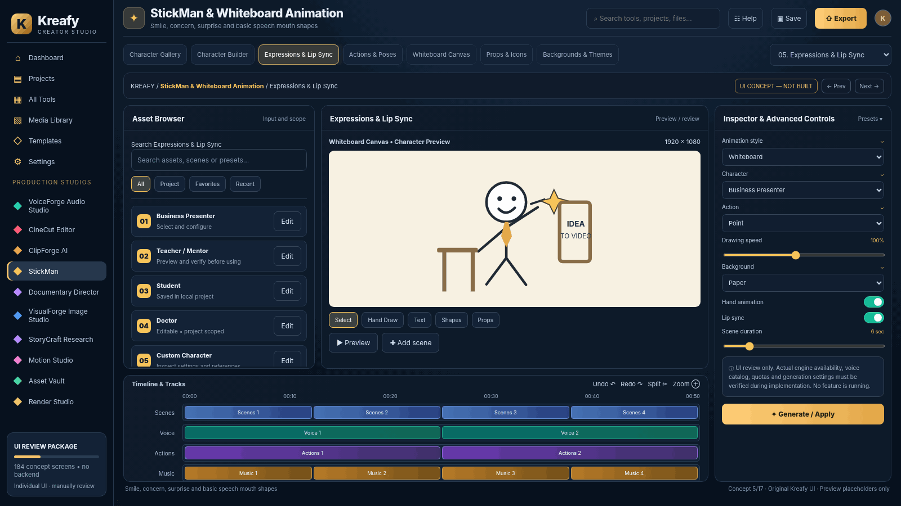](screenshots/05_expressions-lip-sync.png)

[Full-size PNG](screenshots/05_expressions-lip-sync.png) · [HTML prototype source](05_expressions-lip-sync.html) · [Back to all studios](../README.md)

---

### 06. Actions Poses

[Full-size PNG](screenshots/06_actions-poses.png) · [HTML prototype source](06_actions-poses.html) · [Back to all studios](../README.md)

---

### 07. Whiteboard Canvas

[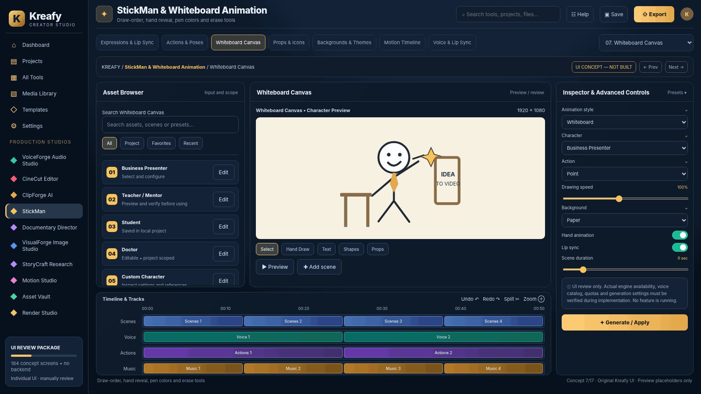](screenshots/07_whiteboard-canvas.png)

[Full-size PNG](screenshots/07_whiteboard-canvas.png) · [HTML prototype source](07_whiteboard-canvas.html) · [Back to all studios](../README.md)

---

### 08. Props Icons

[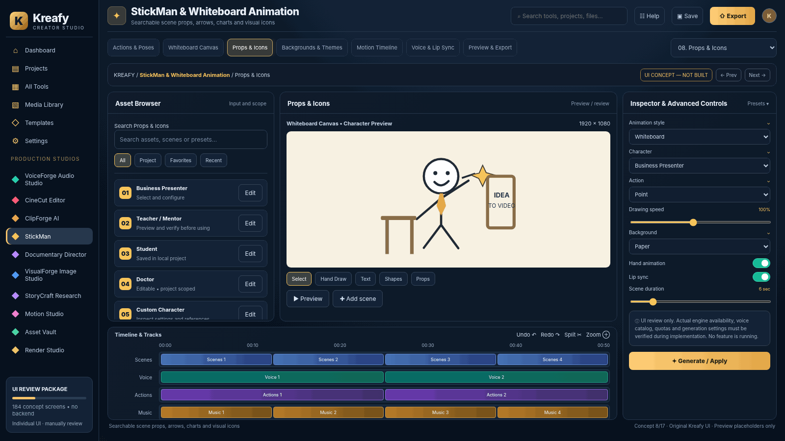](screenshots/08_props-icons.png)

[Full-size PNG](screenshots/08_props-icons.png) · [HTML prototype source](08_props-icons.html) · [Back to all studios](../README.md)

---

### 09. Backgrounds Themes

[Full-size PNG](screenshots/09_backgrounds-themes.png) · [HTML prototype source](09_backgrounds-themes.html) · [Back to all studios](../README.md)

---

### 10. Motion Timeline

[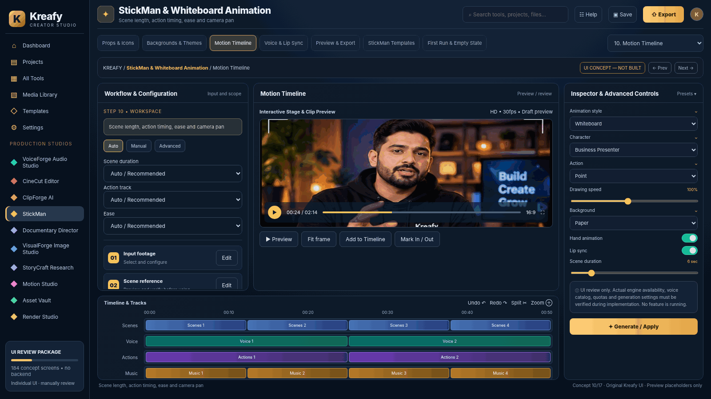](screenshots/10_motion-timeline.png)

[Full-size PNG](screenshots/10_motion-timeline.png) · [HTML prototype source](10_motion-timeline.html) · [Back to all studios](../README.md)

---

### 11. Voice Lip Sync

[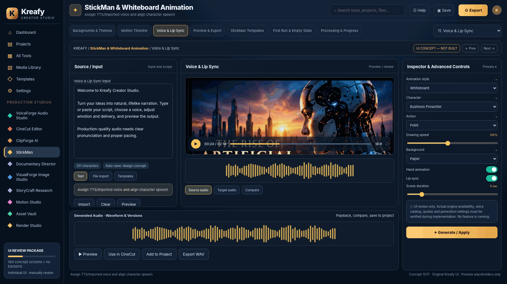](screenshots/11_voice-lip-sync.png)

[Full-size PNG](screenshots/11_voice-lip-sync.png) · [HTML prototype source](11_voice-lip-sync.html) · [Back to all studios](../README.md)

---

### 12. Preview Export

[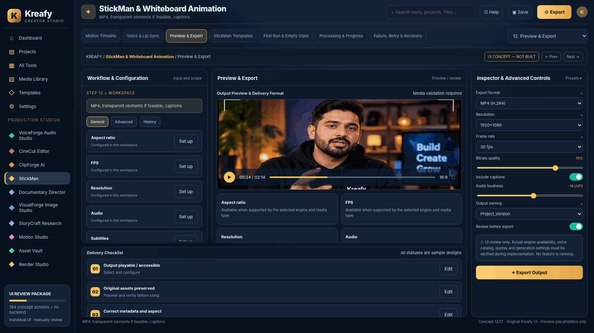](screenshots/12_preview-export.png)

[Full-size PNG](screenshots/12_preview-export.png) · [HTML prototype source](12_preview-export.html) · [Back to all studios](../README.md)

---

### 13. Stickman Templates

[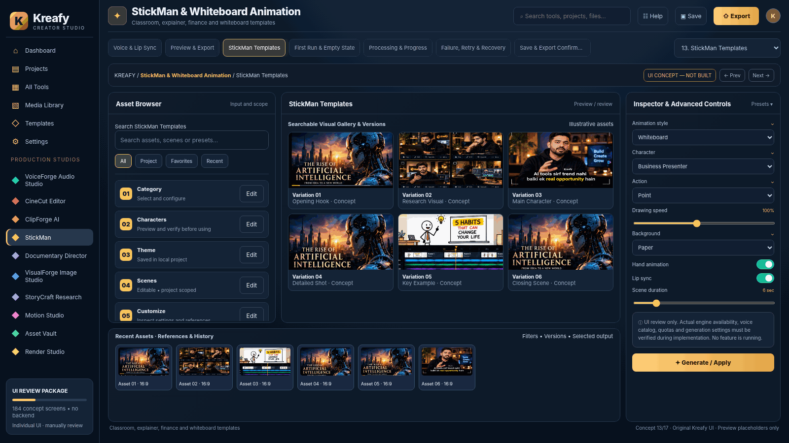](screenshots/13_stickman-templates.png)

[Full-size PNG](screenshots/13_stickman-templates.png) · [HTML prototype source](13_stickman-templates.html) · [Back to all studios](../README.md)

---

### 14. First Run Empty State

[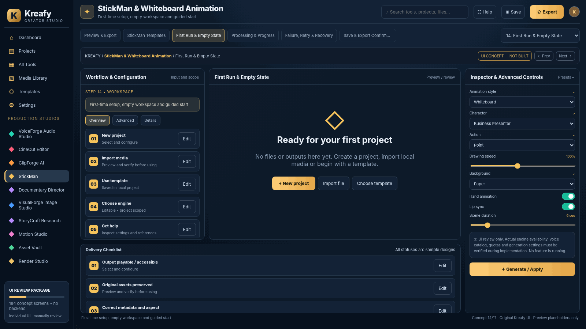](screenshots/14_first-run-empty-state.png)

[Full-size PNG](screenshots/14_first-run-empty-state.png) · [HTML prototype source](14_first-run-empty-state.html) · [Back to all studios](../README.md)

---

### 15. Processing Progress

[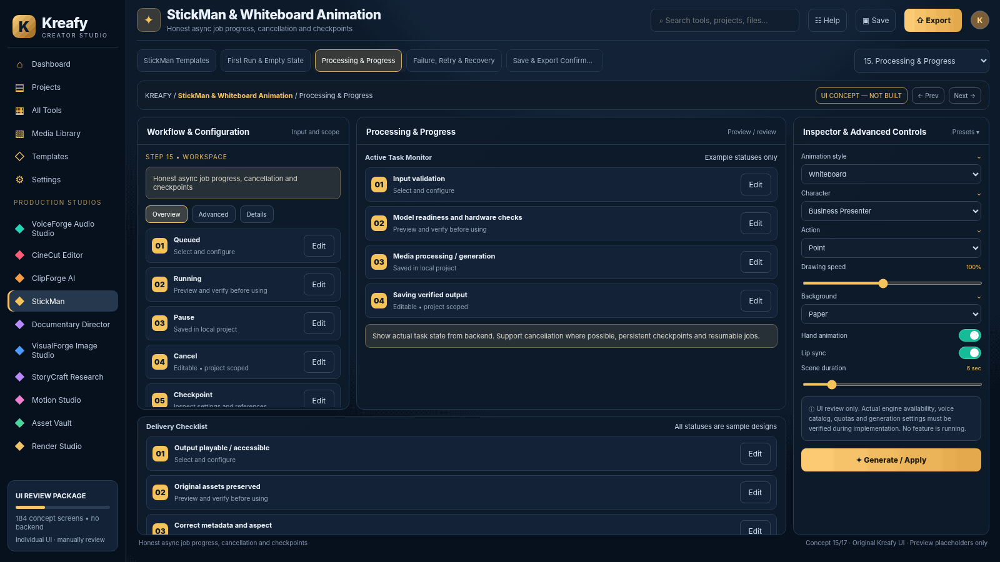](screenshots/15_processing-progress.png)

[Full-size PNG](screenshots/15_processing-progress.png) · [HTML prototype source](15_processing-progress.html) · [Back to all studios](../README.md)

---

### 16. Failure Retry Recovery

[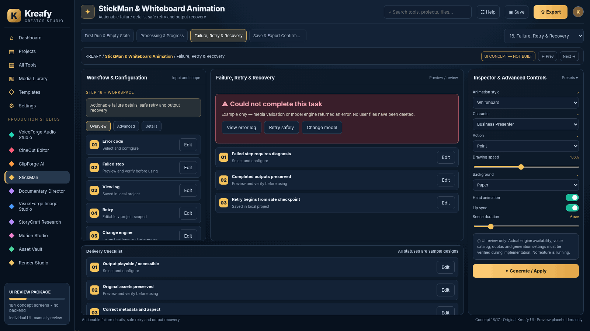](screenshots/16_failure-retry-recovery.png)

[Full-size PNG](screenshots/16_failure-retry-recovery.png) · [HTML prototype source](16_failure-retry-recovery.html) · [Back to all studios](../README.md)

---

### 17. Save Export Confirmation

[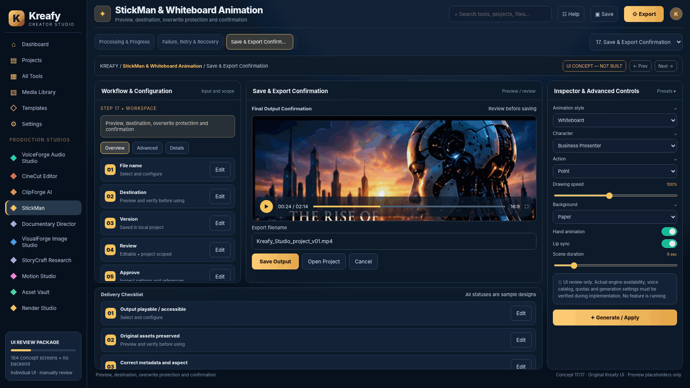](screenshots/17_save-export-confirmation.png)

[Full-size PNG](screenshots/17_save-export-confirmation.png) · [HTML prototype source](17_save-export-confirmation.html) · [Back to all studios](../README.md)

---
