# Documentary Director

**17 separate screenshot previews.** Click any preview image to see the full-size PNG directly on GitHub.

[← All UI Studios](../README.md) · [Interaction specification](UI_INTERACTION_SPEC.md) · [Complete screen inventory](ALL_SCREENS.md) · [Open offline HTML package on Google Drive](https://drive.google.com/file/d/1el4TFos8ai705Ch40GtNtfPCd4qAsgCx/view?usp=drivesdk)

**Status:** Visual design baseline for implementation planning; this is not working product UI. HTML prototypes are for offline/local preview; GitHub displays screenshots and source, not a live app.

---

### 01. Topic Research

[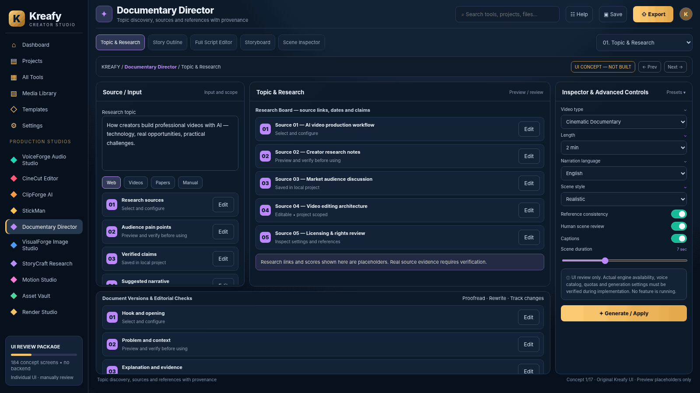](screenshots/01_topic-research.png)

[Full-size PNG](screenshots/01_topic-research.png) · [HTML prototype source](01_topic-research.html) · [Back to all studios](../README.md)

---

### 02. Story Outline

[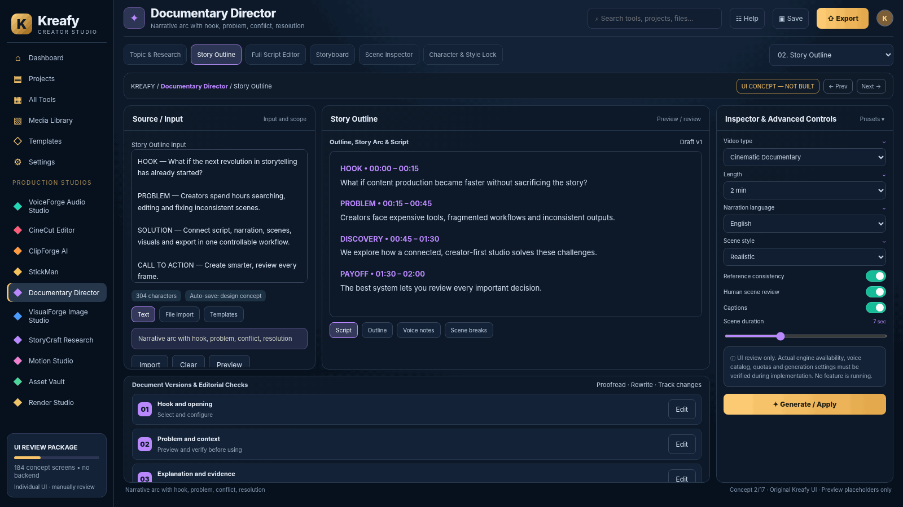](screenshots/02_story-outline.png)

[Full-size PNG](screenshots/02_story-outline.png) · [HTML prototype source](02_story-outline.html) · [Back to all studios](../README.md)

---

### 03. Full Script Editor

[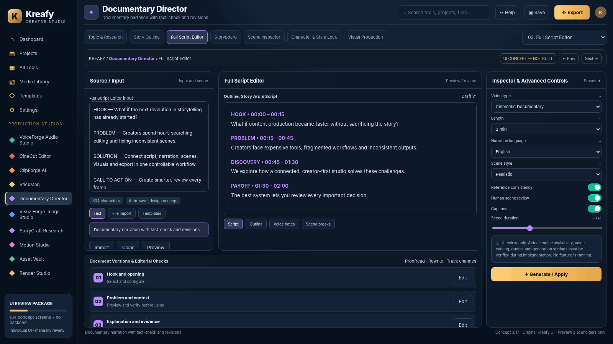](screenshots/03_full-script-editor.png)

[Full-size PNG](screenshots/03_full-script-editor.png) · [HTML prototype source](03_full-script-editor.html) · [Back to all studios](../README.md)

---

### 04. Storyboard

[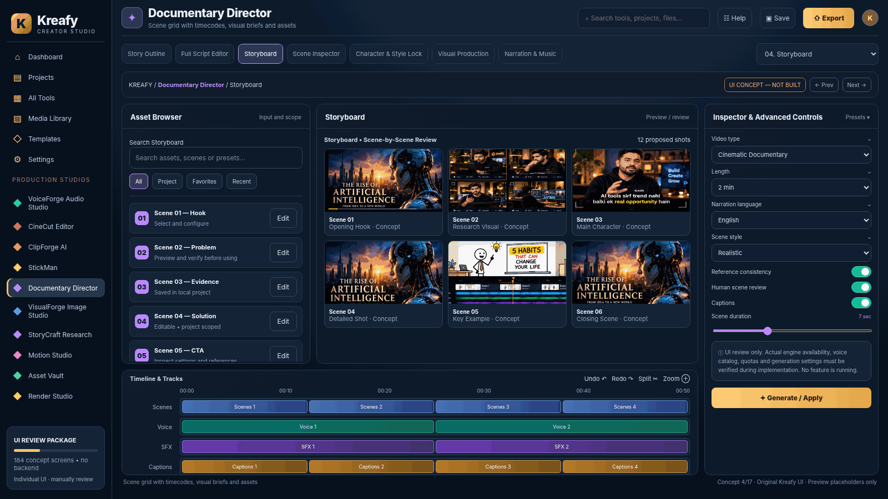](screenshots/04_storyboard.png)

[Full-size PNG](screenshots/04_storyboard.png) · [HTML prototype source](04_storyboard.html) · [Back to all studios](../README.md)

---

### 05. Scene Inspector

[Full-size PNG](screenshots/05_scene-inspector.png) · [HTML prototype source](05_scene-inspector.html) · [Back to all studios](../README.md)

---

### 06. Character Style Lock

[Full-size PNG](screenshots/06_character-style-lock.png) · [HTML prototype source](06_character-style-lock.html) · [Back to all studios](../README.md)

---

### 07. Visual Production

[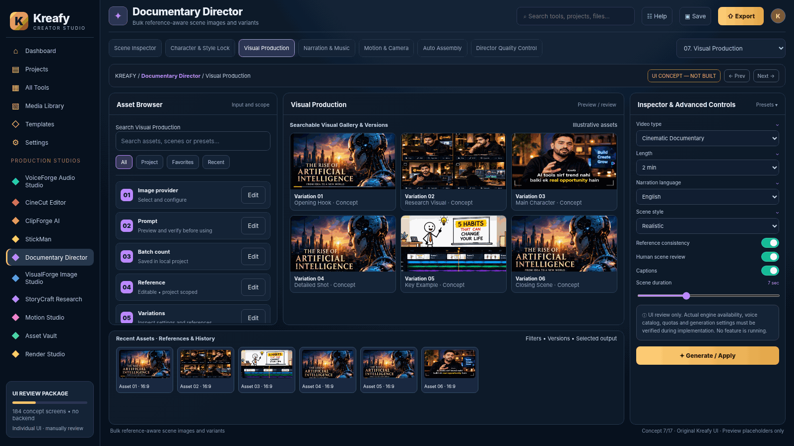](screenshots/07_visual-production.png)

[Full-size PNG](screenshots/07_visual-production.png) · [HTML prototype source](07_visual-production.html) · [Back to all studios](../README.md)

---

### 08. Narration Music

[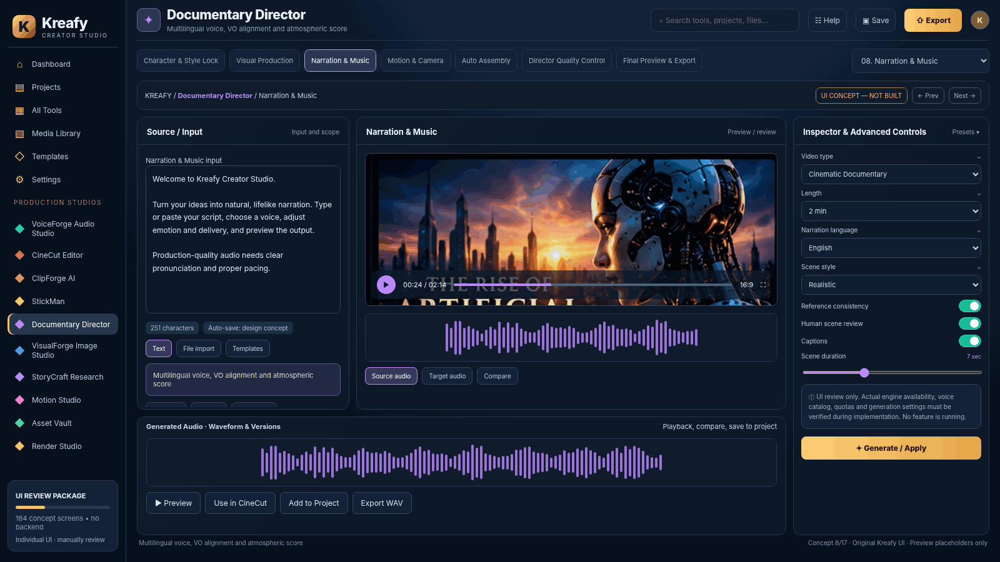](screenshots/08_narration-music.png)

[Full-size PNG](screenshots/08_narration-music.png) · [HTML prototype source](08_narration-music.html) · [Back to all studios](../README.md)

---

### 09. Motion Camera

[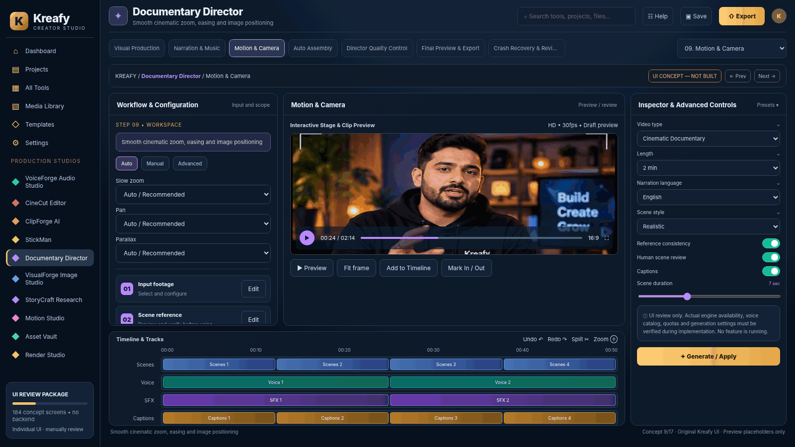](screenshots/09_motion-camera.png)

[Full-size PNG](screenshots/09_motion-camera.png) · [HTML prototype source](09_motion-camera.html) · [Back to all studios](../README.md)

---

### 10. Auto Assembly

[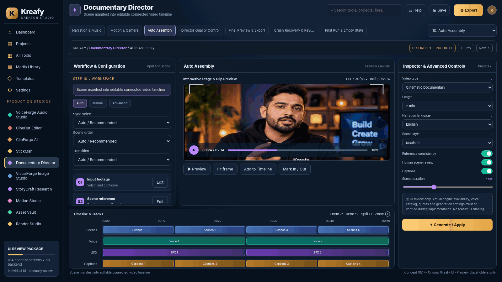](screenshots/10_auto-assembly.png)

[Full-size PNG](screenshots/10_auto-assembly.png) · [HTML prototype source](10_auto-assembly.html) · [Back to all studios](../README.md)

---

### 11. Director Quality Control

[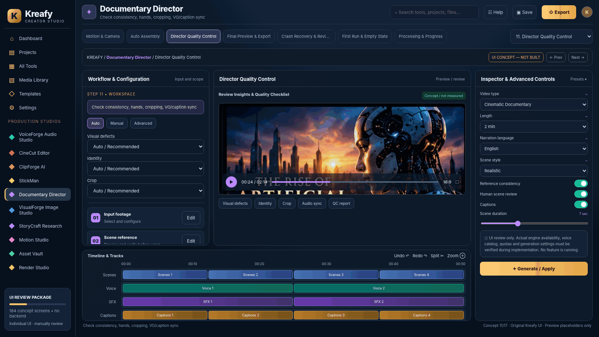](screenshots/11_director-quality-control.png)

[Full-size PNG](screenshots/11_director-quality-control.png) · [HTML prototype source](11_director-quality-control.html) · [Back to all studios](../README.md)

---

### 12. Final Preview Export

[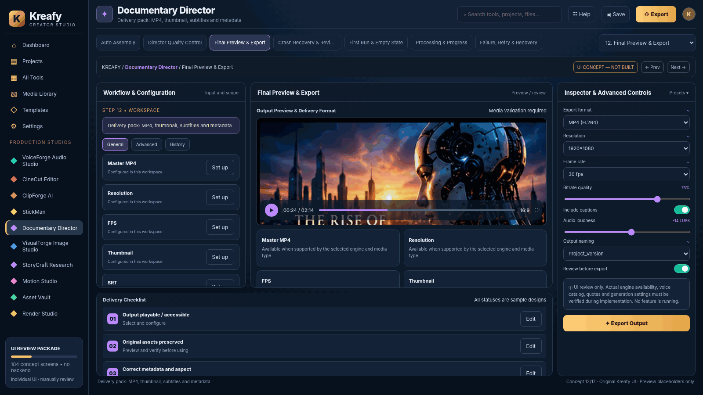](screenshots/12_final-preview-export.png)

[Full-size PNG](screenshots/12_final-preview-export.png) · [HTML prototype source](12_final-preview-export.html) · [Back to all studios](../README.md)

---

### 13. Crash Recovery Revisions

[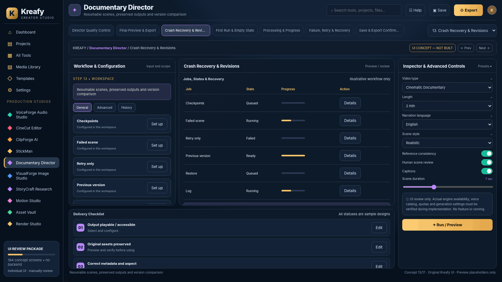](screenshots/13_crash-recovery-revisions.png)

[Full-size PNG](screenshots/13_crash-recovery-revisions.png) · [HTML prototype source](13_crash-recovery-revisions.html) · [Back to all studios](../README.md)

---

### 14. First Run Empty State

[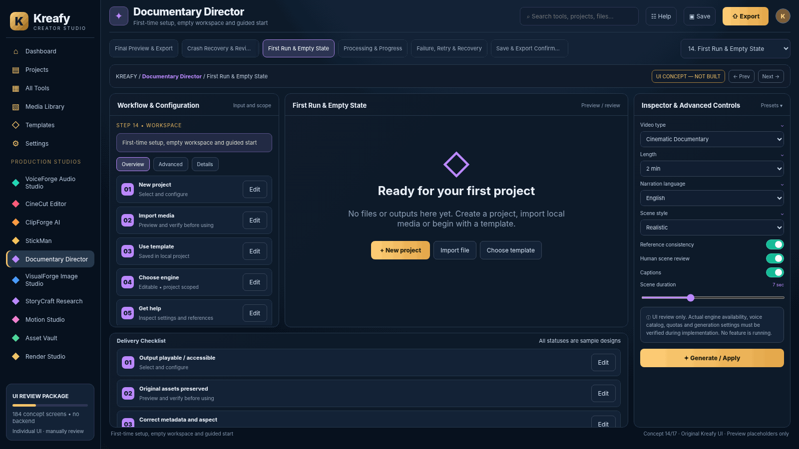](screenshots/14_first-run-empty-state.png)

[Full-size PNG](screenshots/14_first-run-empty-state.png) · [HTML prototype source](14_first-run-empty-state.html) · [Back to all studios](../README.md)

---

### 15. Processing Progress

[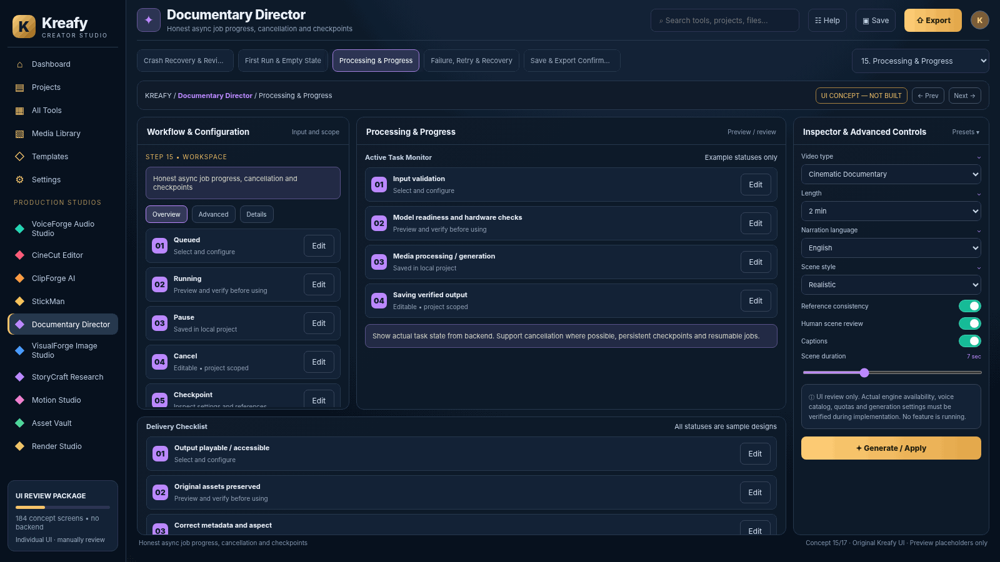](screenshots/15_processing-progress.png)

[Full-size PNG](screenshots/15_processing-progress.png) · [HTML prototype source](15_processing-progress.html) · [Back to all studios](../README.md)

---

### 16. Failure Retry Recovery

[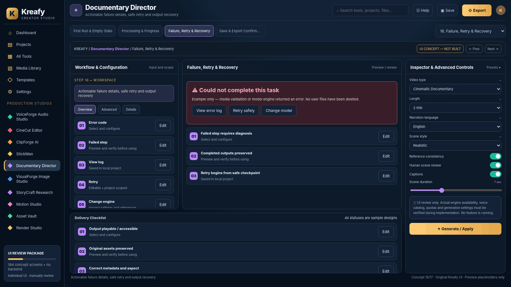](screenshots/16_failure-retry-recovery.png)

[Full-size PNG](screenshots/16_failure-retry-recovery.png) · [HTML prototype source](16_failure-retry-recovery.html) · [Back to all studios](../README.md)

---

### 17. Save Export Confirmation

[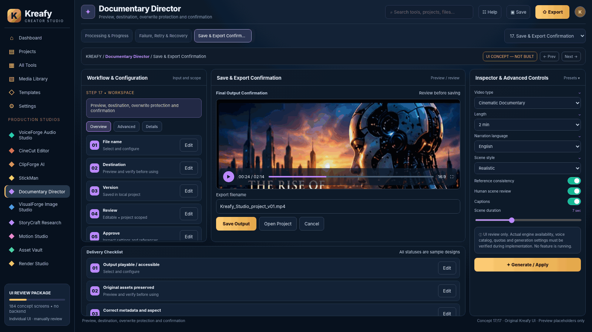](screenshots/17_save-export-confirmation.png)

[Full-size PNG](screenshots/17_save-export-confirmation.png) · [HTML prototype source](17_save-export-confirmation.html) · [Back to all studios](../README.md)

---
