# VisualForge Image Studio

**17 separate screenshot previews.** Click any preview image to see the full-size PNG directly on GitHub.

[← All UI Studios](../README.md) · [Interaction specification](UI_INTERACTION_SPEC.md) · [Complete screen inventory](ALL_SCREENS.md) · [Open offline HTML package on Google Drive](https://drive.google.com/file/d/1el4TFos8ai705Ch40GtNtfPCd4qAsgCx/view?usp=drivesdk)

**Status:** Visual design baseline for implementation planning; this is not working product UI. HTML prototypes are for offline/local preview; GitHub displays screenshots and source, not a live app.

---

### 01. Text To Image

[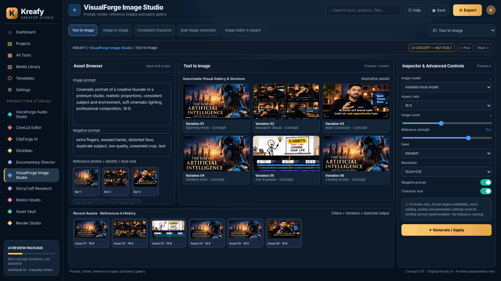](screenshots/01_text-to-image.png)

[Full-size PNG](screenshots/01_text-to-image.png) · [HTML prototype source](01_text-to-image.html) · [Back to all studios](../README.md)

---

### 02. Image To Image

[Full-size PNG](screenshots/02_image-to-image.png) · [HTML prototype source](02_image-to-image.html) · [Back to all studios](../README.md)

---

### 03. Consistent Character

[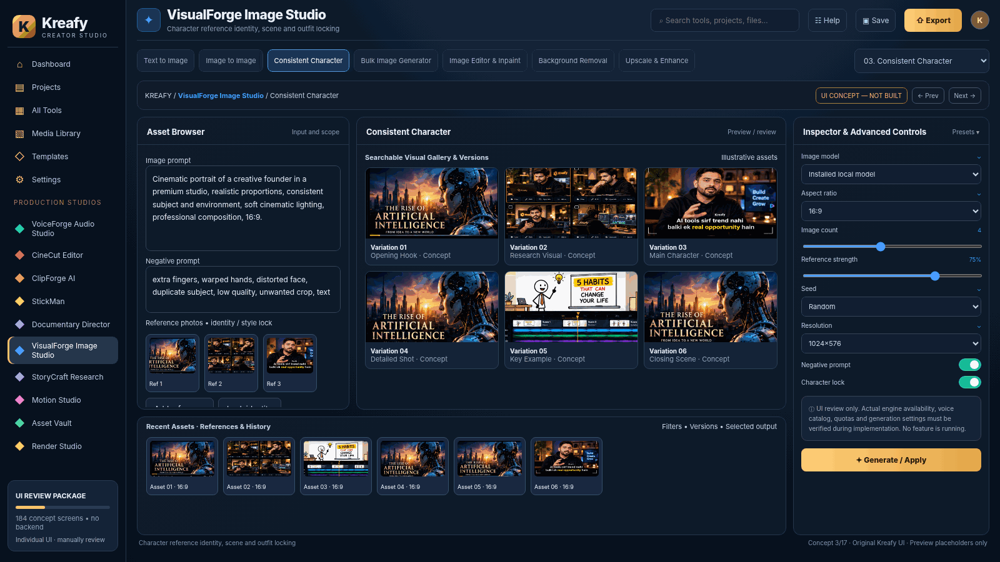](screenshots/03_consistent-character.png)

[Full-size PNG](screenshots/03_consistent-character.png) · [HTML prototype source](03_consistent-character.html) · [Back to all studios](../README.md)

---

### 04. Bulk Image Generator

[Full-size PNG](screenshots/04_bulk-image-generator.png) · [HTML prototype source](04_bulk-image-generator.html) · [Back to all studios](../README.md)

---

### 05. Image Editor Inpaint

[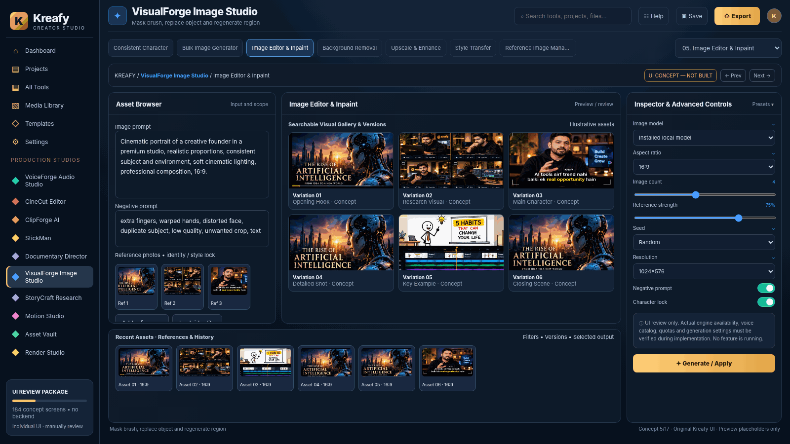](screenshots/05_image-editor-inpaint.png)

[Full-size PNG](screenshots/05_image-editor-inpaint.png) · [HTML prototype source](05_image-editor-inpaint.html) · [Back to all studios](../README.md)

---

### 06. Background Removal

[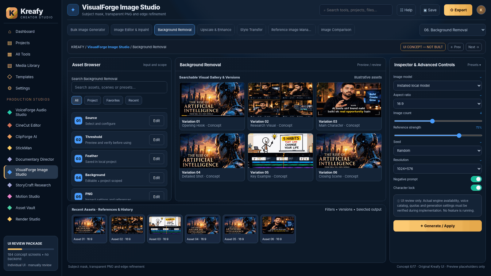](screenshots/06_background-removal.png)

[Full-size PNG](screenshots/06_background-removal.png) · [HTML prototype source](06_background-removal.html) · [Back to all studios](../README.md)

---

### 07. Upscale Enhance

[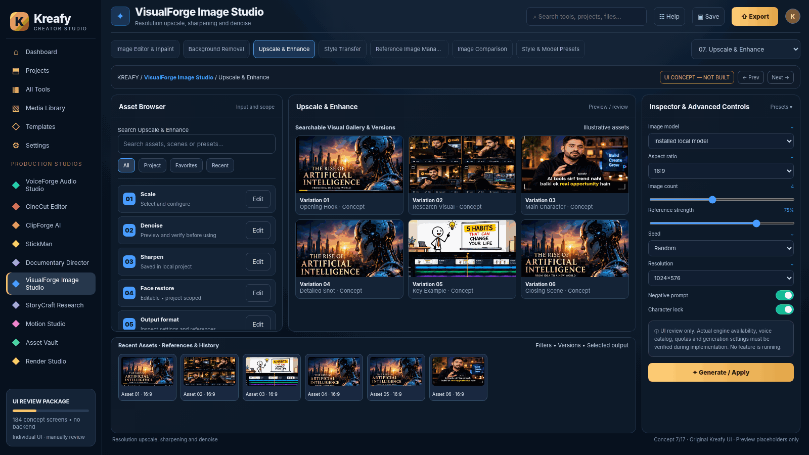](screenshots/07_upscale-enhance.png)

[Full-size PNG](screenshots/07_upscale-enhance.png) · [HTML prototype source](07_upscale-enhance.html) · [Back to all studios](../README.md)

---

### 08. Style Transfer

[Full-size PNG](screenshots/08_style-transfer.png) · [HTML prototype source](08_style-transfer.html) · [Back to all studios](../README.md)

---

### 09. Reference Image Manager

[Full-size PNG](screenshots/09_reference-image-manager.png) · [HTML prototype source](09_reference-image-manager.html) · [Back to all studios](../README.md)

---

### 10. Image Comparison

[Full-size PNG](screenshots/10_image-comparison.png) · [HTML prototype source](10_image-comparison.html) · [Back to all studios](../README.md)

---

### 11. Style Model Presets

[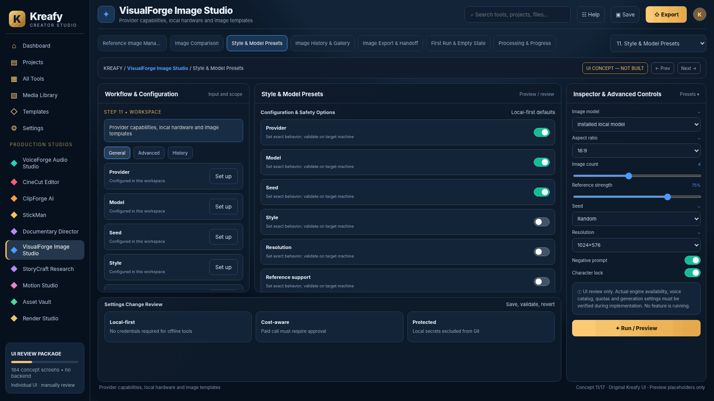](screenshots/11_style-model-presets.png)

[Full-size PNG](screenshots/11_style-model-presets.png) · [HTML prototype source](11_style-model-presets.html) · [Back to all studios](../README.md)

---

### 12. Image History Gallery

[Full-size PNG](screenshots/12_image-history-gallery.png) · [HTML prototype source](12_image-history-gallery.html) · [Back to all studios](../README.md)

---

### 13. Image Export Handoff

[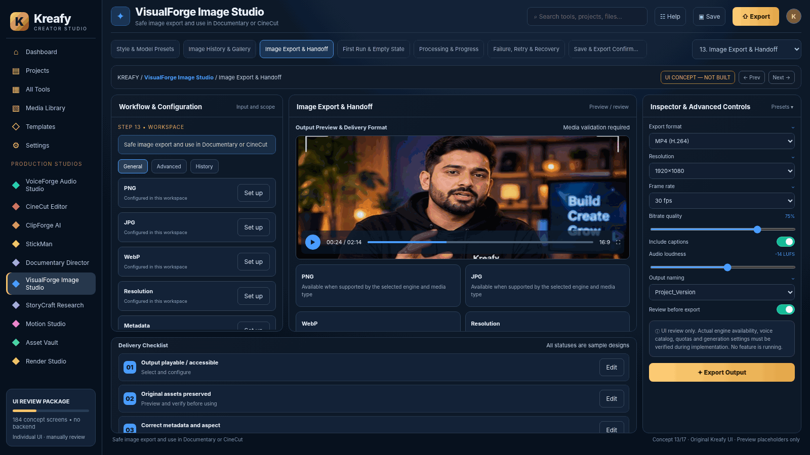](screenshots/13_image-export-handoff.png)

[Full-size PNG](screenshots/13_image-export-handoff.png) · [HTML prototype source](13_image-export-handoff.html) · [Back to all studios](../README.md)

---

### 14. First Run Empty State

[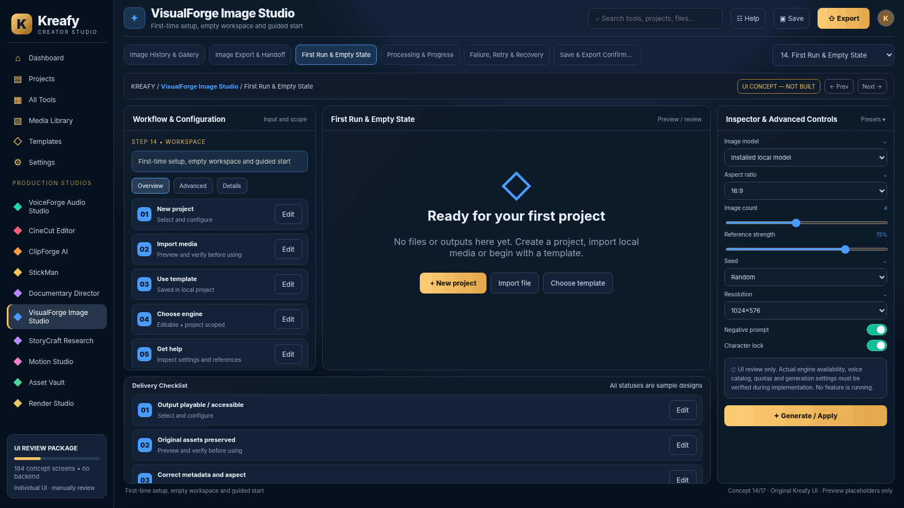](screenshots/14_first-run-empty-state.png)

[Full-size PNG](screenshots/14_first-run-empty-state.png) · [HTML prototype source](14_first-run-empty-state.html) · [Back to all studios](../README.md)

---

### 15. Processing Progress

[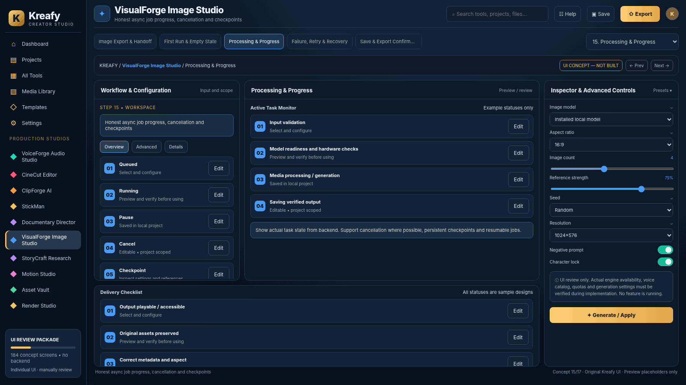](screenshots/15_processing-progress.png)

[Full-size PNG](screenshots/15_processing-progress.png) · [HTML prototype source](15_processing-progress.html) · [Back to all studios](../README.md)

---

### 16. Failure Retry Recovery

[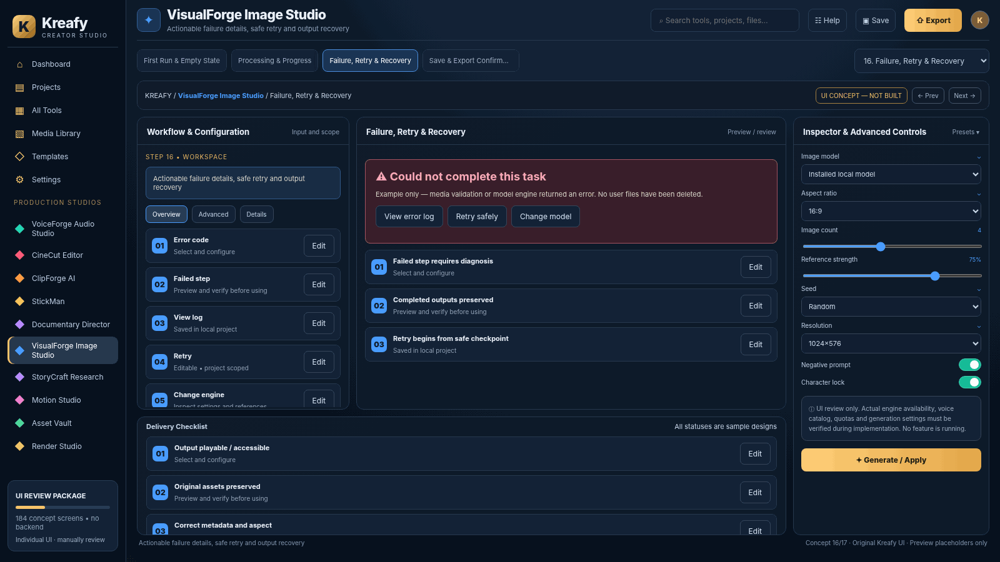](screenshots/16_failure-retry-recovery.png)

[Full-size PNG](screenshots/16_failure-retry-recovery.png) · [HTML prototype source](16_failure-retry-recovery.html) · [Back to all studios](../README.md)

---

### 17. Save Export Confirmation

[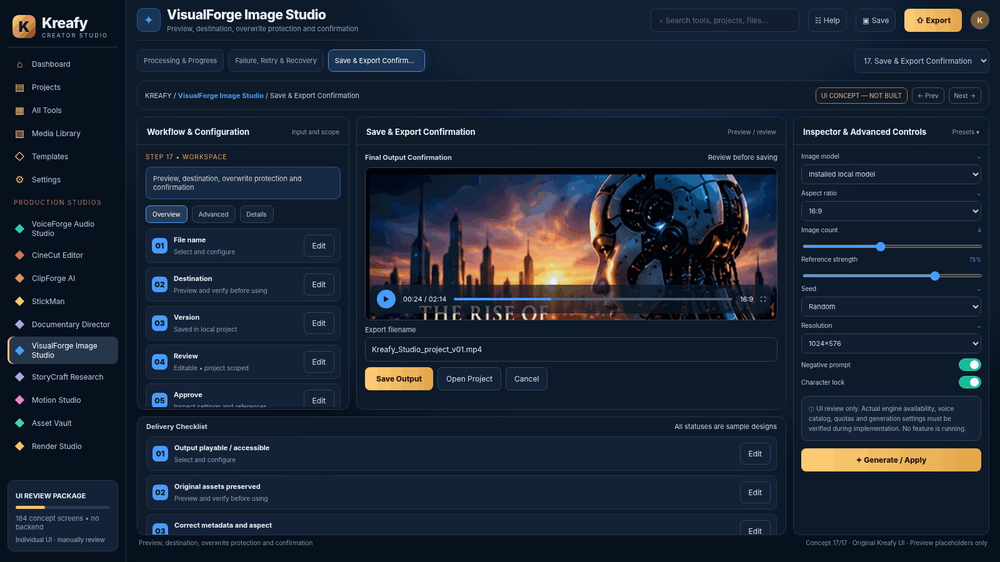](screenshots/17_save-export-confirmation.png)

[Full-size PNG](screenshots/17_save-export-confirmation.png) · [HTML prototype source](17_save-export-confirmation.html) · [Back to all studios](../README.md)

---
