# StoryCraft Research & Writing

**15 separate screenshot previews.** Click any preview image to see the full-size PNG directly on GitHub.

[← All UI Studios](../README.md) · [Interaction specification](UI_INTERACTION_SPEC.md) · [Complete screen inventory](ALL_SCREENS.md) · [Open offline HTML package on Google Drive](https://drive.google.com/file/d/1el4TFos8ai705Ch40GtNtfPCd4qAsgCx/view?usp=drivesdk)

**Status:** Visual design baseline for implementation planning; this is not working product UI. HTML prototypes are for offline/local preview; GitHub displays screenshots and source, not a live app.

---

### 01. Topic Research

[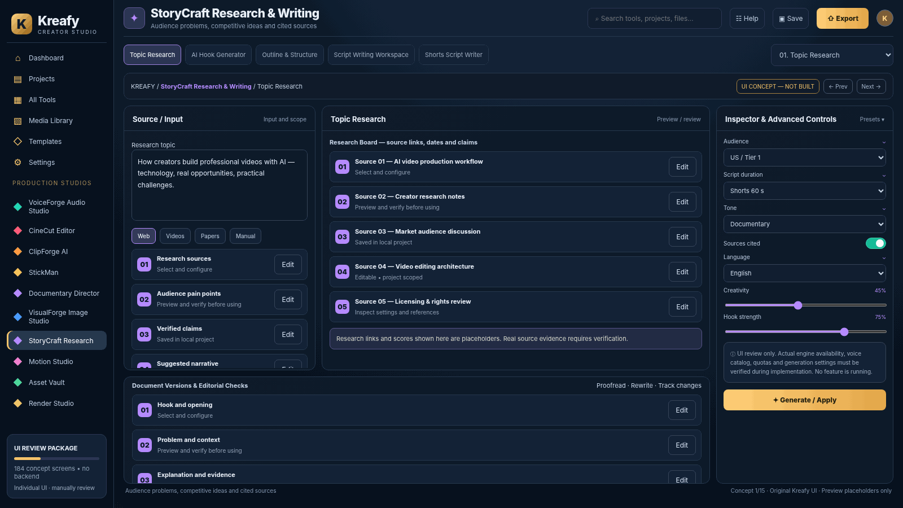](screenshots/01_topic-research.png)

[Full-size PNG](screenshots/01_topic-research.png) · [HTML prototype source](01_topic-research.html) · [Back to all studios](../README.md)

---

### 02. Ai Hook Generator

[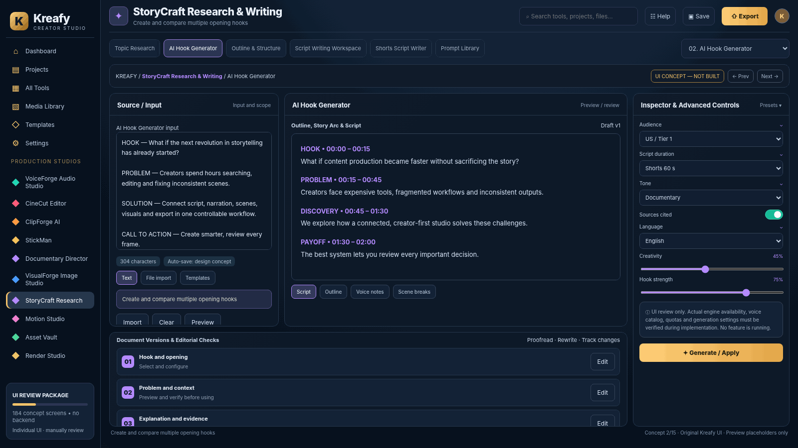](screenshots/02_ai-hook-generator.png)

[Full-size PNG](screenshots/02_ai-hook-generator.png) · [HTML prototype source](02_ai-hook-generator.html) · [Back to all studios](../README.md)

---

### 03. Outline Structure

[Full-size PNG](screenshots/03_outline-structure.png) · [HTML prototype source](03_outline-structure.html) · [Back to all studios](../README.md)

---

### 04. Script Writing Workspace

[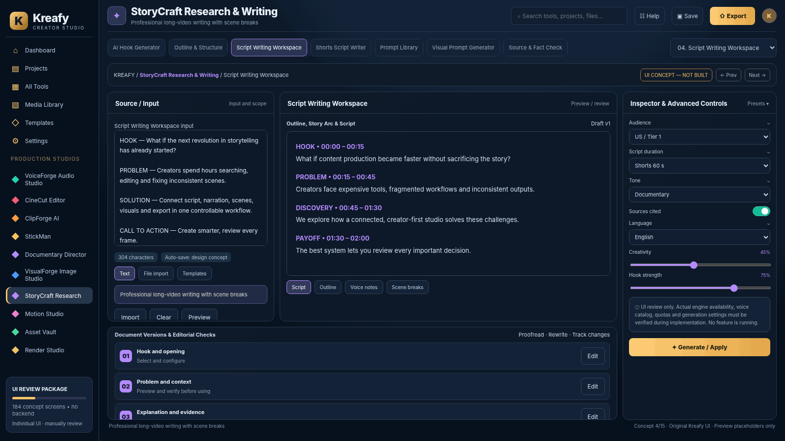](screenshots/04_script-writing-workspace.png)

[Full-size PNG](screenshots/04_script-writing-workspace.png) · [HTML prototype source](04_script-writing-workspace.html) · [Back to all studios](../README.md)

---

### 05. Shorts Script Writer

[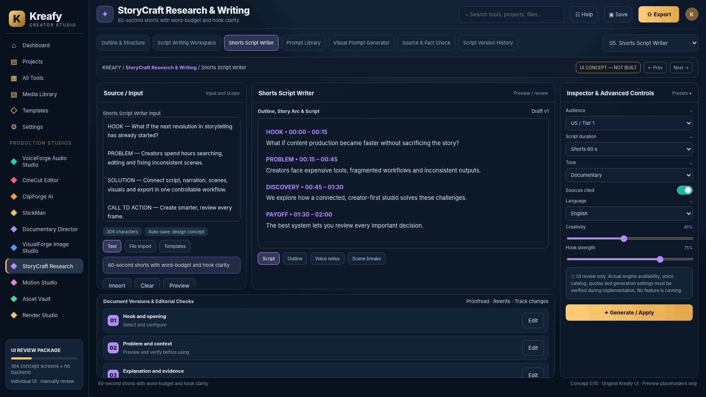](screenshots/05_shorts-script-writer.png)

[Full-size PNG](screenshots/05_shorts-script-writer.png) · [HTML prototype source](05_shorts-script-writer.html) · [Back to all studios](../README.md)

---

### 06. Prompt Library

[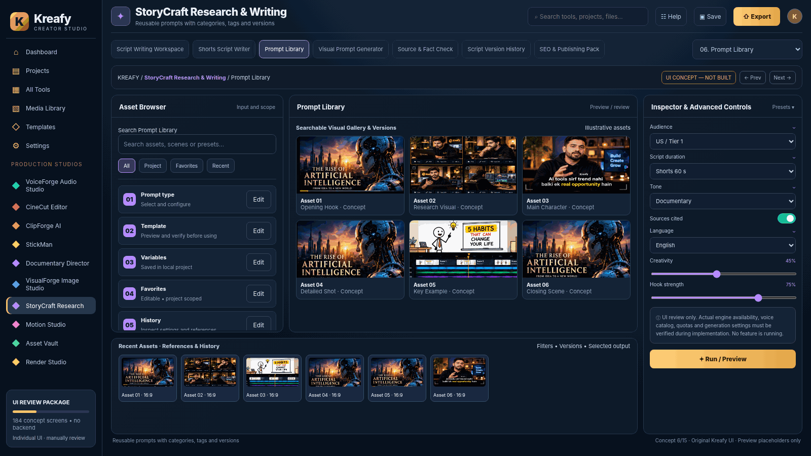](screenshots/06_prompt-library.png)

[Full-size PNG](screenshots/06_prompt-library.png) · [HTML prototype source](06_prompt-library.html) · [Back to all studios](../README.md)

---

### 07. Visual Prompt Generator

[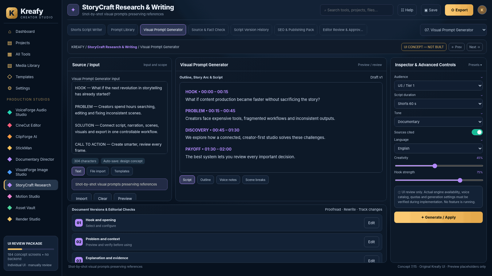](screenshots/07_visual-prompt-generator.png)

[Full-size PNG](screenshots/07_visual-prompt-generator.png) · [HTML prototype source](07_visual-prompt-generator.html) · [Back to all studios](../README.md)

---

### 08. Source Fact Check

[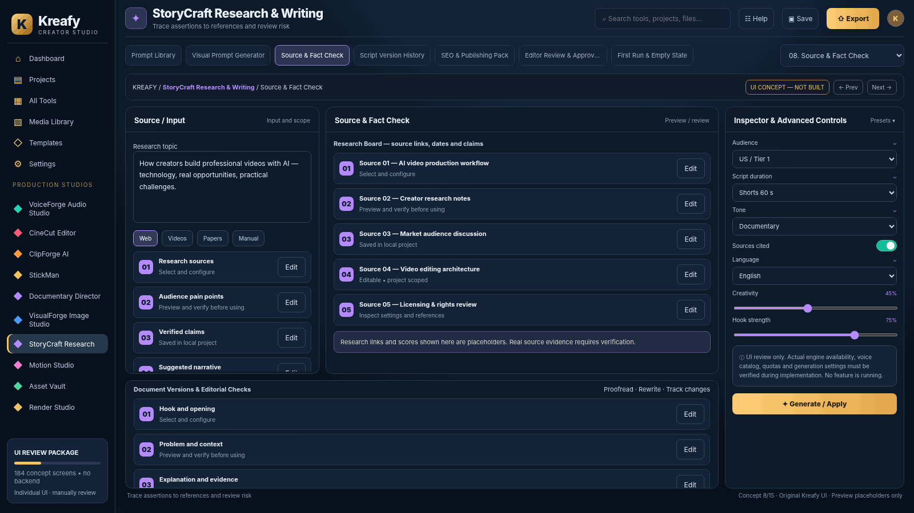](screenshots/08_source-fact-check.png)

[Full-size PNG](screenshots/08_source-fact-check.png) · [HTML prototype source](08_source-fact-check.html) · [Back to all studios](../README.md)

---

### 09. Script Version History

[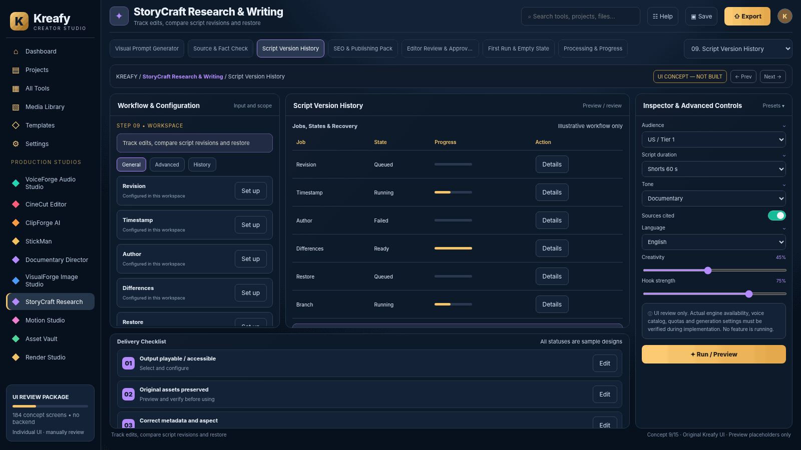](screenshots/09_script-version-history.png)

[Full-size PNG](screenshots/09_script-version-history.png) · [HTML prototype source](09_script-version-history.html) · [Back to all studios](../README.md)

---

### 10. Seo Publishing Pack

[Full-size PNG](screenshots/10_seo-publishing-pack.png) · [HTML prototype source](10_seo-publishing-pack.html) · [Back to all studios](../README.md)

---

### 11. Editor Review Approvals

[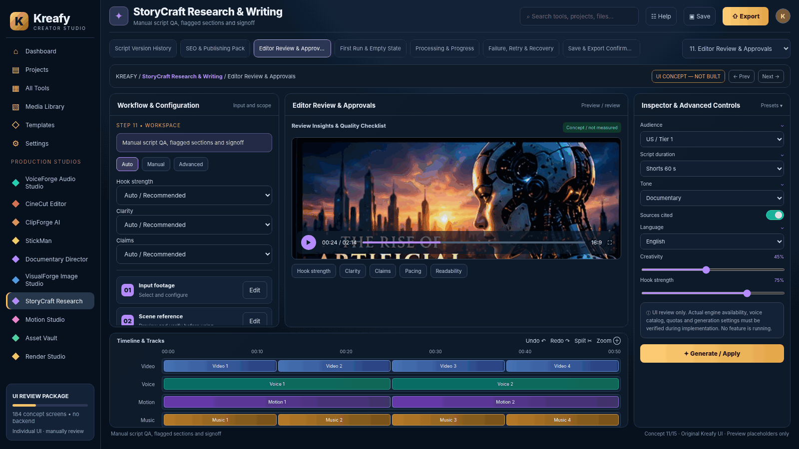](screenshots/11_editor-review-approvals.png)

[Full-size PNG](screenshots/11_editor-review-approvals.png) · [HTML prototype source](11_editor-review-approvals.html) · [Back to all studios](../README.md)

---

### 12. First Run Empty State

[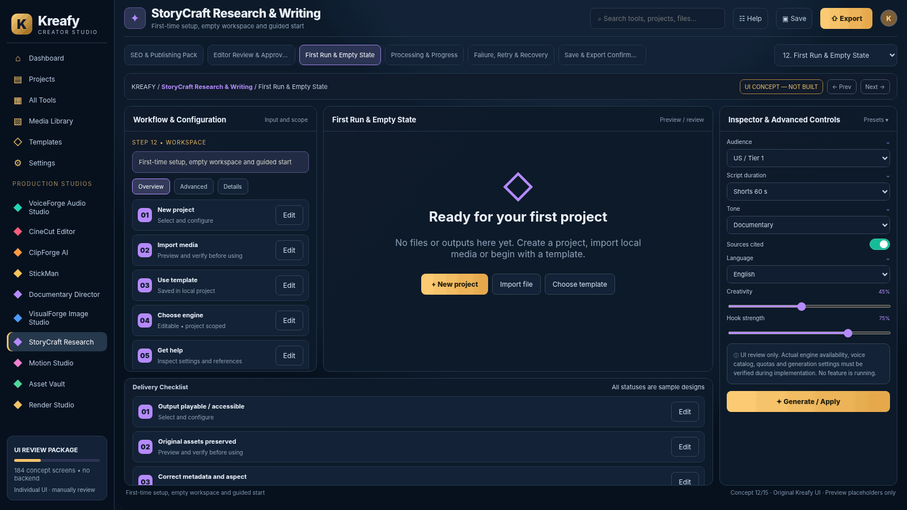](screenshots/12_first-run-empty-state.png)

[Full-size PNG](screenshots/12_first-run-empty-state.png) · [HTML prototype source](12_first-run-empty-state.html) · [Back to all studios](../README.md)

---

### 13. Processing Progress

[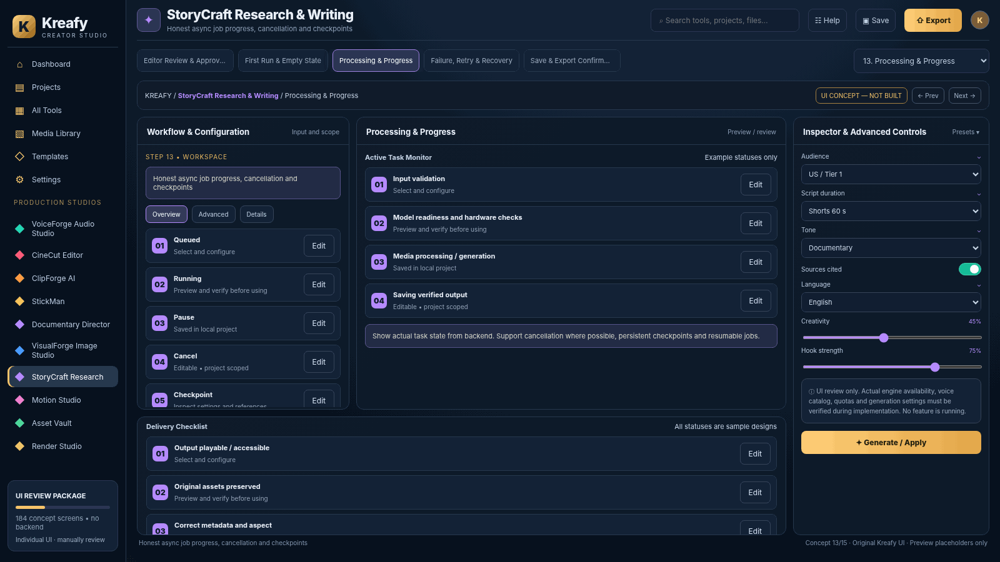](screenshots/13_processing-progress.png)

[Full-size PNG](screenshots/13_processing-progress.png) · [HTML prototype source](13_processing-progress.html) · [Back to all studios](../README.md)

---

### 14. Failure Retry Recovery

[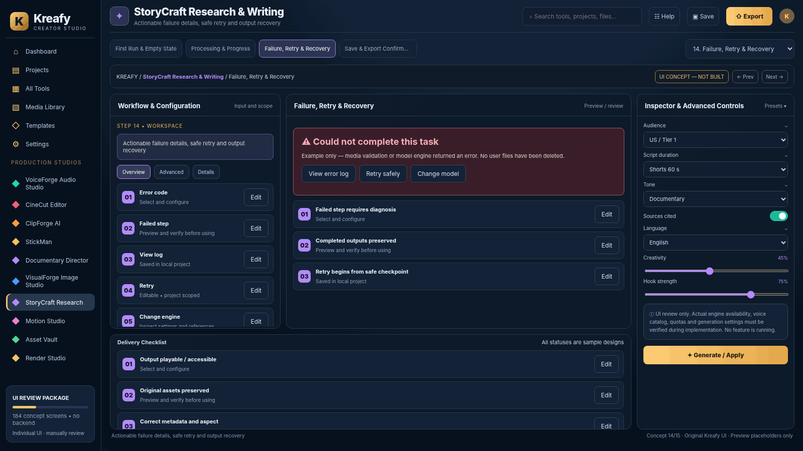](screenshots/14_failure-retry-recovery.png)

[Full-size PNG](screenshots/14_failure-retry-recovery.png) · [HTML prototype source](14_failure-retry-recovery.html) · [Back to all studios](../README.md)

---

### 15. Save Export Confirmation

[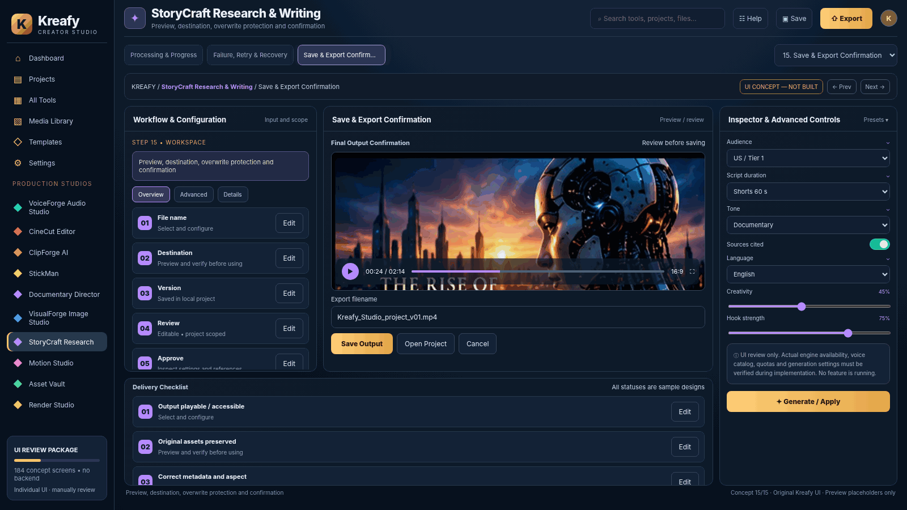](screenshots/15_save-export-confirmation.png)

[Full-size PNG](screenshots/15_save-export-confirmation.png) · [HTML prototype source](15_save-export-confirmation.html) · [Back to all studios](../README.md)

---
