# Motion Studio

**13 separate screenshot previews.** Click any preview image to see the full-size PNG directly on GitHub.

[← All UI Studios](../README.md) · [Interaction specification](UI_INTERACTION_SPEC.md) · [Complete screen inventory](ALL_SCREENS.md) · [Open offline HTML package on Google Drive](https://drive.google.com/file/d/1el4TFos8ai705Ch40GtNtfPCd4qAsgCx/view?usp=drivesdk)

**Status:** Visual design baseline for implementation planning; this is not working product UI. HTML prototypes are for offline/local preview; GitHub displays screenshots and source, not a live app.

---

### 01. Image To Video

[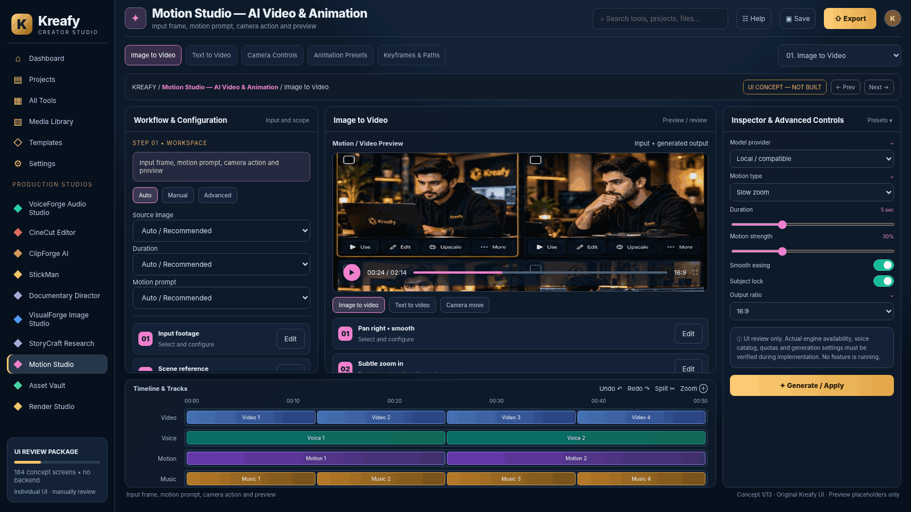](screenshots/01_image-to-video.png)

[Full-size PNG](screenshots/01_image-to-video.png) · [HTML prototype source](01_image-to-video.html) · [Back to all studios](../README.md)

---

### 02. Text To Video

[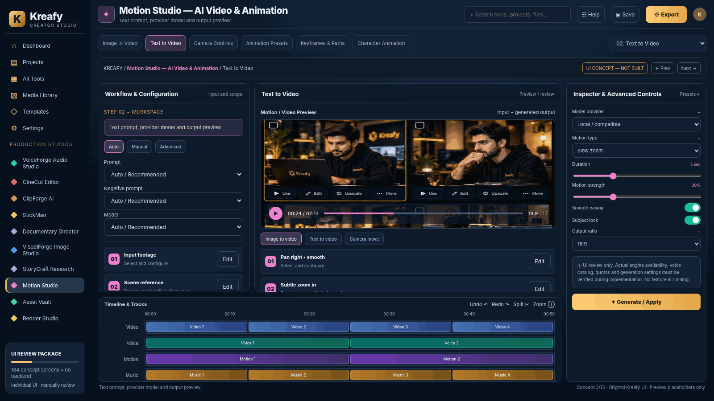](screenshots/02_text-to-video.png)

[Full-size PNG](screenshots/02_text-to-video.png) · [HTML prototype source](02_text-to-video.html) · [Back to all studios](../README.md)

---

### 03. Camera Controls

[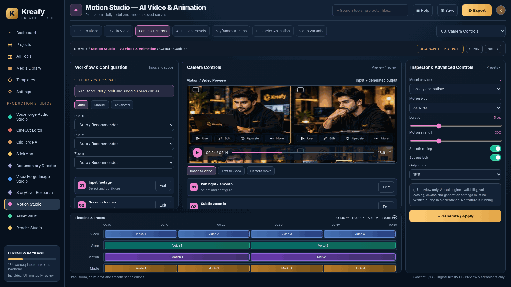](screenshots/03_camera-controls.png)

[Full-size PNG](screenshots/03_camera-controls.png) · [HTML prototype source](03_camera-controls.html) · [Back to all studios](../README.md)

---

### 04. Animation Presets

[Full-size PNG](screenshots/04_animation-presets.png) · [HTML prototype source](04_animation-presets.html) · [Back to all studios](../README.md)

---

### 05. Keyframes Paths

[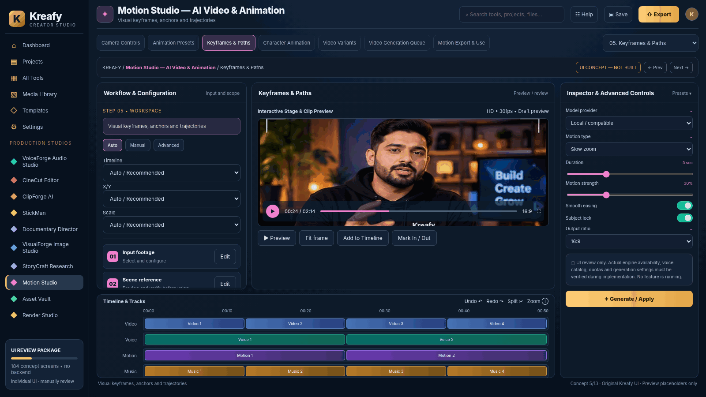](screenshots/05_keyframes-paths.png)

[Full-size PNG](screenshots/05_keyframes-paths.png) · [HTML prototype source](05_keyframes-paths.html) · [Back to all studios](../README.md)

---

### 06. Character Animation

[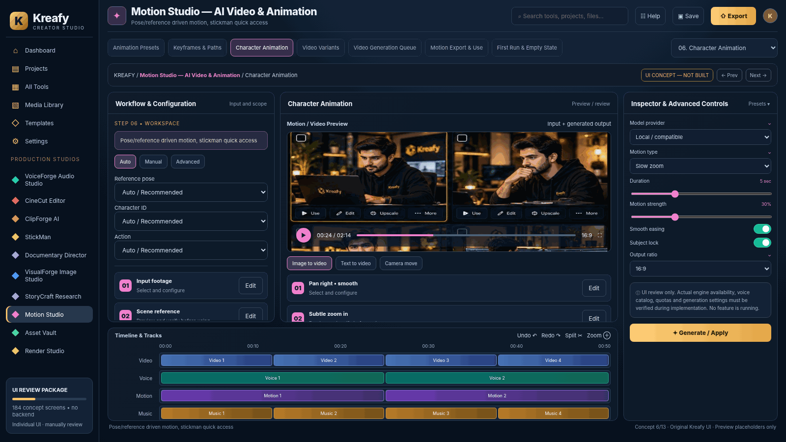](screenshots/06_character-animation.png)

[Full-size PNG](screenshots/06_character-animation.png) · [HTML prototype source](06_character-animation.html) · [Back to all studios](../README.md)

---

### 07. Video Variants

[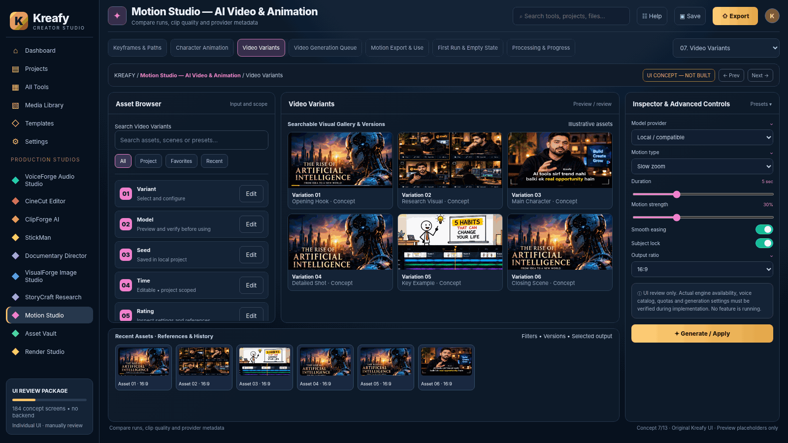](screenshots/07_video-variants.png)

[Full-size PNG](screenshots/07_video-variants.png) · [HTML prototype source](07_video-variants.html) · [Back to all studios](../README.md)

---

### 08. Video Generation Queue

[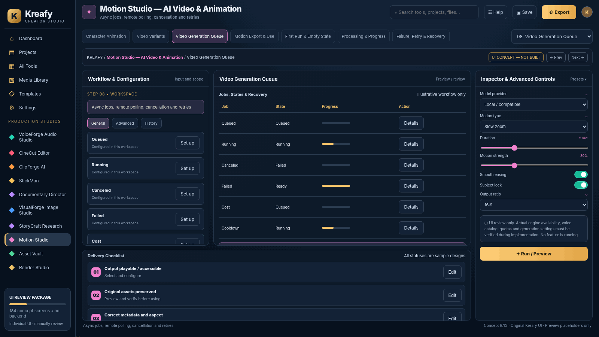](screenshots/08_video-generation-queue.png)

[Full-size PNG](screenshots/08_video-generation-queue.png) · [HTML prototype source](08_video-generation-queue.html) · [Back to all studios](../README.md)

---

### 09. Motion Export Use

[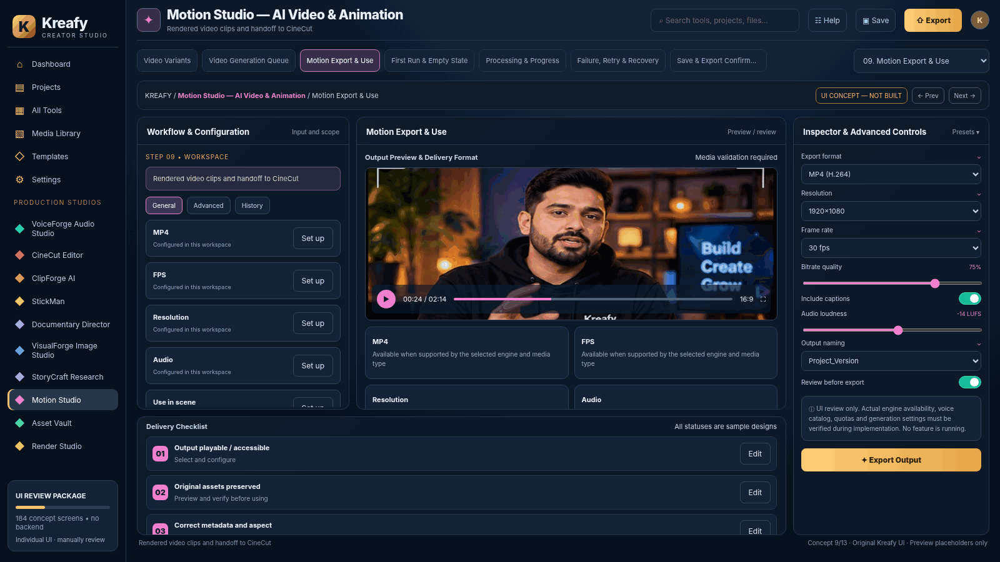](screenshots/09_motion-export-use.png)

[Full-size PNG](screenshots/09_motion-export-use.png) · [HTML prototype source](09_motion-export-use.html) · [Back to all studios](../README.md)

---

### 10. First Run Empty State

[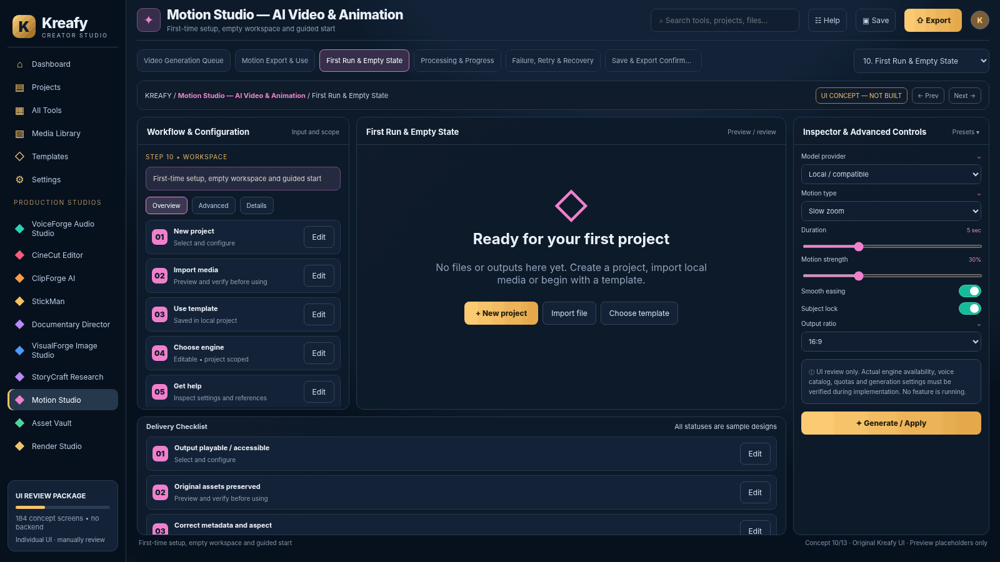](screenshots/10_first-run-empty-state.png)

[Full-size PNG](screenshots/10_first-run-empty-state.png) · [HTML prototype source](10_first-run-empty-state.html) · [Back to all studios](../README.md)

---

### 11. Processing Progress

[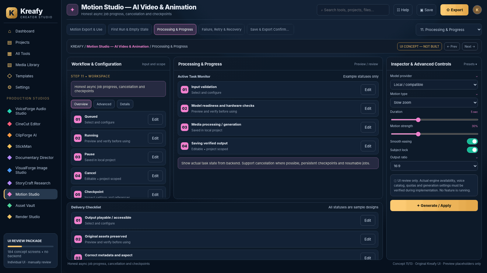](screenshots/11_processing-progress.png)

[Full-size PNG](screenshots/11_processing-progress.png) · [HTML prototype source](11_processing-progress.html) · [Back to all studios](../README.md)

---

### 12. Failure Retry Recovery

[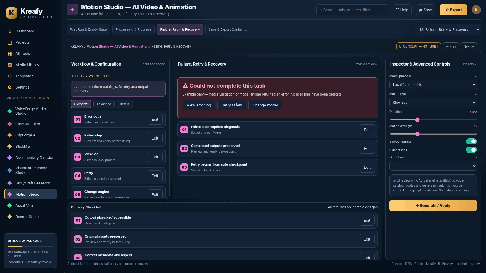](screenshots/12_failure-retry-recovery.png)

[Full-size PNG](screenshots/12_failure-retry-recovery.png) · [HTML prototype source](12_failure-retry-recovery.html) · [Back to all studios](../README.md)

---

### 13. Save Export Confirmation

[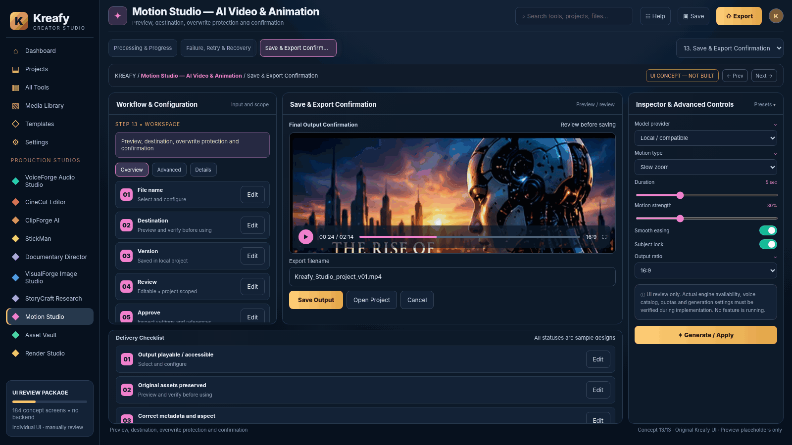](screenshots/13_save-export-confirmation.png)

[Full-size PNG](screenshots/13_save-export-confirmation.png) · [HTML prototype source](13_save-export-confirmation.html) · [Back to all studios](../README.md)

---
