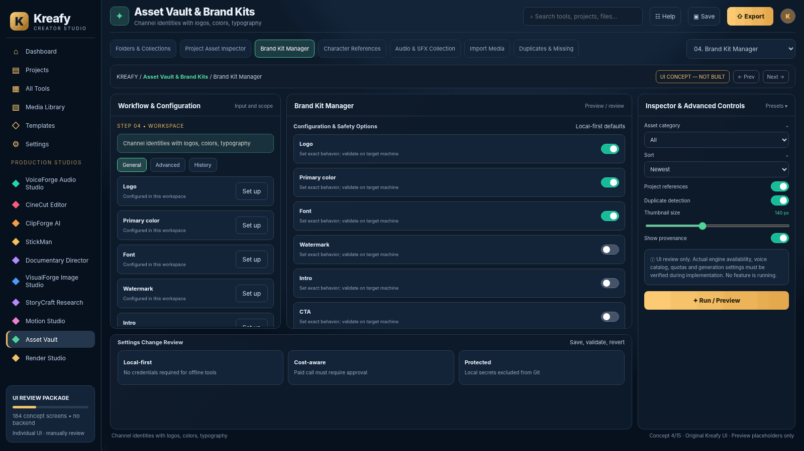
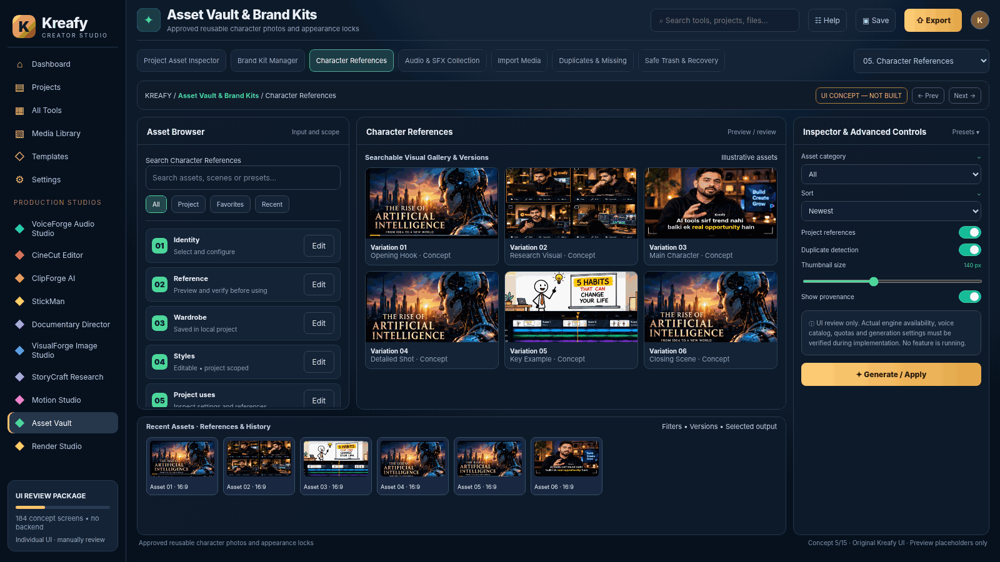
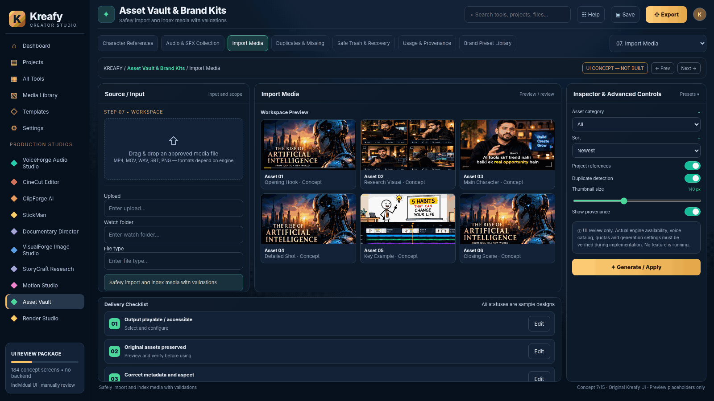
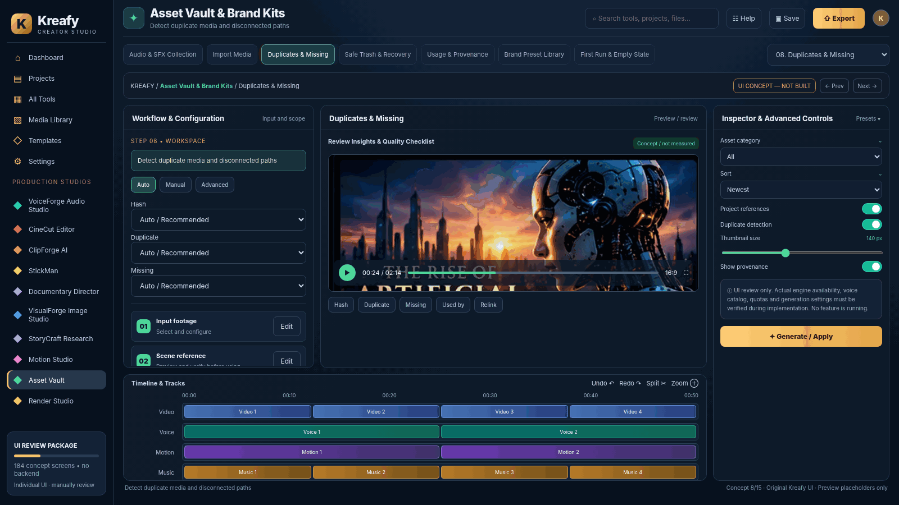
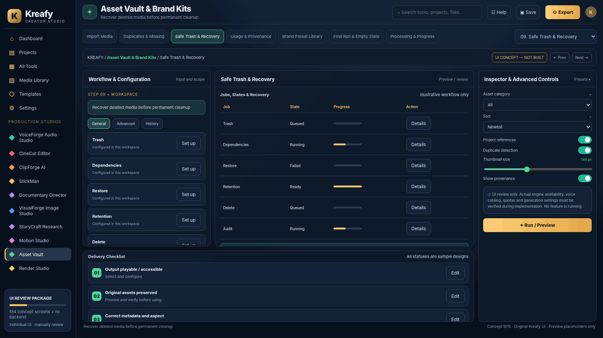
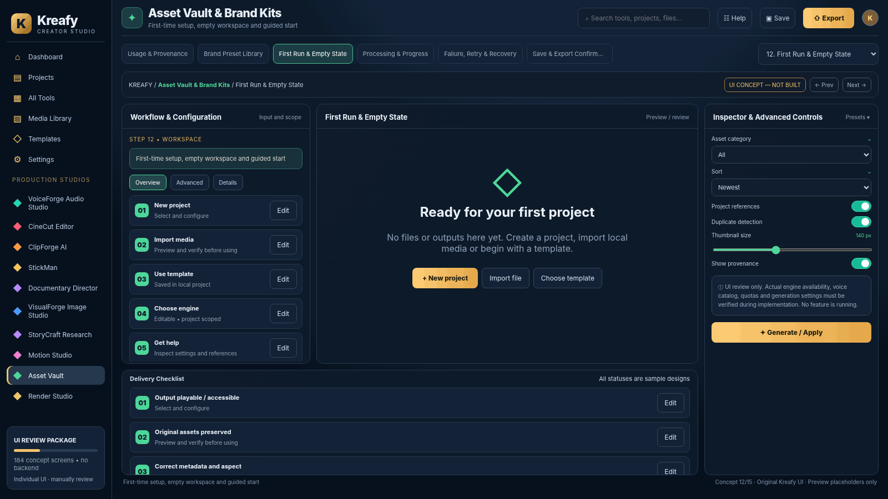
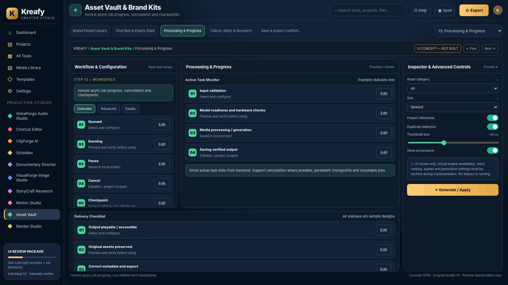
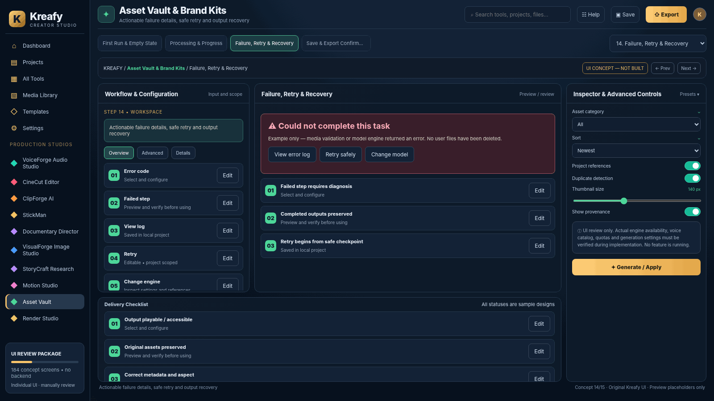
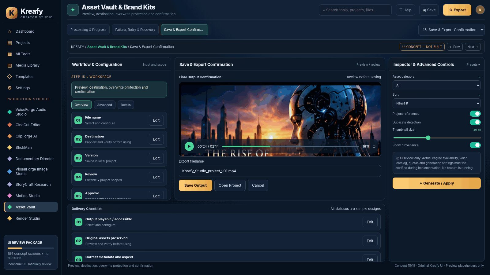

# Asset Vault & Brand Kits

**15 separate screenshot previews.** Click any preview image to see the full-size PNG directly on GitHub.

[← All UI Studios](../README.md) · [Interaction specification](UI_INTERACTION_SPEC.md) · [Complete screen inventory](ALL_SCREENS.md) · [Open offline HTML package on Google Drive](https://drive.google.com/file/d/1el4TFos8ai705Ch40GtNtfPCd4qAsgCx/view?usp=drivesdk)

**Status:** Visual design baseline for implementation planning; this is not working product UI. HTML prototypes are for offline/local preview; GitHub displays screenshots and source, not a live app.

---

### 01. All Assets

[Full-size PNG](screenshots/01_all-assets.png) · [HTML prototype source](01_all-assets.html) · [Back to all studios](../README.md)

---

### 02. Folders Collections

[Full-size PNG](screenshots/02_folders-collections.png) · [HTML prototype source](02_folders-collections.html) · [Back to all studios](../README.md)

---

### 03. Project Asset Inspector

[Full-size PNG](screenshots/03_project-asset-inspector.png) · [HTML prototype source](03_project-asset-inspector.html) · [Back to all studios](../README.md)

---

### 04. Brand Kit Manager

[Full-size PNG](screenshots/04_brand-kit-manager.png) · [HTML prototype source](04_brand-kit-manager.html) · [Back to all studios](../README.md)

---

### 05. Character References

[Full-size PNG](screenshots/05_character-references.png) · [HTML prototype source](05_character-references.html) · [Back to all studios](../README.md)

---

### 06. Audio Sfx Collection

[Full-size PNG](screenshots/06_audio-sfx-collection.png) · [HTML prototype source](06_audio-sfx-collection.html) · [Back to all studios](../README.md)

---

### 07. Import Media

[Full-size PNG](screenshots/07_import-media.png) · [HTML prototype source](07_import-media.html) · [Back to all studios](../README.md)

---

### 08. Duplicates Missing

[Full-size PNG](screenshots/08_duplicates-missing.png) · [HTML prototype source](08_duplicates-missing.html) · [Back to all studios](../README.md)

---

### 09. Safe Trash Recovery

[Full-size PNG](screenshots/09_safe-trash-recovery.png) · [HTML prototype source](09_safe-trash-recovery.html) · [Back to all studios](../README.md)

---

### 10. Usage Provenance

[Full-size PNG](screenshots/10_usage-provenance.png) · [HTML prototype source](10_usage-provenance.html) · [Back to all studios](../README.md)

---

### 11. Brand Preset Library

[Full-size PNG](screenshots/11_brand-preset-library.png) · [HTML prototype source](11_brand-preset-library.html) · [Back to all studios](../README.md)

---

### 12. First Run Empty State

[Full-size PNG](screenshots/12_first-run-empty-state.png) · [HTML prototype source](12_first-run-empty-state.html) · [Back to all studios](../README.md)

---

### 13. Processing Progress

[Full-size PNG](screenshots/13_processing-progress.png) · [HTML prototype source](13_processing-progress.html) · [Back to all studios](../README.md)

---

### 14. Failure Retry Recovery

[Full-size PNG](screenshots/14_failure-retry-recovery.png) · [HTML prototype source](14_failure-retry-recovery.html) · [Back to all studios](../README.md)

---

### 15. Save Export Confirmation

[Full-size PNG](screenshots/15_save-export-confirmation.png) · [HTML prototype source](15_save-export-confirmation.html) · [Back to all studios](../README.md)

---
