# Render Studio & Export

**15 separate screenshot previews.** Click any preview image to see the full-size PNG directly on GitHub.

[← All UI Studios](../README.md) · [Interaction specification](UI_INTERACTION_SPEC.md) · [Complete screen inventory](ALL_SCREENS.md) · [Open offline HTML package on Google Drive](https://drive.google.com/file/d/1el4TFos8ai705Ch40GtNtfPCd4qAsgCx/view?usp=drivesdk)

**Status:** Visual design baseline for implementation planning; this is not working product UI. HTML prototypes are for offline/local preview; GitHub displays screenshots and source, not a live app.

---

### 01. Export Setup

[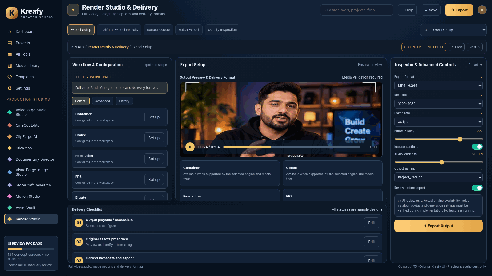](screenshots/01_export-setup.png)

[Full-size PNG](screenshots/01_export-setup.png) · [HTML prototype source](01_export-setup.html) · [Back to all studios](../README.md)

---

### 02. Platform Export Presets

[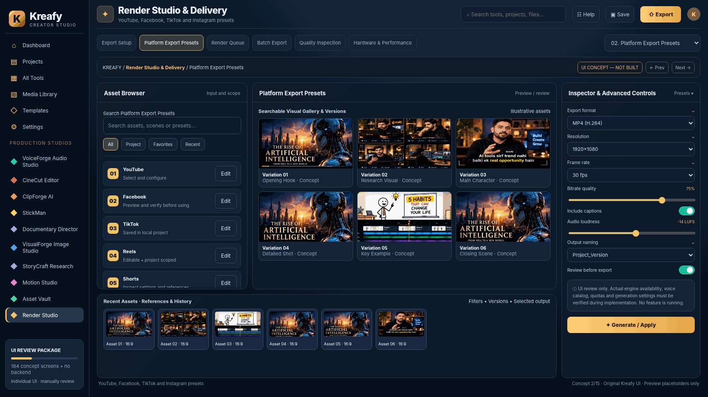](screenshots/02_platform-export-presets.png)

[Full-size PNG](screenshots/02_platform-export-presets.png) · [HTML prototype source](02_platform-export-presets.html) · [Back to all studios](../README.md)

---

### 03. Render Queue

[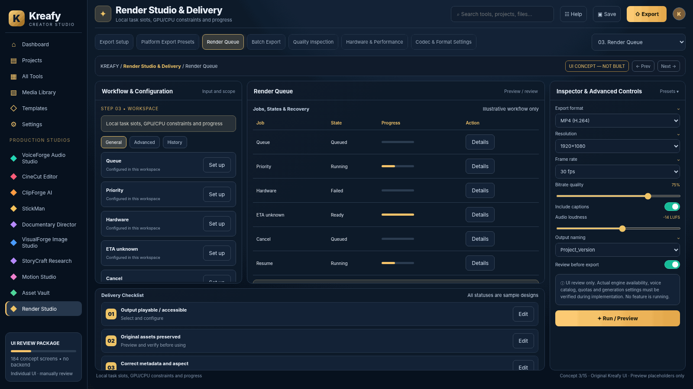](screenshots/03_render-queue.png)

[Full-size PNG](screenshots/03_render-queue.png) · [HTML prototype source](03_render-queue.html) · [Back to all studios](../README.md)

---

### 04. Batch Export

[Full-size PNG](screenshots/04_batch-export.png) · [HTML prototype source](04_batch-export.html) · [Back to all studios](../README.md)

---

### 05. Quality Inspection

[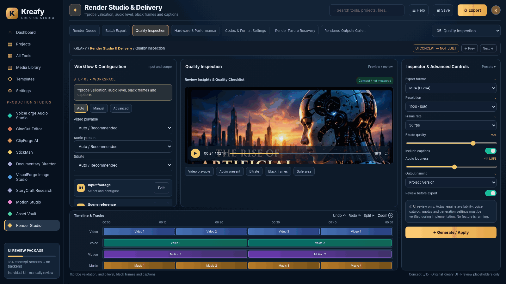](screenshots/05_quality-inspection.png)

[Full-size PNG](screenshots/05_quality-inspection.png) · [HTML prototype source](05_quality-inspection.html) · [Back to all studios](../README.md)

---

### 06. Hardware Performance

[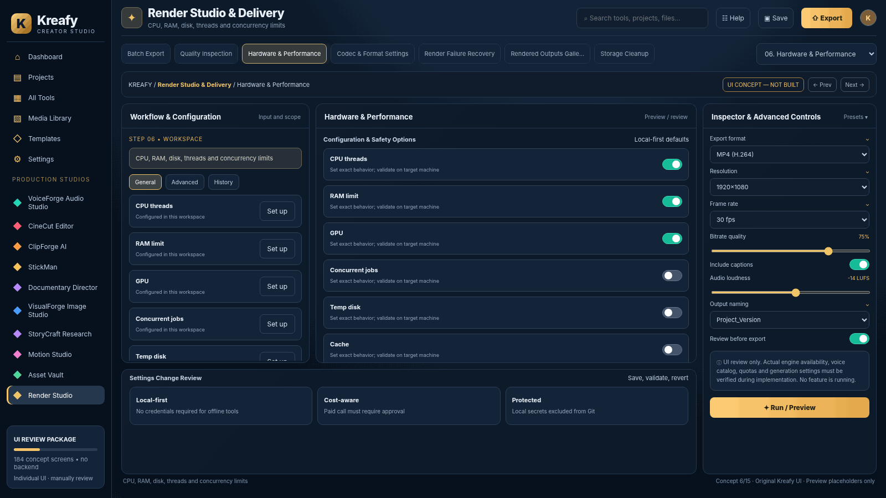](screenshots/06_hardware-performance.png)

[Full-size PNG](screenshots/06_hardware-performance.png) · [HTML prototype source](06_hardware-performance.html) · [Back to all studios](../README.md)

---

### 07. Codec Format Settings

[Full-size PNG](screenshots/07_codec-format-settings.png) · [HTML prototype source](07_codec-format-settings.html) · [Back to all studios](../README.md)

---

### 08. Render Failure Recovery

[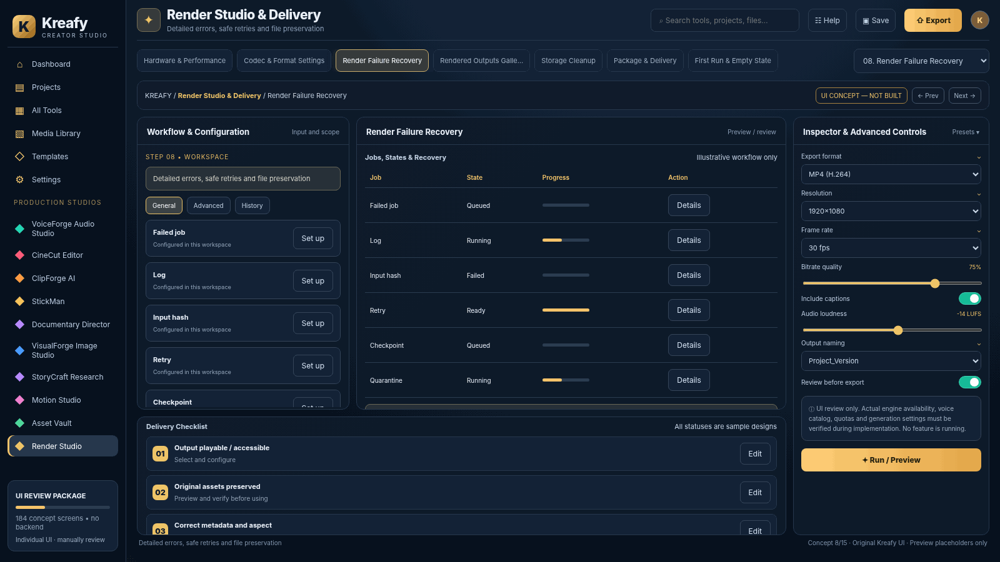](screenshots/08_render-failure-recovery.png)

[Full-size PNG](screenshots/08_render-failure-recovery.png) · [HTML prototype source](08_render-failure-recovery.html) · [Back to all studios](../README.md)

---

### 09. Rendered Outputs Gallery

[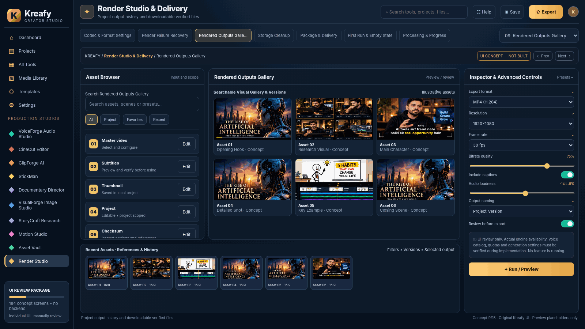](screenshots/09_rendered-outputs-gallery.png)

[Full-size PNG](screenshots/09_rendered-outputs-gallery.png) · [HTML prototype source](09_rendered-outputs-gallery.html) · [Back to all studios](../README.md)

---

### 10. Storage Cleanup

[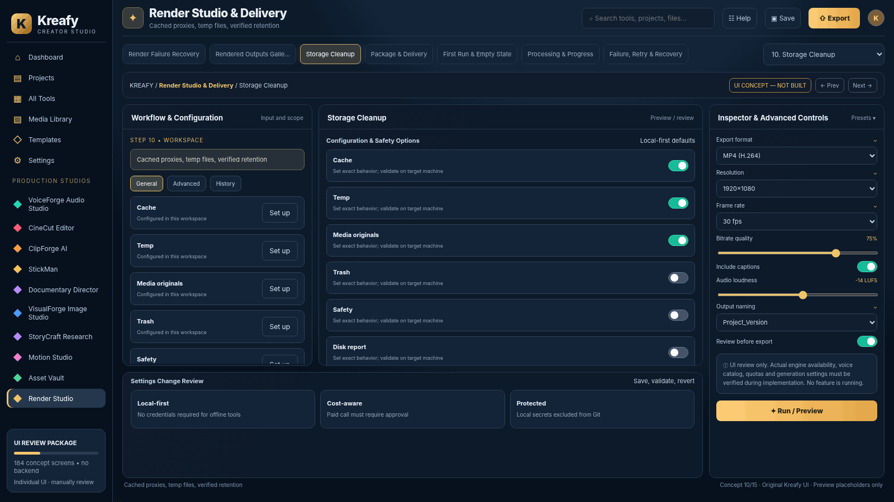](screenshots/10_storage-cleanup.png)

[Full-size PNG](screenshots/10_storage-cleanup.png) · [HTML prototype source](10_storage-cleanup.html) · [Back to all studios](../README.md)

---

### 11. Package Delivery

[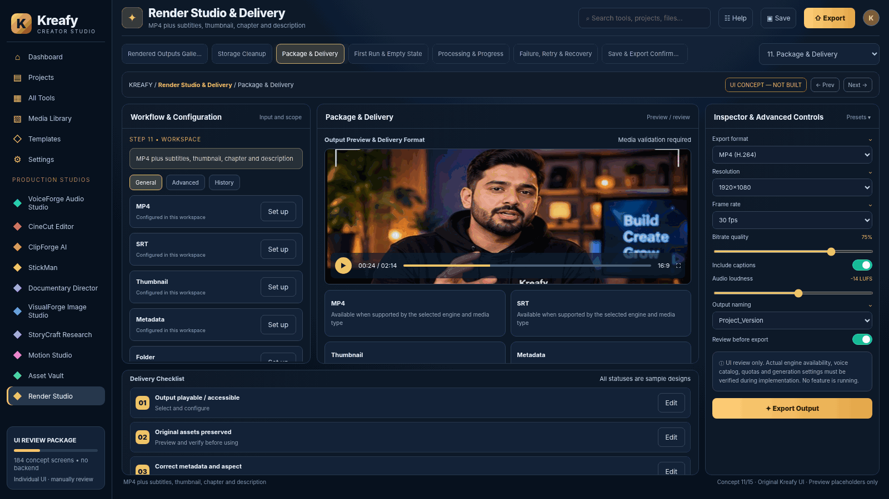](screenshots/11_package-delivery.png)

[Full-size PNG](screenshots/11_package-delivery.png) · [HTML prototype source](11_package-delivery.html) · [Back to all studios](../README.md)

---

### 12. First Run Empty State

[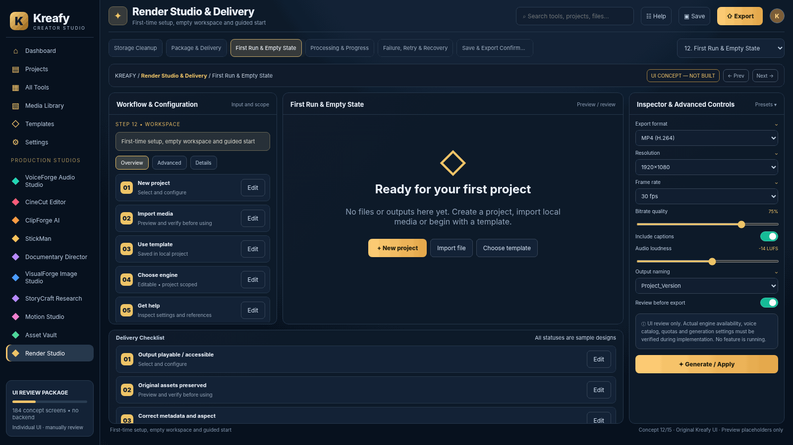](screenshots/12_first-run-empty-state.png)

[Full-size PNG](screenshots/12_first-run-empty-state.png) · [HTML prototype source](12_first-run-empty-state.html) · [Back to all studios](../README.md)

---

### 13. Processing Progress

[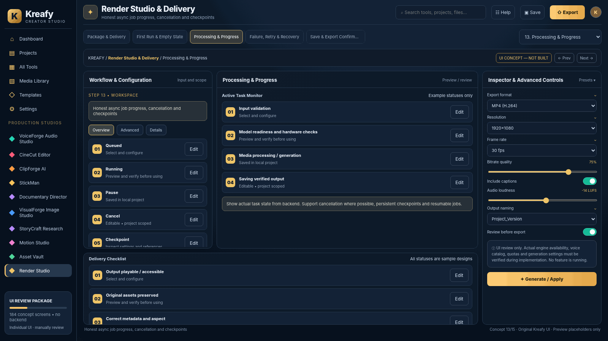](screenshots/13_processing-progress.png)

[Full-size PNG](screenshots/13_processing-progress.png) · [HTML prototype source](13_processing-progress.html) · [Back to all studios](../README.md)

---

### 14. Failure Retry Recovery

[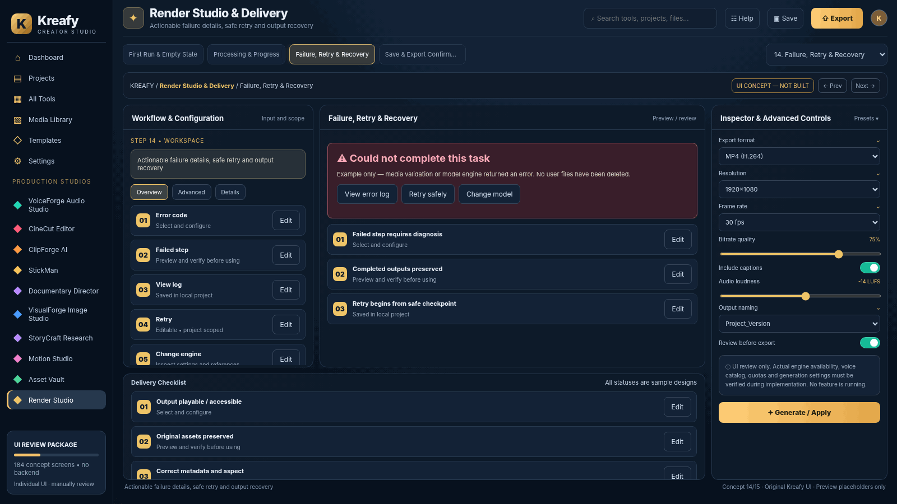](screenshots/14_failure-retry-recovery.png)

[Full-size PNG](screenshots/14_failure-retry-recovery.png) · [HTML prototype source](14_failure-retry-recovery.html) · [Back to all studios](../README.md)

---

### 15. Save Export Confirmation

[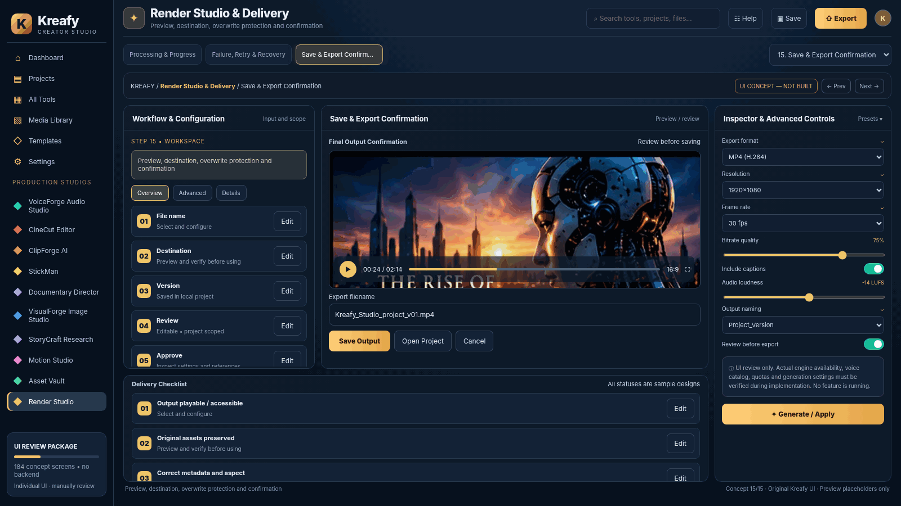](screenshots/15_save-export-confirmation.png)

[Full-size PNG](screenshots/15_save-export-confirmation.png) · [HTML prototype source](15_save-export-confirmation.html) · [Back to all studios](../README.md)

---
