# Kreafy Creator Studio — Clickable UI/UX Gallery

**184 separate UI screenshot concepts across 11 independently organized software folders.**

**How to browse:** Click a studio below → click any screenshot preview → GitHub opens its full-size PNG. Each folder also contains standalone offline HTML prototypes, a contact sheet, a screen checklist and interaction specification.

> **UI baseline:** Owner confirmed this 184-screen review pack as the reference for development planning on 2026-10-31. The screen layouts are still concepts, NOT implemented or verified product features. Fine details may be amended during manual review. GitHub HTML source view is not a hosted interactive application.

**[Download offline interactive HTML review pack from Google Drive](https://drive.google.com/file/d/1el4TFos8ai705Ch40GtNtfPCd4qAsgCx/view?usp=drivesdk)** (also contains START_HERE.html, 184 PNGs and screen checklist).

| Studio | Screens | Open gallery | Overview |
|---|---:|---|---|
| **App Core & Navigation** | 18 | [Browse all 18 screenshots](00_App_Core/README.md) | [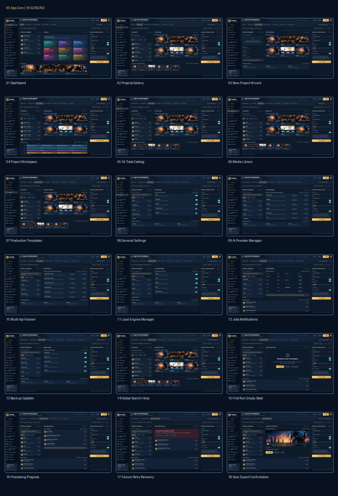](00_App_Core/README.md) |
| **VoiceForge Audio Studio** | 19 | [Browse all 19 screenshots](01_VoiceForge_Studio/README.md) | [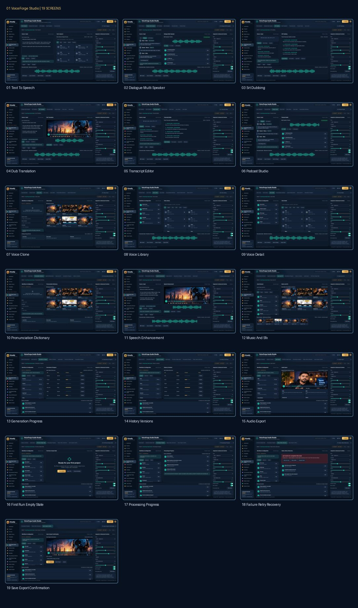](01_VoiceForge_Studio/README.md) |
| **CineCut Video Editor** | 21 | [Browse all 21 screenshots](02_CineCut_Editor/README.md) | [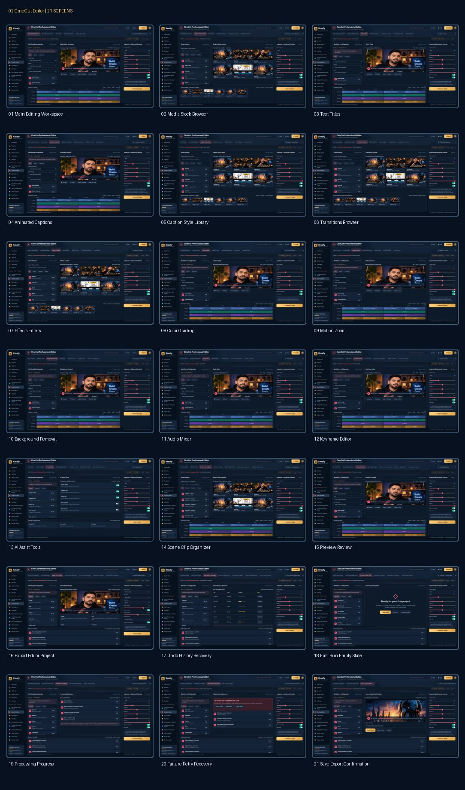](02_CineCut_Editor/README.md) |
| **ClipForge AI — Long Video to Shorts** | 17 | [Browse all 17 screenshots](03_ClipForge_AI/README.md) | [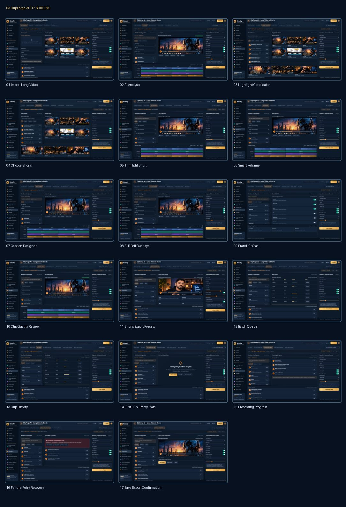](03_ClipForge_AI/README.md) |
| **StickMan & Whiteboard Animation** | 17 | [Browse all 17 screenshots](04_StickMan_Studio/README.md) | [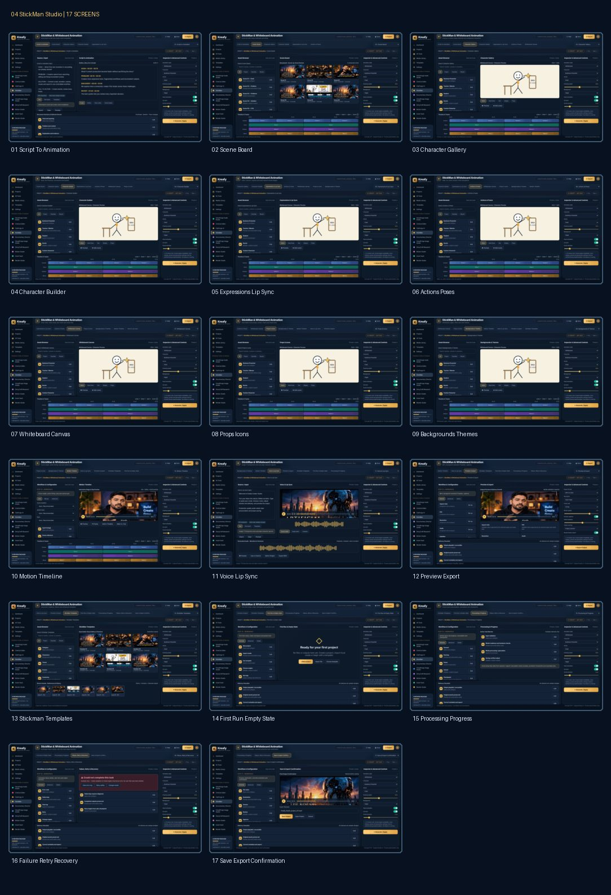](04_StickMan_Studio/README.md) |
| **Documentary Director** | 17 | [Browse all 17 screenshots](05_Documentary_Director/README.md) | [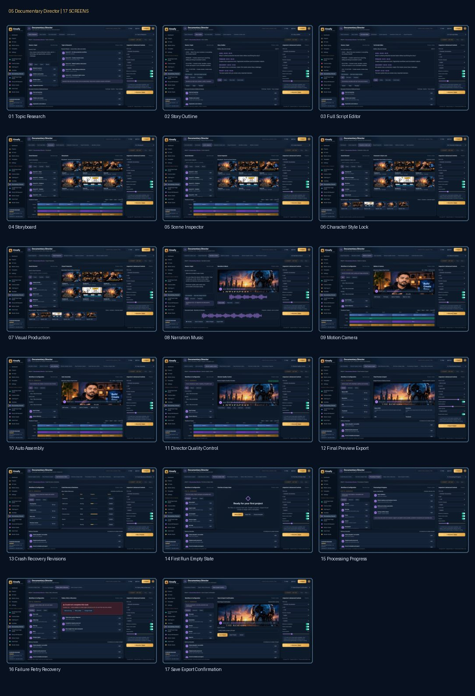](05_Documentary_Director/README.md) |
| **VisualForge Image Studio** | 17 | [Browse all 17 screenshots](06_VisualForge_Studio/README.md) | [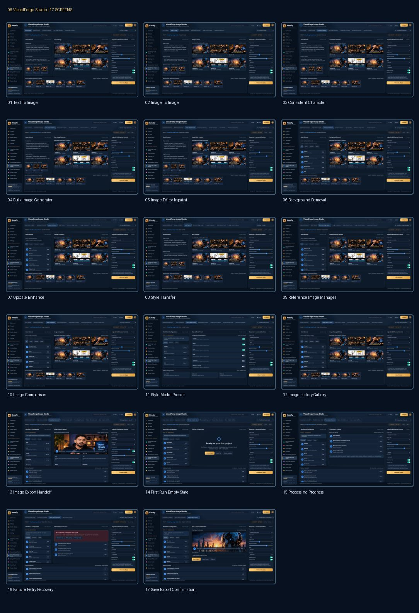](06_VisualForge_Studio/README.md) |
| **StoryCraft Research & Writing** | 15 | [Browse all 15 screenshots](07_StoryCraft_Studio/README.md) | [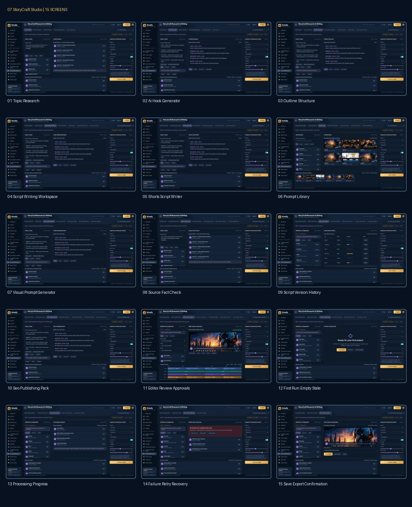](07_StoryCraft_Studio/README.md) |
| **Motion Studio** | 13 | [Browse all 13 screenshots](08_Motion_Studio/README.md) | [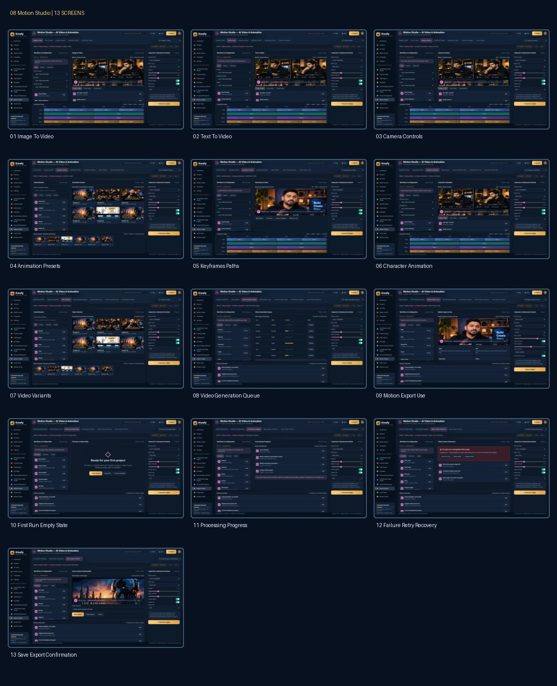](08_Motion_Studio/README.md) |
| **Asset Vault & Brand Kits** | 15 | [Browse all 15 screenshots](09_Asset_Vault/README.md) | [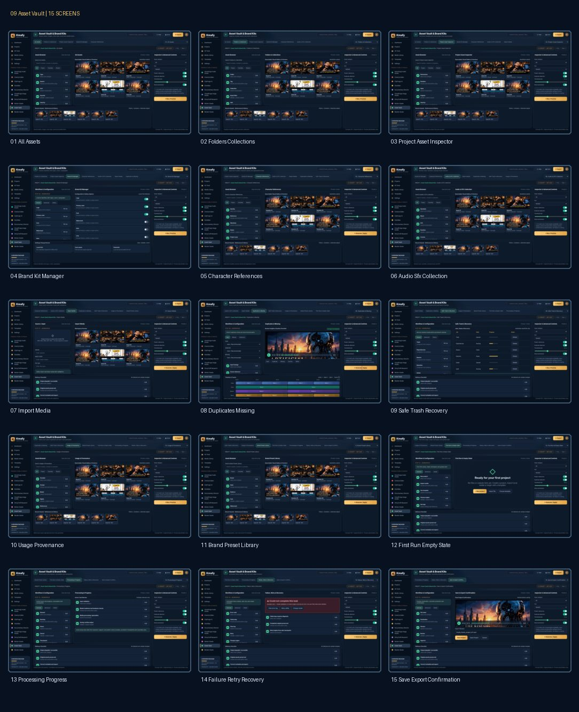](09_Asset_Vault/README.md) |
| **Render Studio & Export** | 15 | [Browse all 15 screenshots](10_Render_Studio/README.md) | [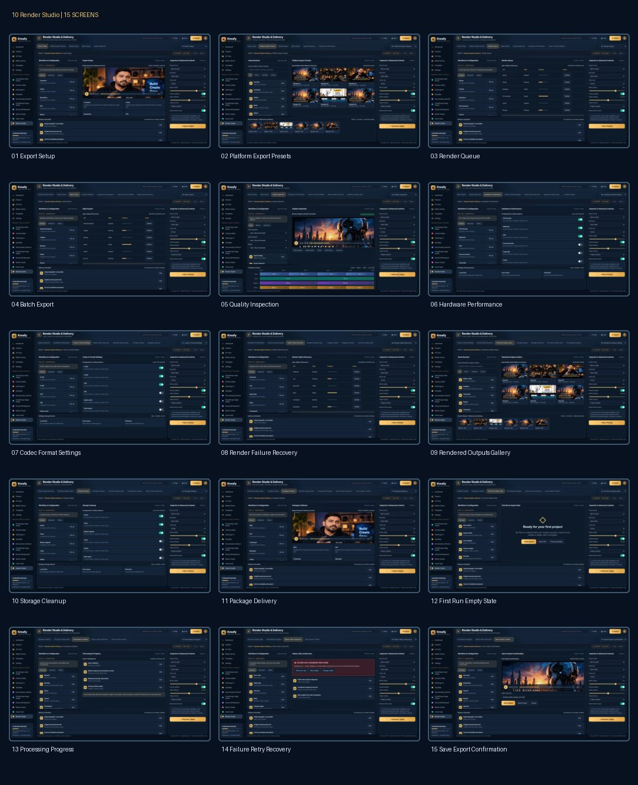](10_Render_Studio/README.md) |

## Design constraints

- Keep approved six-page main navigation: Dashboard, Projects, All Tools, Media Library, Templates, Settings.
- Main dashboard retains colorful Studios + Tools Together cards; tool screens are independent workspaces.
- VoiceForge follows approved Vocify-inspired spacious input controls but is an original implementation, not a clone of proprietary code.
- StickMan is a dedicated workspace in Motion Studio / All Tools, not an extra top-level sidebar page.
- Do not create duplicate media stores for Asset Vault and Media Library.
- Fake demo figures, model quotas, provider connectivity and generated media previews are illustrative only.

## Handoff

- [Master PRD](../docs/MASTER_PRD.md)
- [Approved decisions](../docs/DECISIONS.md)
- [UI design system](../docs/UI_DESIGN_SYSTEM.md)
- [Project state](../docs/PROJECT_STATE.md)

**Validation:** 184 screenshot files, one per named design screen, plus local HTML prototypes. Screenshot visual approval is distinct from production acceptance tests.
